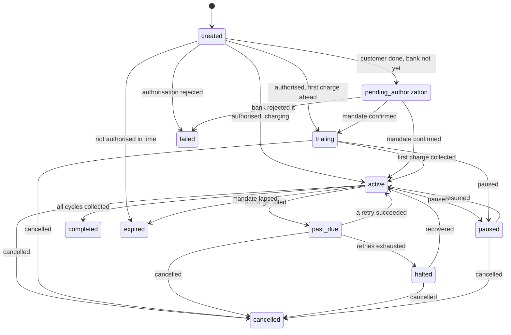

# The subscription lifecycle

After this page you will know every status a subscription can have, what each one means, and what your application should do when it sees one.

Statuses are normalised: every gateway's own status is mapped to one of these, and the gateway's own value is always kept verbatim in `subscription.providerStatus`. The per-gateway mappings are on the [Razorpay](../gateways/razorpay.md#statuses), [Cashfree](../gateways/cashfree.md#statuses) and [PayU](../gateways/payu.md#statuses) pages.

Not every gateway passes through every state. Razorpay's `authenticated` is `trialing`; Cashfree's `BANK_APPROVAL_PENDING` is `pending_authorization`.

## Statuses

| Status | What it means | What your app should do |
|---|---|---|
| `created` | The subscription exists; the customer has not authorised the mandate yet. | Show the checkout again. Grant nothing. If it was never authorised and the checkout has expired, create a new subscription. |
| `pending_authorization` | The customer approved, but the bank or NPCI has not confirmed the mandate (eNACH: up to 48 hours). Nothing is charged yet. | Tell the customer it is being confirmed. Do not grant paid access unless your policy allows it. You will get an event when it is live. |
| `trialing` | The mandate is live and the first charge is in the future (a free trial or a delayed start). `trialEndsAt` says when it ends. | Grant access. Show the trial end date. |
| `active` | The mandate is live and charges are being collected. | Grant access. Extend it on each `subscription.charged` event. |
| `past_due` | A charge failed and is being retried. The subscription is still alive. | Keep access for a grace period if you choose. Ask the customer to fix their payment method. |
| `halted` | Retries are exhausted. No more automatic charges until you or the customer act. | Suspend access. Ask the customer to update their payment method. A halted subscription is not cancelled: it can recover. |
| `paused` | Charging is paused by you or the customer. It can be resumed. | Suspend or keep access, by your policy. Resume to continue. |
| `cancelled` | Ended by you, the customer or the bank. **Terminal.** | End access (at the end of the paid period if `cancelAtPeriodEnd` was set). |
| `completed` | All billing cycles were collected. **Terminal.** | End access, or offer a renewal. |
| `expired` | The authorisation link or the mandate lapsed. **Terminal.** | Create a new subscription if the customer still wants it. |
| `failed` | Setting up the mandate was rejected or failed. **Terminal.** | Tell the customer, and let them try again with a new subscription. |

`cancelled`, `completed`, `expired` and `failed` are the terminal statuses: nothing changes them. They are exported as `TERMINAL_SUBSCRIPTION_STATUSES`.

The status says what the gateway or the schedule believes **now**. A webhook can arrive late or out of order. When it matters (before you grant or revoke access), read the subscription with `subs.get`.

## What a charge is

Each debit is a `Charge`, with a `kind`, a `status` and a `providerStatus`.

| Charge kind | Meaning |
|---|---|
| `authorization` | The small verification debit taken when the mandate is set up (for example ₹1, ₹2 or ₹5). |
| `recurring` | A debit for a billing cycle. |
| `upfront` | A one-off amount such as a setup fee. |

| Charge status | Meaning |
|---|---|
| `scheduled` | Announced to the customer, not attempted yet. |
| `pending` | Sent to the bank; the final result is not known yet. |
| `succeeded` | Collected. |
| `failed` | Not collected. |
| `cancelled` | Cancelled before it was attempted. |
| `refunded`, `partially_refunded` | Collected, then returned in full or in part. |

An unknown gateway state becomes `pending`, never `succeeded` and never `failed`. See the generated [enumerations](../reference/generated/enums.md) for the exact values and constants.

## Merchant-scheduled subscriptions

For gateways where the library's billing scheduler raises the debits (PayU, Cashfree on-demand plans), the gateway only knows the mandate. The scheduler keeps the billing state, and the client merges the two into one subscription: `trialing` while nothing has been paid and the first charge date is ahead, `past_due` while a failed debit is being retried, `halted` when retries run out, and a terminal gateway status always wins. See [Scheduling](./scheduling.md).

Next: [Trials, delayed starts and upfront amounts](./trials.md).
