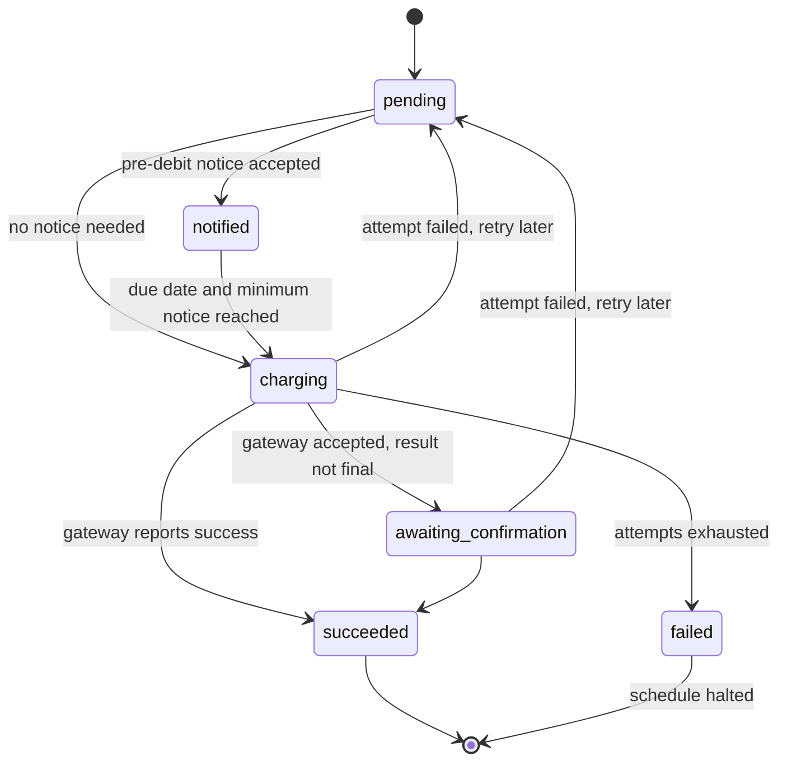

# Gateway-scheduled and merchant-scheduled subscriptions

After this page you will know who raises each debit on each gateway, what the billing scheduler does when it is you, how it avoids ever debiting a customer twice, and what `OUTCOME_UNKNOWN` means for you.

## Who raises the debit

| | Gateway-scheduled | Merchant-scheduled |
|---|---|---|
| Who raises each debit | The gateway, on the plan's schedule | You: in practice, this library's billing scheduler |
| Who sends the pre-debit notice | The gateway | You (PayU), or the gateway once you raise a charge (Cashfree on-demand) |
| Retries | The gateway's | The scheduler's |
| Gateways | Razorpay; Cashfree periodic plans | PayU; Cashfree on-demand plans |
| What you run | Nothing extra | `tick()` from a cron job, or the service's own timer |

The facade (`Subscriptions`) hides the difference. You call `create`, `get`, `pause`, `cancel` the same way, and for a merchant-scheduled subscription the facade also registers a schedule, activates it when the customer authorises, mirrors pause, resume and cancel, and merges the schedule's state (trialing, next charge, paid cycles) into what it returns. Creating a merchant-scheduled subscription **without** a scheduler fails with `CONFIG` before anything is sent to the gateway.

## What the billing scheduler does

You call `subs.tick()` from a cron job (every 15 minutes or so; with nothing due it makes no gateway calls). Each tick does whatever is due, exactly once, even with several workers:

1. **Notice.** Where the gateway needs it (PayU), sends the pre-debit notification at the due time minus `notifyLeadHours` (48 hours by default).
2. **Debit.** On the due date, once the minimum notice (24 hours by default, the RBI minimum) has passed since the gateway accepted the notice, raises the debit.
3. **Retries.** If a debit fails, waits `retryIntervalHours` (24) and tries again with a fresh notification, up to `maxAttempts` (3). Then the cycle fails and the schedule is `halted`.
4. **Reconciliation.** When it cannot tell whether a debit happened (no answer, a crash, a timeout), the next tick asks the gateway with `getCharge`.
5. **Authorisation.** A schedule waiting for the customer is ignored by billing. The scheduler checks the gateway for the mandate at an interval (`authorizationPollMinutes`, 60 by default) and activates it when it is live, and cancels it after `authorizationTimeoutHours` if you set one.

Gateways want debits raised in three styles, chosen from their `capabilities`:

| Style | Capabilities | What the scheduler does |
|---|---|---|
| Notify, then charge (PayU) | `merchantPreDebitNotification` | `notifyCharge` at due minus the lead; `createCharge` on the due date after the minimum notice |
| Charge in advance (Cashfree on-demand) | `merchantChargeLeadHours` greater than 0 | No `notifyCharge`. `createCharge` is called 48 hours before the due date with `scheduledAt` set; the gateway notifies and debits. If the schedule is already too close to the due date (late activation, a retry, a resume), the debit date becomes now plus the lead. |
| Charge on due | Neither | `createCharge` on the due date |

### One cycle

Cycle statuses are `pending`, `notified`, `charging`, `awaiting_confirmation`, `succeeded`, `failed` and `skipped` (never debited because the schedule was cancelled first).

The schedule itself is `pending_authorization`, `active`, `paused`, `halted`, `cancelled` or `completed`. [Scheduler records](../reference/generated/scheduler-records.md) lists every field.

## Why it never debits twice

A scheduler that double-debits a customer is worse than one that does nothing, so three rules hold:

- **The debit id is deterministic** per schedule, cycle and attempt. Asking twice for the same debit means the same id.
- **The cycle is saved as `charging` with that id before the gateway is called.** If the process dies mid-call, the next tick finds a cycle in `charging` and knows money may be moving.
- **When the outcome is unknown, it asks before acting.** It calls `getCharge`. Only a `NOT_FOUND` answer, and only after a grace period (`unknownOutcomeGraceMinutes`, 30 by default), lets it send the debit again, and then with the **same** id. A gateway's refusal of that re-sent id proves nothing, so it never books a failure for it.

Every state change also happens under a per-schedule lock, after re-reading the schedule, so two workers cannot both act on one schedule. That is why a store must implement the lock correctly: see [Running the scheduler](../guides/scheduler.md).

## What an unknown outcome means

`OUTCOME_UNKNOWN` is an error code with one meaning: **a request that moves money was sent and no answer came back.** The debit, refund or change may or may not have happened. It is not retryable. Fetch the current state first (`subs.get`, `subs.charges.list`, `subs.charges.get`), then act on what you find.

You will see it from your own calls (`charges.refund`, `create` on a gateway with no idempotency). Inside the scheduler you never have to handle it: the scheduler turns it into a `charge.outcome_unknown` event and reconciles on its own. If it is still unresolved after the grace period, you also get `charge.outcome_overdue`, which means a person should look at that debit.

## Pausing, cancelling and the mandate

- **Pause** a merchant-scheduled subscription: the scheduler stops raising debits and the mandate stays valid at the gateway. Nothing at the gateway can resume it behind the scheduler's back. `resumeAt` makes the scheduler resume it by itself. A pause that came from the gateway (a customer pausing a UPI mandate in their app) is undone only by the gateway's own resume event; yours is undone only by you.
- **Cancel**: billing is stopped **first**, then the mandate is cancelled at the gateway. If the gateway call fails, the schedule stays cancelled so the customer is never billed against a mandate you meant to end, and the error is thrown so you can retry. A debit already raised at the gateway cannot be recalled, and you get a `charge.in_flight` event.
- **A halted schedule** can be resumed (for example after the customer tops up their account), either re-opening the failed cycle for another round of attempts or skipping it.

## Calendars

Months are anchored: a schedule that starts on the 31st bills on the 31st when the month has one and on the last day when it does not. Dates are IST. See [Money and time](./money-and-time.md).

Next: [Events](./events.md).
