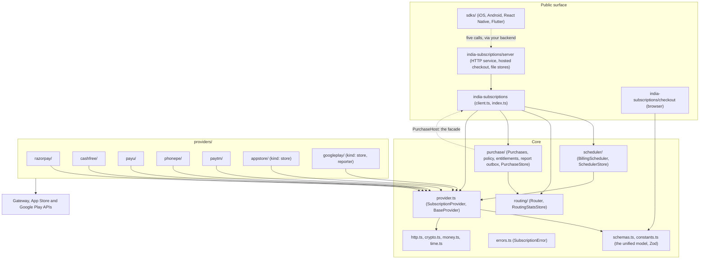

# Architecture overview

After this page you will know how the code is organised, where data flows, and which rules every contribution must follow. For the code rules in short form see `CONTRIBUTING.md` at the repository root.

## Modules and data flow

A call such as `subs.create(Provider.PayU, input)` flows like this:

1. `client.ts` picks the adapter by name and decides, from its `capabilities`, whether a scheduler is needed.
2. The adapter validates `input` with the shared Zod schema (`parseInput`), translates it to the gateway's request, sends it through `BaseProvider.send` (which validates the gateway's response with the adapter's own schema) and maps the answer to a unified `Subscription` with a pure function in `mapper.ts`.
3. For a merchant-scheduled subscription the client registers a schedule with `BillingScheduler`, which stores it through a `SchedulerStore`.
4. Later, `tick()` asks the store which schedules are due, takes a per-schedule lock and talks to the adapter through the same `SubscriptionProvider` interface: the scheduler knows nothing about any gateway.

A purchase session adds one layer on top of that flow:

1. `subs.purchases.start` resolves the platform policy for the `(platform, product)` pair. A store policy calls `create` or `payments.create` on the store provider, which makes no purchase and returns the account token and a store instruction. A gateway policy asks `subs.router.route` for a ranking and calls `create` or `payments.create` on the first gateway, falling down the ranking when a gateway cannot take it.
2. `purchases` always goes through the facade (`PurchaseHost`) and never through an adapter directly, because the facade registers billing schedules.
3. `complete` verifies the result through `verifyCheckout` or `payments.verify` with the option's handle as the expected id, writes an entitlement through `PurchaseStore`, records the outcome for the router and, for a purchase made through Google's user choice billing, enqueues the first report in the store's outbox.
4. Webhooks go through `subs.webhooks.handle`, which hands the events to the scheduler and to `purchases.handleEvents`: entitlements follow them, outcomes reach the router, and renewals and refunds are queued as reports. `purchases.flush` (on every tick of the service) sends the reports through the Google Play adapter, which implements `ExternalTransactionReporter`.

The router is pure decision logic plus a statistics store. It never calls a gateway.

The HTTP service is a thin layer over the same client. The route table in `server/routes.ts` is read by both the request dispatcher and the OpenAPI generator, so the documentation of the API cannot disagree with its behaviour. The Python client is generated from that OpenAPI document. The hosted checkout (`server/checkout.ts`) is the one part of the service that serves HTML: public routes whose credential is the unguessable session id, built to treat everything it receives as hostile.

## Layout

| Path | Role |
|---|---|
| `src/constants.ts` | Shared typed constants: statuses, events, error codes |
| `src/schemas.ts` | The gateway-neutral model as Zod schemas: the single source of truth for types, validation and the OpenAPI document |
| `src/schema-registry.ts` | The published names of the model (a rename is a breaking change for generated clients) |
| `src/provider.ts` | The `SubscriptionProvider` contract and `BaseProvider` plumbing |
| `src/errors.ts`, `src/http.ts`, `src/crypto.ts`, `src/money.ts`, `src/time.ts` | Error type, HTTP client with safe retries, signatures, paise and rupees, IST calendar |
| `src/providers/<gateway>/` | `constants.ts`, `schemas.ts`, `mapper.ts`, `adapter.ts`, `index.ts` |
| `src/scheduler/` | The billing engine and the store contract |
| `src/routing/` | The router: constants, schemas, the scoring and circuit breaker in `router.ts`, the `RoutingStatsStore` contract and its in-memory store |
| `src/purchase/` | Purchase sessions: the catalog and platform policy (`policy.ts`), `Purchases`, entitlement rules, tax split, ids, the `PurchaseStore` contract and its in-memory store |
| `src/providers/appstore/`, `src/providers/googleplay/` | The two store adapters. Google Play also implements `ExternalTransactionReporter` |
| `src/purchase-file-store.ts`, `src/service-purchases.ts` | The durable one-file purchase store, and the reader of the service's purchases file |
| `sdks/ios/`, `sdks/android/` | The Swift package and the Kotlin library for the device side of an App Store and a Google Play purchase |
| `sdks/react-native/`, `sdks/flutter/` | Thin bridges over the two native SDKs, with one TypeScript API and one Dart API |
| `Package.swift` | The repository-root Swift package that exposes the iOS SDK by the repository's URL |
| `src/server/`, `src/service.ts`, `src/service-config.ts`, `src/cli.ts` | The HTTP service (including the hosted checkout) and `serve` |
| `src/events-webhook.ts`, `src/events-envelope.ts` | The signed events webhook |
| `src/checkout/` | The browser helper |
| `clients/python/` | The generated Python client |
| `test/` | Unit tests per area, `integration/` (real adapters through the real facade), `docs/` (these pages) |
| `scripts/` | Build, OpenAPI export, the documentation generator, the live-check scripts |

## Rules that shape the code

- **No magic strings.** Every string that carries meaning is a named constant, shared in `src/constants.ts` or per gateway in `src/providers/<gateway>/constants.ts`. JSON field names appear once, in a Zod schema.
- **Everything is a schema.** Caller input and every gateway response are validated before any field is read. Gateway response schemas require only what the adapter reads; statuses are plain strings translated through a lookup table with a documented fallback, so a status added tomorrow degrades gracefully.
- **Money is integer paise; time is an ISO-8601 string.** Conversion happens at the adapter edge.
- **One error type.** Only `SubscriptionError` with a code from `ErrorCode`. Never a secret in a message, a log line or `raw`.
- **HTTP only through `BaseProvider.send`.** `idempotent: true` only for reads or writes with a gateway idempotency key. A write that gets no answer is `OUTCOME_UNKNOWN`.
- **Verify signatures on the raw bytes**, in constant time. Store adapters verify what the store signs (Apple's JWS chain, Google's push token) with `node:crypto`; there is no new runtime dependency.
- **Stores make no purchase.** At a store, `create` and `payments.create` validate the product and mint an account token; the purchase starts on the device, and verification binds the result to that token.
- **Purchases go through the facade**, never an adapter, so the billing schedules stay in step.
- **Tests cite their source.** Fixtures are the gateway documentation's sample payloads, verbatim, with a comment naming the page.

## How the documentation stays true

`scripts/generate-docs-reference.ts` generates the reference pages and the tables inside the gateway pages from the code. `test/docs/` extracts every code sample from the Markdown, type-checks it against the real entry points, runs the main flows against scripted gateway responses, and checks links. Run `npm run docs:reference` after changing a schema, a route, an environment variable, an error code or an adapter's capabilities or mapping tables.
