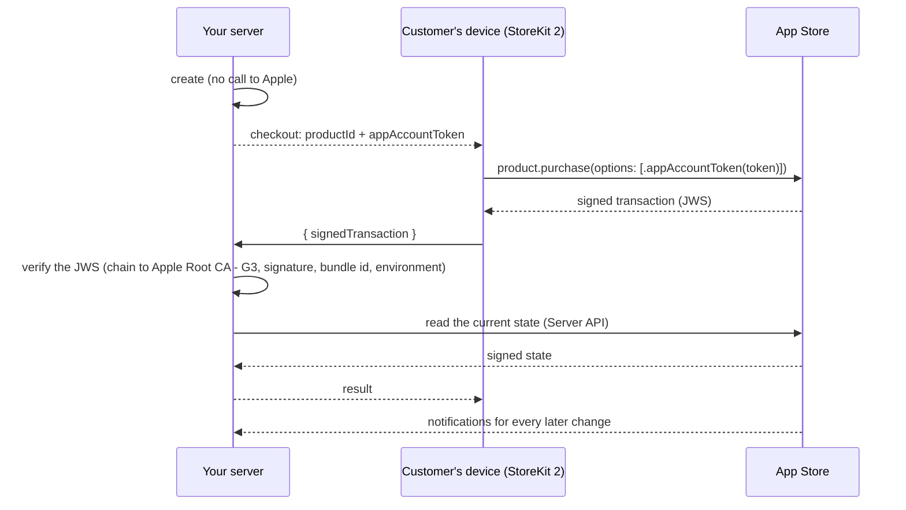

# Apple App Store

The App Store adapter sells nothing itself. The product, its price, its billing period and any free trial live in App Store Connect, and the purchase starts on the customer's device with StoreKit. The adapter does the server side: it hands the app a token that ties the purchase to your order, verifies what the device sends back, reads the current state from the App Store Server API, and turns App Store Server Notifications V2 into unified events.

Apple renews and bills the subscription itself, so there is no mandate, no scheduler and no pre-debit notice. Cancelling, pausing, changing the product and refunding are things the customer and Apple do; the adapter reports them but cannot do them (see [What only the customer can do](#what-only-the-customer-can-do)).

The App Store is a provider of kind `store`. The [router](../guides/routing.md) never picks it; [purchase sessions](../guides/purchases.md) use it for iOS. On the device the [iOS SDK](../guides/mobile-apps.md#ios-sdk) (or React Native or Flutter) buys the product and hands the signed transaction to your backend. To create the products, keys and notification URLs it needs, see [Setting up the App Store](../guides/setting-up-app-store.md).

## Configuration

```ts title="app-store-config.ts"
import { Environment, appStore, createSubscriptions } from 'india-subscriptions';

export const subs = createSubscriptions({
  providers: [
    appStore({
      bundleId: 'com.example.app',
      issuerId: process.env.APP_STORE_ISSUER_ID!,
      keyId: process.env.APP_STORE_KEY_ID!,
      privateKey: process.env.APP_STORE_PRIVATE_KEY!,
      environment: Environment.Test,
      appAppleId: 1234567890,
    }),
  ],
});
```

| Option | Required | Meaning |
|---|---|---|
| `bundleId` | yes | The app's bundle id. It is the `bid` claim of every API token, and signed data for any other bundle id is refused. |
| `issuerId` | yes | The issuer id from the Keys page of App Store Connect (Users and Access). |
| `keyId`, `privateKey` | yes | The In-App Purchase key that signs API requests: its key id, and the text of its `.p8` file (a PKCS #8 P-256 key). Line breaks written as the two characters `\n`, as an environment variable often has them, are accepted. |
| `environment` | yes | `Environment.Test` is Apple's **sandbox** (`api.storekit-sandbox.apple.com`). `Environment.Live` is **production** (`api.storekit.apple.com`). Signed data from the other environment is refused. |
| `appAppleId` | with `live` | The app's Apple id (App Store Connect, App Information). Production notifications name it and it must match. Sandbox notifications omit it, so it is not checked there. |
| `promotionalOfferKey` | for promotional offers | `{ keyId, privateKey }` of the key that signs promotional offers. It can be the same key as above. Without it, a `storeProduct.offerId` is refused with `CONFIG`. |
| `rootCertificates` | no | PEM certificates that replace Apple Root CA - G3 as the trusted root. Only for a private certificate authority. |

The keys are never put in an error message, in `raw`, or in anything `JSON.stringify` can reach. The service reads the same settings from the `APP_STORE_*` [environment variables](../reference/generated/environment.md#app-store).

## Capabilities

<!-- generated:begin capabilities app_store -->
<!-- generated:end -->

In words: the App Store is gateway-scheduled (Apple raises every renewal), has no plans of its own, and takes no trial, upfront amount, quantity, pause, cancel, plan change, merchant charge or refund from the server. `cancelAtPeriodEnd` is false as a capability, but the state is reported: a subscription's `cancelAtPeriodEnd` is true while the customer has turned auto-renew off. The customer pays with their Apple Account, so there are no payment methods to choose. Consumables, non-consumables and non-renewing subscriptions are one-time payments.

## How a purchase works



1. `create` (or `payments.create` for a one-time product) makes **no purchase and no call to Apple**. It checks `storeProduct`, creates an **app account token** (a UUID) and returns `status: created` with that token as `id` and an `apple_storekit` checkout.

   ```ts title="app-store-purchase.ts"
   import { Provider, type CheckoutResult } from 'india-subscriptions';
   import { subs } from './app-store-config';

   export async function startSubscription(email: string) {
     const subscription = await subs.create(Provider.AppStore, {
       plan: 'pro', // not read: the price and period come from App Store Connect
       customer: { email },
       storeProduct: { productId: 'com.example.app.pro.monthly' },
     });
     // Keep subscription.id with your order. The app passes checkout.appAccountToken to StoreKit.
     return { orderToken: subscription.id, checkout: subscription.checkout };
   }

   export async function confirm(orderToken: string, result: CheckoutResult) {
     // `result` is { signedTransaction } as the device sent it.
     const verification = await subs.verifyCheckout(Provider.AppStore, result, { expectedSubscriptionId: orderToken });
     return { subscriptionId: verification.subscriptionId, authorized: verification.authorized };
   }
   ```

2. The device sends the transaction it got from StoreKit (`VerificationResult.jwsRepresentation`) as `{ signedTransaction }`. Pass it, untouched, to `verifyCheckout` (subscriptions) or `payments.verify` (one-time purchases), with the stored token as `expectedSubscriptionId` or `expectedPaymentId`.

3. The adapter verifies the JWS, then reads the current state from the Server API. The result carries the store's id and the token:

   | | Subscription | One-time purchase |
   |---|---|---|
   | Returned id | `subscriptionId` is the `originalTransactionId` | `paymentId` is the `transactionId` |
   | `reference` | the app account token | the app account token |

   The facade compares `reference` with the id you expected, so a purchase made for one order cannot unlock another.

4. Calling `finish()` on the transaction once the app has delivered the content is a device-side step. Get Transaction Info also answers for transactions the app has finished.

With [purchase sessions](../guides/purchases.md) you do not call these yourself: `start` creates the token and `complete` verifies the result.

### Which id each call takes

| Call | Id |
|---|---|
| `getSubscription` | The `originalTransactionId`. The `transactionId` of its latest transaction also works. |
| `listCharges(subscriptionId)` | The `originalTransactionId`. |
| `getCharge(subscriptionId, chargeId)` | The `originalTransactionId`, and a `transactionId` as `chargeId`. |
| `getPayment(paymentId)` | The `transactionId` of a one-time purchase. |

The token that `create` returns is **not** an App Store id. `getSubscription` and `getPayment` refuse a UUID with `VALIDATION`, naming the id to use.

### What the store does instead

`create` and `payments.create` refuse what the store cannot honour with `UNSUPPORTED`, and the message says what the store does instead.

| You pass | The store |
|---|---|
| `trial`, `startAt` | A free trial is an introductory offer configured on the subscription in App Store Connect. |
| `upfrontAmount` | The customer pays the price set in App Store Connect; configure a pay-up-front offer there. |
| `quantity` other than 1 | An App Store subscription is bought one at a time. |
| `totalCycles`, `mandateEndsAt`, a plan with `maxCycles` | A subscription renews until the customer cancels it. |
| `paymentMethods` | The customer pays with the payment method of their Apple Account. |
| `authorizeBy`, `expiresAt` | The purchase starts on the device and has no deadline. |
| A plan with `scheduling` set to merchant | Apple raises every renewal itself. |
| `storeProduct.basePlanId` | A Google Play field (`VALIDATION`). |
| `storeProduct` missing | `VALIDATION`: the product lives in App Store Connect. |

`plan` is required by the model and is accepted but not read. On `payments.create`, `amount` is carried back as the amount you expect; the amount actually charged is the one `payments.verify` and `payments.get` return.

### Promotional offers

`storeProduct.offerId` on `create` asks for a promotional offer. With `promotionalOfferKey` configured, the adapter signs it (the bundle id, key id, product id, offer id, the token and a fresh nonce in lower case, and the timestamp, joined with U+2063, signed with ECDSA and SHA-256 and Base64 encoded) and returns it on the checkout as `promotionalOffer: { offerId, keyId, nonce, timestamp, signature }`. The app passes those to StoreKit's `promotionalOffer(offerID:keyID:nonce:signature:timestamp:)` purchase option together with the app account token. Apple makes each signature valid for 24 hours and for one purchase. Promotional offers apply to auto-renewable subscriptions only: `payments.create` with an `offerId` is refused, because customers redeem offer codes for one-time products in the App Store.

### One-time purchases

```ts title="app-store-one-time.ts"
import { Provider, type CheckoutResult } from 'india-subscriptions';
import { subs } from './app-store-config';

export async function startPurchase(email: string, amountInPaise: number) {
  const payment = await subs.payments.create(Provider.AppStore, {
    amount: amountInPaise, // carried back as the amount you expect; the App Store charges its own price
    customer: { email },
    storeProduct: { productId: 'com.example.app.coins100', consumable: true },
  });
  return { orderToken: payment.id, checkout: payment.checkout };
}

export async function confirmPurchase(orderToken: string, result: CheckoutResult) {
  const verification = await subs.payments.verify(Provider.AppStore, result, { expectedPaymentId: orderToken });
  return { paymentId: verification.paymentId, paid: verification.paid };
}
```

## How signed data is verified

Everything Apple signs is checked before anything is read from it, with `node:crypto` only. A JWS must:

- have an `alg` of `ES256` and exactly three certificates in `x5c` (leaf, intermediate, root);
- chain up to **Apple Root CA - G3**, which is built in and pinned to its SHA-256 fingerprint (`63343abf...3e9179`). The intermediate is issued by that root and the leaf by the intermediate, the intermediate is a certificate authority, the leaf carries Apple's receipt-signing extension (`1.2.840.113635.100.6.11.1`) and the intermediate the Worldwide Developer Relations extension (`1.2.840.113635.100.6.2.1`), and every certificate is inside its validity period at the time of the call (a minute of slack each way). The root in the header is never trusted, only the pinned one;
- carry an ES256 signature over the header and payload that the leaf's P-256 key verifies;
- name the configured **bundle id** and **environment** (and, in production notifications, the configured `appAppleId`).

Anything that fails is `SIGNATURE_INVALID` and the payload is not read. The check is the one Apple's own server library makes, except for the revocation lookup (OCSP), which needs a call to Apple's responders. The `Xcode` and `LocalTesting` environments of StoreKit testing are not signed by the App Store and are refused.

## Amounts and currency

Apple records a price in **milliunits** (the price times 1000) with its currency. One rupee is 1000 milliunits, so paise are milliunits divided by ten, in integers. A price with a fraction of a paisa is rounded half up. A transaction without a price (a free offer code) is an amount of 0.

The unified model is **INR only**. A transaction priced in another currency:

| Where | What happens |
|---|---|
| `payments.get`, `payments.verify`, `charges.get`, `charges.list` | `UNSUPPORTED`, naming the currency and the storefront. |
| `get`, `verifyCheckout` | Works: the status is what matters for access. The subscription has no `amount` and no `currency`. |
| Notifications | The event is still produced with its type and ids, without the `charge`, `payment` or `refund` that would carry the amount. |

Sell the products on the India storefront. Apple's documentation says not to use `price` and `currency` for revenue reconciliation: App Store Connect reporting is the record.

## Statuses

### Subscription

The status comes from Get All Subscription Statuses (and from the `status` of a notification), refined by the renewal information.

<!-- generated:begin appstore-subscription-status -->

| App Store status | Unified status |
|---|---|
| `1` Active | `active` |
| `2` Expired | `expired` |
| `3` BillingRetry | `past_due` |
| `4` GracePeriod | `past_due` |
| `5` Revoked | `cancelled` |

| Expiration intent of an expired subscription | Unified status |
|---|---|
| `1` CustomerCancelled | `cancelled` |
| `2` BillingError | `halted` |
| `3` PriceIncreaseNotConsented | `expired` |
| `4` ProductUnavailable | `expired` |
| `5` Other | `expired` |

A status Apple adds later is `expired`.

<!-- generated:end -->

- An active subscription is `trialing` while the current period is a free trial (`offerDiscountType` `FREE_TRIAL`); `trialEndsAt` is the period end.
- Billing retry (3) means no access and Apple retries for up to 60 days. Billing grace period (4) means keep access while Apple retries. Both are `past_due`; the subscription's other fields say which.
- A revoked subscription (5) was refunded or revoked from Family Sharing; `endedAt` is the revocation date.
- `providerStatus` is Apple's number, verbatim. `cancelAtPeriodEnd` is true while a live subscription's auto-renew is off, and `nextChargeAt` is the period end while it renews. `interval` is not set: the signed data does not carry the subscription's duration. `amount` is the price of the next period (`renewalPrice`), or the transaction's price when it carries no offer.

### Charge and payment

Every transaction is a charge or payment that went through; a renewal that fails creates none (the notification says so). A free trial is a charge of 0. A transaction that is not revoked is `succeeded` with no `refundedAmount`. A revoked one is:

<!-- generated:begin appstore-revocation-status -->

| Revocation type of a transaction | Unified payment status | Unified charge status |
|---|---|---|
| `REFUND_FULL` | `refunded` | `refunded` |
| `REFUND_PRORATED` | `partially_refunded` | `partially_refunded` |
| `FAMILY_REVOKE` | `cancelled` | `cancelled` |
| `ASSIGNMENT_REVOKE` | `cancelled` | `cancelled` |

<!-- generated:end -->

`refunded` carries the whole amount as `refundedAmount`. `partially_refunded` carries the amount times `revocationPercentage` (milliunits of a percent), rounded half up. A revocation with no type is `refunded`. `providerStatus` is the `revocationType`, `REVOKED` when a revoked transaction names none, and `PURCHASED` otherwise.

## Notifications

Point App Store Connect at your endpoint and pass the request to `webhooks.handle` or `webhooks.parse`. The body is `{ "signedPayload": "..." }`; the payload and the signed transaction and renewal information inside it are all verified. The result is one event whose `id` is Apple's `notificationUUID`, which stays the same on every redelivery. Reply `200` when you have handled it. Apple retries a `40x` or `50x` five times, up to 72 hours later, in production only; sandbox notifications are sent once.

```ts title="app-store-webhook.ts"
import { ErrorCode, EventType, Provider, isSubscriptionError } from 'india-subscriptions';
import { subs } from './app-store-config';

/** The handler of POST /webhooks/app_store. Apple sends a JSON body, which `parse` reads as text. */
export async function receiveAppleNotification(rawBody: string): Promise<number> {
  try {
    const events = await subs.webhooks.parse(Provider.AppStore, { rawBody, headers: {} });
    for (const event of events) {
      if (event.type === EventType.SubscriptionCharged) console.log('renewed', event.subscriptionId);
      if (event.type === EventType.RefundSucceeded) console.log('refund of', event.refund?.chargeId);
    }
    return 200;
  } catch (error) {
    // The signature is the JWS inside the body: a notification that does not verify is refused.
    return isSubscriptionError(error) && error.code === ErrorCode.SignatureInvalid ? 401 : 500;
  }
}
```

<!-- generated:begin appstore-webhook-events -->

| Notification type (and subtype) | Unified event |
|---|---|
| `SUBSCRIBED` | `subscription.activated` |
| `DID_RENEW` | `subscription.charged` |
| `DID_FAIL_TO_RENEW` | `subscription.past_due` |
| `GRACE_PERIOD_EXPIRED` | `subscription.past_due` |
| `EXPIRED` | `subscription.expired` |
| `EXPIRED:VOLUNTARY` | `subscription.cancelled` |
| `EXPIRED:BILLING_RETRY` | `subscription.halted` |
| `EXPIRED:PRICE_INCREASE` | `subscription.expired` |
| `EXPIRED:PRODUCT_NOT_FOR_SALE` | `subscription.expired` |
| `DID_CHANGE_RENEWAL_STATUS` | `subscription.updated` |
| `DID_CHANGE_RENEWAL_PREF` | `subscription.updated` |
| `OFFER_REDEEMED` | `subscription.updated` |
| `PRICE_INCREASE` | `subscription.updated` |
| `RENEWAL_EXTENDED` | `subscription.updated` |
| `REVOKE` | `subscription.cancelled` |
| `ONE_TIME_CHARGE` | `payment.succeeded` |
| `REFUND` | `refund.succeeded` |
| `REFUND:SEATS` | `unknown` |
| `REFUND_DECLINED` | `unknown` |
| `REFUND_REVERSED` | `unknown` |
| `CONSUMPTION_REQUEST` | `unknown` |
| `RENEWAL_EXTENSION` | `unknown` |
| `RENEWAL_EXTENSION:SUMMARY` | `unknown` |
| `RENEWAL_EXTENSION:FAILURE` | `unknown` |
| `EXTERNAL_PURCHASE_TOKEN` | `unknown` |
| `METADATA_UPDATE` | `unknown` |
| `MIGRATION` | `unknown` |
| `PRICE_CHANGE` | `unknown` |
| `RESCIND_CONSENT` | `unknown` |
| `TEST` | `unknown` |
| `UNCLAIM_SEATS` | `unknown` |

<!-- generated:end -->

- `providerEventType` is `TYPE` or `TYPE:SUBTYPE`; `raw` holds the verified notification and the decoded transaction and renewal information.
- `DID_FAIL_TO_RENEW` and `GRACE_PERIOD_EXPIRED` are both `subscription.past_due`; the subscription's status says whether access continues.
- A subscription event about a product that is not an auto-renewable subscription, or without a transaction, is `unknown`.
- The customer turning auto-renew off keeps the paid period running, so it is `subscription.updated`, not `subscription.cancelled`. The subscription ends with `EXPIRED`.
- A refund has no id of its own at Apple: the refund's `id` and `chargeId` are the refunded transaction's id, and `paymentId` (one-time) or `subscriptionId` is set.
- `unknown` events still carry the subscription or payment they are about when the notification names a transaction. `REFUND_REVERSED` is one of them: reinstate what the refund revoked.
- A type or subtype Apple adds later is `unknown`; a new subtype of a known type behaves as the type.

## What only the customer can do

| Call | What happens | What to do instead |
|---|---|---|
| `cancel` | `UNSUPPORTED` | The customer cancels in Settings, Apple Account, Subscriptions; the app can show that sheet with `AppStore.showManageSubscriptions(in:)`. You hear of it as `DID_CHANGE_RENEWAL_STATUS` and, at the period end, `EXPIRED`. |
| `pause` | `UNSUPPORTED` | The App Store has no pause. |
| `resume` | `UNSUPPORTED` | The customer turns renewal back on, or resubscribes. |
| `update` | `UNSUPPORTED` | The customer buys another product of the same subscription group in the app (`DID_CHANGE_RENEWAL_PREF`). |
| `charges.refund`, `payments.refund` | `UNSUPPORTED` | The customer asks in the app (`Transaction.beginRefundRequest(for:in:)`) or on reportaproblem.apple.com, Apple decides, and the outcome arrives as `REFUND` or `REFUND_DECLINED`. |
| `plans.create`, `plans.get` | `UNSUPPORTED` | Create the product in App Store Connect. |

## Errors

| App Store answer | Error |
|---|---|
| 400 (`InvalidTransactionIdError` and others) | `VALIDATION` |
| 401 (the token was refused) | `AUTH`: check `issuerId`, `keyId`, `privateKey` and `bundleId` |
| 404 `TransactionIdNotFoundError` (`4040010`), `AccountNotFoundError`, `OriginalTransactionIdNotFoundError` | `NOT_FOUND`: the transaction may belong to the other environment |
| 404 `AppNotFoundError` (`4040003`) | `CONFIG`: check `bundleId` |
| 404 and 500 answers Apple marks as retryable (`4040002`, `4040004`, `4040006`, `5000001`) | `PROVIDER_UNAVAILABLE` |
| 429 (`4290000`) | `RATE_LIMITED` |
| Other 5xx | `PROVIDER_UNAVAILABLE` |

Apple's `errorCode` is in `providerCode`. Every call to Apple is a read, so it is retried safely.

## Sandbox

Use `Environment.Test` with sandbox purchases, made with a Sandbox Apple Account on a device. Sandbox notifications are sent once, without retries, and omit the app's Apple id. A transaction id belongs to the environment that created it: an id from the sandbox is `NOT_FOUND` in production and the other way round. Create the sandbox accounts as Apple describes in [Create a Sandbox Apple Account](https://developer.apple.com/help/app-store-connect/test-in-app-purchases/create-a-sandbox-apple-account/); [Setting up the App Store](../guides/setting-up-app-store.md#test-with-a-sandbox-account) lists the steps.

## Not built

- Revocation (OCSP) checks of the certificate chain.
- Sending consumption information after a `CONSUMPTION_REQUEST`, extending renewal dates, Set App Account Token, and the multiseat, Advanced Commerce and external purchase APIs.
- Currencies other than INR and storefronts other than India.

Apple's own pages: [App Store Server API](https://developer.apple.com/documentation/appstoreserverapi), [App Store Server Notifications](https://developer.apple.com/documentation/appstoreservernotifications), [`JWSTransactionDecodedPayload`](https://developer.apple.com/documentation/appstoreserverapi/jwstransactiondecodedpayload).
