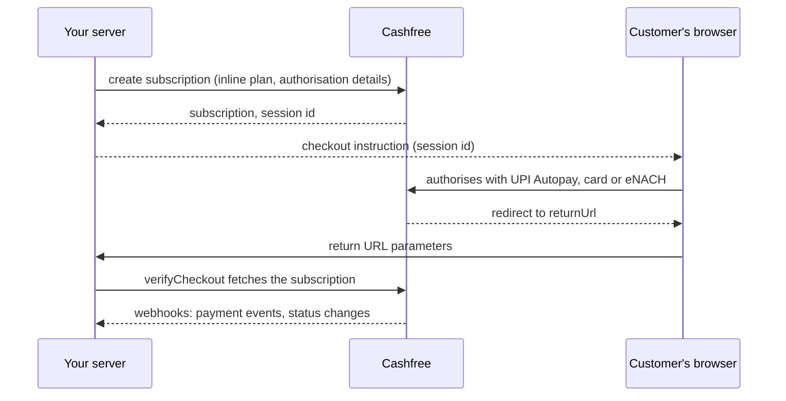

# Cashfree

Cashfree offers two kinds of plan, and the difference decides who raises each debit.

- **Periodic plan.** Cashfree debits a fixed amount on a schedule you set. This is the default, and it works like [Razorpay](./razorpay.md): you do not need the scheduler.
- **On-demand plan.** Cashfree holds the mandate and you raise each debit, for any amount up to the mandate ceiling. The library's [billing scheduler](../guides/scheduler.md) does that for you. You ask for it with `plan.scheduling: SchedulingMode.Merchant`.

## Configuration

```ts
import { cashfree, Environment } from 'india-subscriptions';

export const gateway = cashfree({
  clientId: process.env.CASHFREE_CLIENT_ID!,
  clientSecret: process.env.CASHFREE_CLIENT_SECRET!,
  environment: Environment.Test,
});
```

| Option | Required | Meaning |
|---|---|---|
| `clientId`, `clientSecret` | yes | Sent as `x-client-id` and `x-client-secret`. |
| `environment` | yes | `Environment.Test` (`https://sandbox.cashfree.com/pg`) or `Environment.Live` (`https://api.cashfree.com/pg`). |
| `webhookSecret` | no | The secret that signs webhooks. Defaults to the client secret, which is what Cashfree's own SDK does. Set it if your account has a separate one. |
| `apiVersion` | no | The `x-api-version` header, as `YYYY-MM-DD`. Defaults to the version the adapter was built for (`2026-01-01`). |
| `baseUrl` | no | Replaces the host, including the `/pg` prefix. |

The service reads the same settings from the `CASHFREE_*` [environment variables](../reference/generated/environment.md#cashfree).

## Capabilities

<!-- generated:begin capabilities cashfree -->
<!-- generated:end -->

`scheduling` lists both modes. A plan without `scheduling` is periodic. Several capabilities describe periodic plans only; the sections below say which.

## How a subscription works on Cashfree

Cashfree keeps the mandate; the customer authorises it in Cashfree.js using a session id.



### What you must supply

Cashfree rejects a subscription without a customer e-mail and a customer phone. The phone must be a 10-digit Indian mobile number, with or without `+91`. The adapter checks this before calling Cashfree. Your `reference` becomes Cashfree's `subscription_id` (letters, digits, `_`, `.`, `-` and spaces, up to 250 characters); without one, the adapter generates an id.

A plan name is limited to 40 characters. `quantity` other than 1 is not supported (create a plan for the total), and neither is `upfrontLabel`. `notifyCustomer: false` is refused, because Cashfree documents no way to turn its notifications off. Physical (paper) NACH is not built.

### Trials and the first charge

A trial on a periodic plan is a future `subscription_first_charge_time`. Cashfree does not move your date, but it will not debit earlier than the method allows, and the debit happens on the nearest possible date:

| Method | Customer authorises | Earliest first debit |
|---|---|---|
| UPI Autopay | Before 9 PM | Next day (T+1) |
| UPI Autopay | After 9 PM | T+2 |
| Cards | Before 9 PM | T+1 |
| Cards | After 9 PM | T+2 |
| eNACH | Any time | T+4 |

One FAQ line says the first charge date must fall within a 14-day window. Whether that caps trial length is not clear; check it in the sandbox if your trials are longer than 14 days. For on-demand plans there is no first-charge setting: the scheduler simply does not raise a debit until the trial ends.

### Authorisation amount and upfront amount

| You pass | Cashfree collects | Refunded? |
|---|---|---|
| nothing | ₹1 for UPI and cards, ₹0 for eNACH | Yes, automatically (UPI and cards) |
| `upfrontAmount` | That amount, as the authorisation amount | No |

An upfront amount works on UPI and cards only. eNACH never collects anything at authorisation, so `upfrontAmount` with eNACH throws `UNSUPPORTED`, and with no `paymentMethods` the checkout is limited to UPI and cards. If you need an upfront amount with eNACH, charge it separately once the mandate is `ACTIVE`. The upper bound of the authorisation amount is not documented.

### Raising debits (on-demand plans)

With an on-demand plan the scheduler calls `createCharge` for you. Cashfree sends the pre-debit notification itself once the charge exists, so the scheduler raises each charge **48 hours before the debit date** with `scheduledAt` set, and never more than **13 days** ahead. These limits come from Cashfree's cut-off table:

| Charge raised | For | UPI Autopay and Indian cards |
|---|---|---|
| Before 21:00 on day T | T+1 | Allowed |
| 21:00 or later on day T | T+1 | Not allowed |
| Any time on day T | T+2 to T+14 | Allowed |
| Any time on day T | T (same day) | Not allowed |

NACH and international cards can be debited the same day if the charge is raised before 07:00. Dates are dates, not instants: Cashfree uses only the date part, so the adapter sends midnight IST. With no schedule date, a charge is dated the next day if raised before 21:00 IST, otherwise the day after. The 48-hour lead and the 13-day ceiling appear in `capabilities` as `merchantChargeLeadHours` and `merchantChargeMaxAheadHours`.

`createCharge` is not marked idempotent: Cashfree's idempotency key has to be a UUID and your charge id is not one. A dropped request is `OUTCOME_UNKNOWN`, and the scheduler asks `getCharge` before deciding anything. Cashfree rejects a reused `payment_id`.

### Failures and retries

| Method | After a failed debit |
|---|---|
| UPI Autopay | Cashfree retries up to three times, hourly. What status the subscription takes afterwards is not documented. |
| eNACH | No automatic retry. The subscription becomes `ON_HOLD` (unified `halted`). |
| Cards | No automatic retry. `ON_HOLD`. |

Cashfree allows up to 3 manual retries per cycle through its dashboard or API (not exposed by this library). With on-demand plans the scheduler applies its own retry policy: see [Running the scheduler](../guides/scheduler.md).

## Payment methods and limits

| Method | Largest mandate |
|---|---|
| UPI Autopay | ₹15,000 without additional factor authentication, ₹1,00,000 with it |
| Cards (Indian) | ₹15,000 without it, ₹1,00,00,000 with it |
| Cards (international) | ₹1,00,00,000 |
| eNACH | ₹1,00,00,000 |

Card and UPI are hidden by default for mandates of ₹15,000 and above, in both sandbox and production; additional factor authentication has to be enabled on your account. "At or above" and "above" ₹15,000 are both stated, so whether exactly ₹15,000 works is unclear. If you need a method that never asks the customer to authenticate each debit, use eNACH, which is only for individual accounts. Bank approval of an eNACH mandate takes 24 to 48 hours; until the status is `ACTIVE` the subscription reads `pending_authorization` and nothing is charged. UPI Autopay is not self-serve: Cashfree has to switch it on for your sandbox and production accounts.

Since August 2025 UPI Autopay debits are processed only before 10:00, between 13:00 and 17:00 and after 21:30. Pick a debit time of day in those windows with the scheduler's `debitAtIstTime` policy.

## Authorisation and checkout

`subscription.checkout` has `kind: CheckoutKind.CashfreeCheckout`, the session id and the environment. [`openCheckout`](../guides/checkout.md) loads Cashfree.js and calls `subscriptionsCheckout`. The customer then returns to your `returnUrl`.

Cashfree's return-URL signature algorithm is undocumented, so `verifyCheckout` trusts nothing in the query except the subscription id (`cf_subscriptionId`) and **fetches the subscription from the API** instead. `authorized` is true when the mandate is `ACTIVE` or in a trial. A mandate still waiting for the bank is `authorized: false` with `status: pending_authorization`; the later `ACTIVE` event completes the activation. A session id expires after 2 hours; `getSubscription` returns a fresh one while the subscription is still `created`.

## Managing a subscription

| Operation | On Cashfree |
|---|---|
| `pause` | Periodic plans only. `resumeAt` is not supported. For an on-demand subscription the scheduler pauses by not raising debits and the mandate stays valid. |
| `resume` | Periodic plans: `nextChargeAt` is **required** (Cashfree's `ACTIVATE` needs the date). On-demand: the scheduler resumes. |
| `update` | Only `planId` (periodic plans, through `CHANGE_PLAN`). To change the amount, create a plan with the new amount and move to it. `quantity`, `mandateEndsAt`, `timing: AtPeriodEnd` and `notifyCustomer: true` throw `UNSUPPORTED`. For an on-demand subscription the facade applies `amount`, `nextChargeAt` and `remainingCycles` to the schedule, after checking the amount against the mandate ceiling. |
| `cancel` | Immediately. `CancelMode.AtPeriodEnd` throws `UNSUPPORTED`. |
| `charges.refund` | Needs `subscriptionId`. Without `amount` the adapter reads the charge and refunds all of it. Refund speed is left to Cashfree: UPI allows only standard refunds, eNACH only instant ones. |
| `charges.list` | Newest first by initiation date; Cashfree documents no paging or order, so the adapter imposes the order. |

## Statuses

<!-- generated:begin cashfree-subscription-status -->

| Cashfree subscription status | Unified status |
|---|---|
| `INITIALIZED` | `created` |
| `BANK_APPROVAL_PENDING` | `pending_authorization` |
| `ACTIVE` | `active` |
| `ON_HOLD` | `halted` |
| `PAUSED` | `paused` |
| `CUSTOMER_PAUSED` | `paused` |
| `COMPLETED` | `completed` |
| `CUSTOMER_CANCELLED` | `cancelled` |
| `CANCELLED` | `cancelled` |
| `EXPIRED` | `expired` |
| `LINK_EXPIRED` | `expired` |
| `CARD_EXPIRED` | `expired` |

<!-- generated:end -->

A status Cashfree adds in future maps to `created`, which is safe: it does not charge. When a periodic subscription is `ACTIVE` but its first charge is still ahead, the adapter reports `trialing`.

<!-- generated:begin cashfree-charge-status -->

| Cashfree payment status | Unified charge status |
|---|---|
| `INITIALIZED` | `scheduled` |
| `PENDING` | `pending` |
| `SUCCESS` | `succeeded` |
| `FAILED` | `failed` |
| `CANCELLED` | `cancelled` |

| Cashfree payment type | Unified charge kind |
|---|---|
| `AUTH` | `authorization` |
| `CHARGE` | `recurring` |

<!-- generated:end -->

An unknown payment status becomes `pending`, never `failed`, so the scheduler keeps asking instead of debiting again. A cancelled charge is reported as a failed charge whose status is `cancelled`.

<!-- generated:begin cashfree-refund-status -->

| Cashfree refund status | Unified refund status |
|---|---|
| `INITIALIZED` | `pending` |
| `SUCCESS` | `succeeded` |
| `CANCEL` | `failed` |
| `CANCELLED` | `failed` |
| `PENDING` | `pending` |
| `FAILED` | `failed` |

<!-- generated:end -->

## Webhooks

Subscription webhooks have their own setting in the Cashfree Dashboard: **Payment Gateway, Developers, Webhooks, Subscriptions tab**. An endpoint configured only in the main webhooks section does not receive them. Cashfree signs each delivery with `base64(HMAC_SHA256(secret, timestamp + rawBody))`; the headers are `x-webhook-signature` and `x-webhook-timestamp`. The timestamp's format is not documented, so no replay window is enforced.

Cashfree sends no event id, so the library builds one from the event type, the entity's id, its status and the event time. A repeat has the same id; a later transition does not. Cashfree does not replay webhooks. If you miss one, call `charges.get`.

<!-- generated:begin cashfree-webhook-events -->

| Status in `SUBSCRIPTION_STATUS_CHANGED` | Unified event |
|---|---|
| `INITIALIZED` | `subscription.updated` |
| `BANK_APPROVAL_PENDING` | `subscription.updated` |
| `ACTIVE` | `subscription.activated` |
| `ON_HOLD` | `subscription.halted` |
| `PAUSED` | `subscription.paused` |
| `CUSTOMER_PAUSED` | `subscription.paused` |
| `COMPLETED` | `subscription.completed` |
| `CUSTOMER_CANCELLED` | `subscription.cancelled` |
| `CANCELLED` | `subscription.cancelled` |
| `EXPIRED` | `subscription.expired` |
| `LINK_EXPIRED` | `subscription.expired` |
| `CARD_EXPIRED` | `subscription.expired` |

<!-- generated:end -->

Payment webhooks map to events like this:

| Cashfree event | Unified event |
|---|---|
| `SUBSCRIPTION_AUTH_STATUS` | `subscription.authorized`, `subscription.authorization_failed`, or `subscription.updated` while the bank has not confirmed |
| `SUBSCRIPTION_PAYMENT_NOTIFICATION_INITIATED` | `subscription.charge_scheduled` |
| `SUBSCRIPTION_PAYMENT_SUCCESS` | `subscription.charged` |
| `SUBSCRIPTION_PAYMENT_FAILED` | `subscription.charge_failed` |
| `SUBSCRIPTION_PAYMENT_CANCELLED` | `subscription.charge_failed`, with the charge's status `cancelled` |
| `SUBSCRIPTION_REFUND_STATUS` | `refund.succeeded` or `refund.failed` |
| Card expiry reminders and the controlled-charge events | `unknown` |

Only an `ACTIVE` mandate maps to `subscription.activated`. A mandate that is `BANK_APPROVAL_PENDING` is `subscription.updated`, so the scheduler does not start raising debits that Cashfree would reject.

## Testing in the sandbox

Cashfree's sandbox base URL is `https://sandbox.cashfree.com/pg`. To move a charge to a result, call Cashfree's Simulate Payment API (`POST /pg/simulate`) with `entity: SUBS_PAYMENTS` and the payment id; the payment must be `PENDING`. A periodic subscription's payment only leaves `INITIALIZED` on its real billing date, and the sandbox cannot move time forward, so use an **on-demand** plan to test charges quickly: raise a charge, then simulate its result. Specific test UPI ids, test cards and OTPs for subscriptions are not stated anywhere in Cashfree's documentation. In the sandbox the authorisation responses for eNACH, card and UPI differ from production.

## Not built

Physical NACH, the controlled notify-and-execute flow, and the legacy `/api/v2/subscriptions` API.
