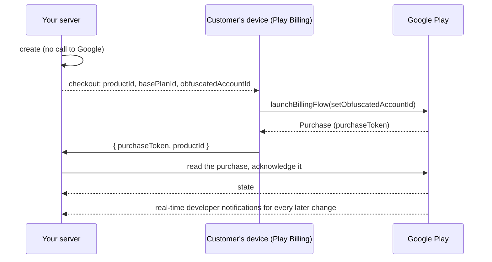

# Google Play

Google Play is an **app store**, not a gateway. The product (a subscription base plan or a one-time product) lives in Play Console, the purchase happens on the customer's Android device through Google Play Billing, and Google collects the money. On the device the [Android SDK](../guides/mobile-apps.md#android-sdk) (or React Native or Flutter) runs the purchase and sends the purchase token to your backend. The adapter's job is on your server: it hands the device what it needs to start the purchase, then **verifies** what the device bought by reading it from the Google Play Developer API, **acknowledges** it (Google refunds a purchase that is not acknowledged within three days), and keeps your records current from Google's real-time developer notifications.

Because the purchase starts on the device, the adapter follows the app store contract of `SubscriptionProvider`: `create` and `payments.create` make **no purchase and no network call**.

The same adapter also reports purchases that customers make outside Google Play, through [user choice billing](#user-choice-billing-reporting-external-transactions). [Purchase sessions](../guides/purchases.md) drive all of it for you. To create the service account, the Pub/Sub topic and the products, see [Setting up Google Play](../guides/setting-up-google-play.md).

## Configuration

```ts title="google-play-config.ts"
import { Environment, createSubscriptions, googlePlay } from 'india-subscriptions';

export const subs = createSubscriptions({
  providers: [
    googlePlay({
      packageName: 'com.example.app',
      clientEmail: process.env.GOOGLE_PLAY_CLIENT_EMAIL!,
      privateKey: process.env.GOOGLE_PLAY_PRIVATE_KEY!,
      environment: Environment.Test,
      pushAudience: 'https://shop.example.com/webhooks/google_play',
      pushServiceAccountEmail: 'pubsub-push@example-project.iam.gserviceaccount.com',
    }),
  ],
});
```

| Option | Meaning |
|---|---|
| `packageName` | The app's package name, as in Play Console. Every call and every notification is scoped to it; a notification for another app becomes an `unknown` event. |
| `clientEmail`, `privateKey` | `client_email` and `private_key` of the service account key (JSON). A key with its line breaks written as `\n` (an environment variable) is accepted. |
| `privateKeyId` | `private_key_id`, sent as the `kid` of the assertion. Optional. |
| `environment` | `live` refuses to grant anything for a **test purchase** (made by a licence tester, never charged by Google). `test` accepts them. Both call the same API. |
| `pushAudience`, `pushServiceAccountEmail` | The audience of your Pub/Sub push subscription and the e-mail of its push authentication service account. Set both or neither. |
| `acceptUnauthenticatedWebhooks` | Default `false`. See [Webhooks](#webhooks). |
| `revokeOnRefund` | Default `true`: a refund also ends access (and, for a subscription, all future payments). Set `false` to refund the money only. |
| `consumableProductIds` | Product ids of consumable one-time products. See [One-time products](#one-time-products). |

The service account needs access to the app in Play Console (**View financial data** and **Manage orders and subscriptions**), and the Google Play Android Developer API enabled in its Cloud project. The service reads the same settings from the `GOOGLE_PLAY_*` [environment variables](../reference/generated/environment.md#google-play).

### Authentication

The adapter signs an RS256 JWT with the service account key (`iss` the e-mail, `scope` `https://www.googleapis.com/auth/androidpublisher`, `aud` Google's token endpoint, valid one hour) and exchanges it for an access token at `https://oauth2.googleapis.com/token`. The token is cached until five minutes before it expires, concurrent calls share one token request, and a call Google refuses with 401 is repeated once with a new token. No Google client library is used.

## Capabilities

<!-- generated:begin capabilities google_play -->
<!-- generated:end -->

In words: Google Play is gateway-scheduled (Google bills every renewal). It can cancel a subscription from the server at the end of the paid period only, and refund the whole order only. It takes no trial, upfront amount, quantity, pause, resume or plan change from the server (those are set up in Play Console, see below), cannot list a subscription's charges (`charges.get` reads one order), and raises no charges of its own. One-time payments are supported.

## How a purchase works



1. **Create.** `subs.create(Provider.GooglePlay, { plan, customer, storeProduct: { productId, basePlanId, offerId? } })` returns a subscription with `status: created`, an `id` that is a freshly minted **obfuscated account id** (a UUID), and a `google_play_billing` checkout: `productKind`, `productId`, `basePlanId`, `offerId`, `obfuscatedAccountId` and `userChoiceBilling: false`. Keep the `id` with your order. For a one-time product use `subs.payments.create(Provider.GooglePlay, { amount, customer, storeProduct: { productId } })`; `amount` is echoed, not charged: Google Play charges the price set in Play Console.
2. **Buy on the device.** The app starts the Play Billing flow with `BillingFlowParams.setObfuscatedAccountId(obfuscatedAccountId)` for that product, base plan and offer.
3. **Verify.** The app sends `{ purchaseToken, productId }` from the `Purchase` to your server, which calls `verifyCheckout` (a subscription) or `payments.verify` (a one-time product). The adapter reads the purchase from Google, acknowledges it while it is unacknowledged and grants access, and returns the **purchase token as `subscriptionId` or `paymentId`** and the account id as `reference`. Pass the id from step 1 as `expectedSubscriptionId` or `expectedPaymentId`: a purchase made for one order cannot unlock another.

```ts title="google-play-purchase.ts"
import { Provider, type CheckoutResult } from 'india-subscriptions';
import { subs } from './google-play-config';

export async function startSubscription(email: string) {
  const subscription = await subs.create(Provider.GooglePlay, {
    plan: 'pro', // not read: the price and period come from the base plan in Play Console
    customer: { email },
    storeProduct: { productId: 'pro', basePlanId: 'monthly' },
  });
  // Keep subscription.id with your order and hand subscription.checkout to the app.
  return { orderToken: subscription.id, checkout: subscription.checkout };
}

export async function confirm(orderToken: string, result: CheckoutResult) {
  // `result` is { purchaseToken, productId } as the device sent it.
  const verification = await subs.verifyCheckout(Provider.GooglePlay, result, { expectedSubscriptionId: orderToken });
  // Store verification.subscriptionId: it is the purchase token, the id every later call takes.
  return { purchaseToken: verification.subscriptionId, authorized: verification.authorized };
}
```

Verification only acknowledges purchases that grant access. A purchase that is still **pending** (the customer has not finished paying) comes back with `authorized: false` and is left alone; the notification that follows tells you when it completes. A purchase that **never reaches** `verifyCheckout` is not acknowledged and Google refunds it after three days. This includes purchases made outside your app, such as a resubscribe from the Play Store, so call `verifyCheckout` with `{ purchaseToken }` when a `subscription.activated` event arrives for a token you do not know.

### Ids

| Call | Accepts |
|---|---|
| `get`, `cancel` | The **purchase token** (the `subscriptionId` from `verifyCheckout`). |
| `payments.get`, `payments.refund` | The **purchase token** of the one-time purchase (the `paymentId`). |
| `charges.get`, `charges.refund` | `chargeId` is an **order id** (`GPA.1234-5678-9012-34567`). The order of the latest renewal is `metadata.latestOrderId` of the subscription. |

The obfuscated account id from step 1 is never accepted by these calls: it only exists to tie a purchase to your order.

### What the store does instead of your inputs

`create` refuses what Google Play cannot honour, and says what it does instead (`UNSUPPORTED`):

| Input | Google Play |
|---|---|
| `trial`, `startAt` | A free trial or delayed first charge is an **offer** on the base plan in Play Console; pass its id as `storeProduct.offerId`. |
| `upfrontAmount` | The base plan and offer set the price. |
| `quantity` other than 1 | One unit of the base plan. |
| `totalCycles` | A base plan renews until cancelled; an installment plan with a commitment is configured in Play Console. |
| `paymentMethods` | The customer chooses from the methods on their Google account. |
| `mandateEndsAt`, `authorizeBy` | There is no mandate and no authorisation deadline. |

`storeProduct` is required, and for a subscription it needs `basePlanId`.

### Currency

The unified model is INR only. Only amounts in INR are converted, from Google's `units` and `nanos` to paise with integer arithmetic (a fraction of a paisa rounds half up). A subscription priced in another currency is returned **without** `amount` and `currency` (`metadata.currencyCode` says which). An order or one-time payment in another currency answers `UNSUPPORTED` from `payments.get`, `charges.get` and `payments.refund`; `payments.verify` still acknowledges the purchase and returns it without `payment`.

### One-time products

Google wants a purchased one-time product either **acknowledged** (a non-consumable) or **consumed** (a consumable: this also acknowledges it and lets the customer buy it again). The documentation does not say how a backend learns which a product is, so `payments.verify` decides from two inputs:

- the checkout result carries `consumable: true`: add it on your server from `storeProduct.consumable` before calling `payments.verify`. [Purchase sessions](../guides/purchases.md) do this for a product whose `googlePlay.consumable` is true; or
- the product id is in the `consumableProductIds` option.

Anything else is acknowledged. A purchase that is already acknowledged or consumed is not touched again.

## Cancel and refund

- `cancel` with `CancelMode.AtPeriodEnd` stops the renewals (`DEVELOPER_REQUESTED_STOP_PAYMENTS`): the subscription cannot be restored by the customer, and the customer keeps access until the period they paid for ends. Repeating it changes nothing. Prepaid plans cannot be cancelled; Google refuses.
- `CancelMode.Immediately` is **refused**. Google's only way to end a subscription at once is *revoke*, which refunds the customer; use `charges.refund` for that.
- `charges.refund` and `payments.refund` call `orders.refund` for the whole order (`revoke=true` unless `revokeOnRefund` is false). Google refunds a whole order only: an `amount` other than the order total is `UNSUPPORTED`. The call has no refund id, so your `refundId` is the refund's id; the refund is `succeeded` when the order shows `REFUNDED` and `pending` until then. Orders older than three years cannot be refunded.

## Statuses

The `subscriptionState` is read through a lookup table; the verbatim value is in `providerStatus`.

<!-- generated:begin googleplay-subscription-status -->

| Google subscription state | Unified status |
|---|---|
| `SUBSCRIPTION_STATE_UNSPECIFIED` | `pending_authorization` |
| `SUBSCRIPTION_STATE_PENDING` | `pending_authorization` |
| `SUBSCRIPTION_STATE_ACTIVE` | `active` |
| `SUBSCRIPTION_STATE_PAUSED` | `paused` |
| `SUBSCRIPTION_STATE_IN_GRACE_PERIOD` | `past_due` |
| `SUBSCRIPTION_STATE_ON_HOLD` | `halted` |
| `SUBSCRIPTION_STATE_CANCELED` | `cancelled` |
| `SUBSCRIPTION_STATE_EXPIRED` | `expired` |
| `SUBSCRIPTION_STATE_PENDING_PURCHASE_CANCELED` | `failed` |

A state Google adds later is `pending_authorization`.

<!-- generated:end -->

- `SUBSCRIPTION_STATE_ACTIVE` is `trialing` while the subscription is in a free-trial offer phase, and `trialEndsAt` is the expiry.
- `SUBSCRIPTION_STATE_CANCELED` is `active` with `cancelAtPeriodEnd: true` until `expiryTime`, then `cancelled`: the customer has paid for the period.
- `SUBSCRIPTION_STATE_EXPIRED` is `cancelled` if `canceledStateContext` says the user, Google or you ended it (a revoke too), and `expired` otherwise.
- `SUBSCRIPTION_STATE_IN_GRACE_PERIOD` keeps access; `SUBSCRIPTION_STATE_ON_HOLD` suspends it and is recoverable.

Access is granted for `active`, `trialing` and `past_due` (`CheckoutVerification.authorized`).

One-time purchases:

<!-- generated:begin googleplay-payment-status -->

| Google one-time purchase state | Unified payment status |
|---|---|
| `PURCHASE_STATE_UNSPECIFIED` | `pending` |
| `PURCHASED` | `succeeded` |
| `CANCELLED` | `cancelled` |
| `PENDING` | `pending` |

A state Google adds later is `pending`.

<!-- generated:end -->

An order that is `REFUNDED` or `PARTIALLY_REFUNDED` makes the payment `refunded` or `partially_refunded`. Orders are charges: `PROCESSED` is `succeeded`, `PENDING` is `pending`, `CANCELED` is `cancelled`, `PENDING_REFUND` is `succeeded` (the money was collected) and then `partially_refunded` or `refunded`. An unknown order state is `pending`. The order of a free trial is an `authorization` charge.

`amount` of a subscription is the recurring price (the sum over add-on items), which Google states without discounts or tax. The amount of a charge or payment is `Order.total`: what the customer paid, with discounts and tax.

### Replaced purchases

An upgrade, downgrade, resubscribe or prepaid top-up creates a **new purchase token** and names the old one in `linkedPurchaseToken` (in `metadata.linkedPurchaseToken` and in `raw`). The old subscription is invalidated: when the new purchase arrives as a notification, the adapter adds a second event, `subscription.cancelled` for the old token (id `<messageId>:replaced`), so one customer is never entitled twice.

## Webhooks

Google publishes real-time developer notifications to a Cloud Pub/Sub topic. Create a **push** subscription for it that points at your webhook route, with authentication enabled: choose a service account (its e-mail is `pushServiceAccountEmail`) and an audience (`pushAudience`; by default the endpoint URL). Give `google-play-developer-notifications@system.gserviceaccount.com` the *Pub/Sub Publisher* role on the topic. [Setting up Google Play](../guides/setting-up-google-play.md) has the steps.

- **Authentication.** With both options set, every push must carry a Google-signed OIDC token in `Authorization: Bearer`. The adapter verifies the RS256 signature against Google's published keys (`https://www.googleapis.com/oauth2/v3/certs`, cached by their `Cache-Control`), the issuer, the audience, the expiry, the e-mail and `email_verified`, on every request. Anything wrong is `SIGNATURE_INVALID`. A failure to *fetch* the keys keeps its own error code, so Pub/Sub retries.
- **Without push authentication** a webhook cannot be told from a forgery, so it is **refused** (`SIGNATURE_INVALID`) unless you set `acceptUnauthenticatedWebhooks: true` to say the route is protected another way.
- **Ids.** The event `id` is the Pub/Sub `messageId`.
- **Current state.** A notification carries only a token, so the adapter reads the purchase from Google and attaches it (`subscription`, or `payment` for one-time products). A purchase Google no longer holds (more than 60 days after expiry) still yields the event, without the object.
- **Acknowledgement is not done here.** Webhooks never acknowledge a purchase: only `verifyCheckout` and `payments.verify` do, after you have checked the purchase.

```ts title="google-play-webhook.ts"
import { ErrorCode, EventType, Provider, isSubscriptionError } from 'india-subscriptions';
import { subs } from './google-play-config';

/** The handler of the Pub/Sub push endpoint. `authorization` is the Authorization header of the push request. */
export async function receivePush(rawBody: string, authorization: string | undefined): Promise<number> {
  try {
    const events = await subs.webhooks.parse(Provider.GooglePlay, {
      rawBody,
      headers: authorization === undefined ? {} : { authorization },
    });
    for (const event of events) {
      if (event.type === EventType.SubscriptionActivated) console.log('verify the purchase token', event.subscriptionId);
      if (event.type === EventType.RefundSucceeded) console.log('voided', event.refund?.chargeId);
    }
    return 200;
  } catch (error) {
    return isSubscriptionError(error) && error.code === ErrorCode.SignatureInvalid ? 401 : 500;
  }
}
```

<!-- generated:begin googleplay-webhook-events -->

| Subscription notification | Unified event |
|---|---|
| `SUBSCRIPTION_RECOVERED` (1) | `subscription.resumed` |
| `SUBSCRIPTION_RENEWED` (2) | `subscription.charged` |
| `SUBSCRIPTION_CANCELED` (3) | `subscription.updated` |
| `SUBSCRIPTION_PURCHASED` (4) | `subscription.activated` |
| `SUBSCRIPTION_ON_HOLD` (5) | `subscription.halted` |
| `SUBSCRIPTION_IN_GRACE_PERIOD` (6) | `subscription.past_due` |
| `SUBSCRIPTION_RESTARTED` (7) | `subscription.updated` |
| `SUBSCRIPTION_PRICE_CHANGE_CONFIRMED` (8) | `subscription.updated` |
| `SUBSCRIPTION_DEFERRED` (9) | `subscription.updated` |
| `SUBSCRIPTION_PAUSED` (10) | `subscription.paused` |
| `SUBSCRIPTION_PAUSE_SCHEDULE_CHANGED` (11) | `subscription.updated` |
| `SUBSCRIPTION_REVOKED` (12) | `subscription.cancelled` |
| `SUBSCRIPTION_EXPIRED` (13) | `subscription.expired` |
| `SUBSCRIPTION_ITEMS_CHANGED` (17) | `subscription.updated` |
| `SUBSCRIPTION_CANCELLATION_SCHEDULED` (18) | `subscription.updated` |
| `SUBSCRIPTION_PRICE_CHANGE_UPDATED` (19) | `subscription.updated` |
| `SUBSCRIPTION_PENDING_PURCHASE_CANCELED` (20) | `subscription.authorization_failed` |
| `SUBSCRIPTION_PLAN_TRANSITION_UPDATED` (21) | `subscription.updated` |
| `SUBSCRIPTION_PRICE_STEP_UP_CONSENT_UPDATED` (22) | `subscription.updated` |

| One-time product notification | Unified event |
|---|---|
| `ONE_TIME_PRODUCT_PURCHASED` (1) | `payment.succeeded` |
| `ONE_TIME_PRODUCT_CANCELED` (2) | `payment.failed` |

<!-- generated:end -->

Two more notifications are mapped by what they say rather than by a number:

| Notification | Unified event |
|---|---|
| A voided purchase | `refund.succeeded`, with `refund` and `subscriptionId` or `paymentId` |
| A test notification, a pending refund review, another app's notification, an unknown type | `unknown` |

`SUBSCRIPTION_CANCELED` is `subscription.updated` while the paid period runs and `subscription.cancelled` once it has ended. `providerEventType` holds Google's name (`SUBSCRIPTION_RENEWED`); an unknown type number is kept in it.

## User choice billing: reporting external transactions

When a customer on Android chooses an alternative billing method on Google's choice screen, the payment happens outside Google Play and **you must report it to Google** within 24 hours of the payment's authorisation: the first payment (also a free trial, as a zero amount), every renewal, upgrades and downgrades, and every refund. The adapter implements `ExternalTransactionReporter` for this. With purchase sessions the reports are queued and sent for you; this section is for calling the reporter yourself.

```ts title="google-play-external.ts"
import { Environment, ProductKind, googlePlay } from 'india-subscriptions';

const google = googlePlay({
  packageName: 'com.example.app',
  clientEmail: process.env.GOOGLE_PLAY_CLIENT_EMAIL!,
  privateKey: process.env.GOOGLE_PLAY_PRIVATE_KEY!,
  environment: Environment.Test,
});

export async function reportFirstPayment(token: string) {
  // The token comes from the device (UserChoiceDetails.getExternalTransactionToken()).
  return google.reportExternalTransaction({
    externalTransactionId: 'ext-8f3a',
    externalTransactionToken: token,
    productKind: ProductKind.Subscription,
    amount: 42288, // pre-tax paise
    taxAmount: 7612, // paise; the two add up to the 49900 the customer paid
    transactionTime: '2026-11-22T12:45:00Z',
    state: 'Kerala',
  });
}

export async function reportRenewal() {
  // A new id, and the id of the first transaction instead of the token.
  return google.reportExternalTransaction({
    externalTransactionId: 'ext-9b21',
    initialExternalTransactionId: 'ext-8f3a',
    productKind: ProductKind.Subscription,
    amount: 42288,
    taxAmount: 7612,
    transactionTime: '2026-12-22T12:45:00Z',
    state: 'Kerala',
  });
}

export async function reportRefund() {
  // No amounts for a full refund.
  return google.refundExternalTransaction({ externalTransactionId: 'ext-9b21', refundTime: '2026-12-23T09:00:00Z' });
}
```

- Amounts are sent to Google as micros (1 paisa is 10,000 micros) and the customer's state as `userTaxAddress` with region `IN`. The state must be one of the names Google lists (upper case); `Kerala`, `jammu & kashmir` and similar spellings are normalised, and anything else is `VALIDATION`.
- A one-time purchase is `oneTimeTransaction` with the token; the first transaction of a subscription is `recurringTransaction` with the token; a renewal is `recurringTransaction` with `initialExternalTransactionId`. Refund each recurrence's own transaction id.
- `externalTransactionId` is 1 to 63 characters of `A-Z a-z 0-9 _ -`, and must not hold personal data.
- A partial refund is sent as `partialRefund` with a `refundId` derived from the refund time and amount, so sending the same refund again is recognised. Google's partial refund takes only the pre-tax amount: `taxAmount` is not sent.
- If a report's outcome is unknown, or Google answers that the id is already used, the adapter asks Google for the transaction. One that Google holds with the same amount is returned as reported, so repeating a report is safe.
- Errors are `SubscriptionError`s. Input Google would reject (id, state, amounts, dates) is `VALIDATION` before any call. Otherwise the code follows the HTTP status (`AUTH` for 401 and 403, `NOT_FOUND`, `CONFLICT`, `RATE_LIMITED`, `PROVIDER_ERROR`, `PROVIDER_UNAVAILABLE`), or `OUTCOME_UNKNOWN` when no answer came for a write. `httpStatus`, `providerCode` (Google's `reason` or `status`) and `raw` (Google's error body) are set.

Google's own pages: [Report external transactions](https://developer.android.com/google/play/billing/outside-gpb-backend) and [Understanding user choice billing on Google Play](https://support.google.com/googleplay/android-developer/answer/13821247).

## Not built

- Pause, resume, defer, plan changes, installment-plan and price-change management: the unified model has no equivalent, and Google Play handles them in its own subscription centre.
- Immediate cancellation without a refund, partial refunds of a Play order, and listing the orders of a purchase: the Developer API does not offer them.
- Responding to `PENDING_REFUND_REVIEW` (chargeback) notifications: they arrive as `unknown` events.
- Currencies other than INR, and Google's other billing programmes: alternative billing only and link-outs are not available in India.
