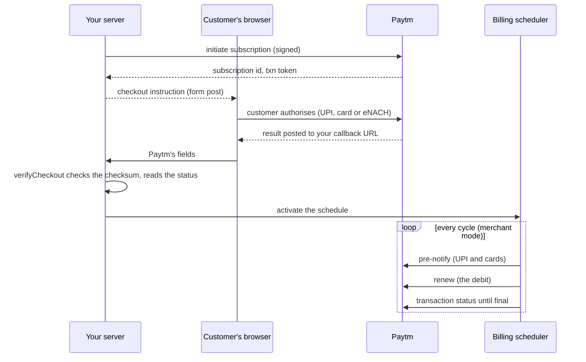

# Paytm

Paytm Subscriptions can collect each cycle itself, or leave every debit to you. This adapter defaults to **you**, driven by the library's [billing scheduler](../guides/scheduler.md), and offers Paytm's own collection for plain fixed plans.

| | Merchant mode (default) | Paytm mode |
|---|---|---|
| Who raises each debit | The billing scheduler, through Paytm's Renew API | Paytm, on each due date |
| Needs a scheduler | Yes | No |
| You ask for it with | Nothing (or `plan.scheduling: SchedulingMode.Merchant`) | `plan.scheduling: SchedulingMode.Gateway` |
| Amounts | Fixed or variable, up to the mandate ceiling | **Fixed only** |
| Daily billing | Yes | **No** |
| Trials of any length | Yes | Only when the first debit is today or one cycle away on UPI |
| Retries | The scheduler's | Paytm's (grace days and a retry count) |

The scheduler is the default because Paytm's own collection cannot do what most products need. Paytm's documentation says manual collection is **mandatory** for variable amounts, on-demand plans and daily frequency, and on UPI Paytm accepts a future start date only when it is **today or exactly one period away**. A trial of arbitrary length therefore cannot use Paytm's collection.

::: info Enterprise merchants
Paytm's documentation describes subscriptions as available to **enterprise merchants**: ask Paytm to enable them on your merchant id before you start.
:::

## Configuration

```ts
import { Environment, MemorySchedulerStore, createSubscriptions, paytm } from 'india-subscriptions';

export const subs = createSubscriptions({
  providers: [
    paytm({
      mid: process.env.PAYTM_MID!,
      merchantKey: process.env.PAYTM_MERCHANT_KEY!,
      website: 'WEBSTAGING',
      environment: Environment.Test,
      callbackUrl: 'https://shop.example.com/paytm/return',
    }),
  ],
  scheduler: { store: new MemorySchedulerStore() },
});
```

| Option | Required | Meaning |
|---|---|---|
| `mid` | yes | Your merchant id. It differs between staging and production. |
| `merchantKey` | yes | The merchant key. It is the AES-128 key of the checksum, so it must be **exactly 16 bytes**. It is never put in an error, a log line, `raw` or a checkout field. |
| `website` | yes | The `websiteName`: `WEBSTAGING` on staging, `DEFAULT` on production, or the name Paytm gave you. |
| `environment` | yes | `Environment.Test` (staging hosts) or `Environment.Live`. |
| `callbackUrl` | no | Default page Paytm posts the customer's result to. A subscription's `returnUrl` overrides it. Without either, Paytm uses the URL configured for `website`. |
| `graceDays`, `retryCount` | no | Grace days and retry count sent for merchant-collected subscriptions. The default grace is the days to the first debit plus 2, capped by what the cycle length and payment modes allow; the default retry count is 3. |
| `mandateYears` | no | How long a subscription without an end date lasts. Default 5 years. Paytm requires an expiry date. |
| `debitReason` | no | The reason shown to the customer in the pre-debit notice (at most 50 characters). Default "Subscription renewal". |
| `channelId`, `clientId` | no | `head.channelId` (`WEB` or `WAP`) and `head.clientId`, for accounts that need them. |
| `subscriptionBaseUrl`, `transactionStatusBaseUrl`, `refundBaseUrl`, `checkoutBaseUrl` | no | Replace the Paytm hosts. Each API goes to the host **its own reference page** prints, because Paytm's pages name two host families (`paytmpayments.com` and `paytmpayments.in`). |

The service reads the same settings from the `PAYTM_*` [environment variables](../reference/generated/environment.md#paytm).

## Capabilities

<!-- generated:begin capabilities paytm -->
<!-- generated:end -->

`scheduling` lists both modes, merchant first. The adapter-level `pause: yes` and `resume: yes` are Paytm's own APIs and apply to a Paytm-collected subscription. For a merchant-scheduled one the facade pauses and resumes through the scheduler instead and leaves the mandate valid.

## How a subscription works on Paytm

`createSubscription` calls Paytm's Initiate Subscription API and returns the subscription (its `id` is Paytm's `subscriptionId`, its `reference` your order id, status `created`) with a **form post** to Paytm's payment page. The form holds only `mid`, `orderId` and a one-time `txnToken`; the merchant key is never in it.



### What you must supply

- The plan **inline**. A plan id string throws `VALIDATION`; `plans.create` and `plans.get` throw `UNSUPPORTED`.
- `reference` becomes Paytm's order id: at most 50 characters of letters, digits and `@ . _ -`. Without one a `sub_...` id is generated. The customer id (`custId`), when you give none, is derived from the order id.
- A 10-digit Indian mobile number (with or without `+91`) for the customer, and an e-mail address.
- No `|` character in any request value.
- `quantity` other than 1 is not supported. `authorizeBy`, `upfrontLabel`, `metadata` and `idempotencyKey` have no Paytm equivalent and are ignored (the order id is the natural idempotency key: Paytm refuses a repeated one).
- `paymentMethods`: `upi`, `card` and `enach`. Paper mandates are not built.

### Billing intervals

Paytm's request takes a frequency **unit with no multiplier**, so only these intervals are accepted. Any other interval throws `VALIDATION`:

<!-- generated:begin paytm-frequencies -->

| Plan interval | Paytm frequency unit |
|---|---|
| 1 day | `DAY` |
| 1 week | `WEEK` |
| 1 month | `MONTH` |
| 2 month | `BI_MONTHLY` |
| 3 month | `QUARTER` |
| 6 month | `SEMI_ANNUALLY` |
| 12 month | `YEAR` |
| 1 year | `YEAR` |

<!-- generated:end -->

UPI Autopay takes week, month, two-month, quarter, half-year, year and on-demand units only; asking for UPI alone with a daily interval is refused.

### Trials, delayed starts and upfront amounts

| You pass | What the customer pays at sign-up |
|---|---|
| Nothing, or a `trial` | **₹0.** Paytm may take ₹1 itself for cards, UPI and wallet to complete authorisation. Whether it is refunded is not stated. |
| `upfrontAmount` | That amount as the first payment |

An upfront amount cannot exceed the mandate ceiling (merchant mode) or the renewal amount (Paytm mode, for UPI and eNACH). **With eNACH as the only method it must be zero**: Paytm refuses a non-zero first amount for bank mandates (code 4001), so the adapter throws `VALIDATION`.

**Merchant mode.** The subscription is created with a variable amount, the plan's ceiling as the maximum, `autoRenewal: false` and a start date of **today**. It is today because a later date would take UPI away from the payment page. The first debit may be days later, so the adapter sends **grace days** that cover the days to the first debit plus room for retries. Paytm's documentation does not say whether Renew is refused outside that window, so a long trial may fail its first debit: override with `graceDays` if it does. Paytm never retries by itself; the scheduler retries, each attempt under a new order id.

**Paytm mode.** The subscription is created with a fixed amount, `autoRenewal: true`, the start date set to the first debit date, and Paytm's documented retry defaults (two grace days, three retries; none for eNACH). The adapter refuses what Paytm cannot collect: a `maxAmount` different from `amount`, a daily interval, and, if UPI could be used, a first debit that is neither today nor exactly one cycle from today. Paytm sends the pre-debit notification itself.

### Pre-debit notification and the debit (merchant mode)

For UPI, wallet and cards the scheduler calls **Pre-Notify** before each debit; the reference id it sends comes back as `ChargeNotification.invoiceNumber` and is passed on the Renew call. **Bank mandates (eNACH) need no pre-notification**: the adapter reads the payment mode and returns an accepted notification without a request. Paytm's own pages disagree about cards and about timing (24, 48 or 72 hours): the scheduler's defaults of 48 hours ahead and 24 minimum apply.

The debit is **Renew**, with your debit id as Paytm's order id. Paytm only acknowledges it ("Subscription Txn accepted"), so the charge is `pending`; its end comes from Transaction Status or the payment webhook. Paytm refuses a repeated order id (code 325), so a re-sent debit id cannot debit twice, and the refusal is `CONFLICT`. There is **no lookup before debiting**: the adapter relies on that refusal. A failure Paytm does not list is `OUTCOME_UNKNOWN`, never a failed debit.

Paytm allows one collection per subscription per cycle, and none against an expired or cancelled subscription.

## Payment methods and limits

| | UPI Autopay | Cards | eNACH (bank mandate) |
|---|---|---|---|
| Limit per debit | ₹15,000, and ₹1,00,000 for insurance, credit-card bill payments and mutual funds. Above that the customer needs additional factor authentication. | ₹15,000 without it (same exceptions) | ₹10,00,000 in Paytm's main table; up to ₹1,00,00,000 on its marketing page |
| First amount | Up to the mandate ceiling | Same | **Must be zero** |
| Pre-notification | Mandatory | Pages disagree | Not needed |
| Grace days and retries | Yes | Up to 3 grace days (one page says none) | None |
| Refunds | Yes | Yes | **Not supported by Paytm** |
| Authorisation | UPI PIN | OTP or 3-D Secure | Net banking or debit card; activation can take up to 2 days |

A customer may hold at most 5 active subscriptions per merchant (configurable). Other Paytm limits (per-day, per-month and RBI monthly debit limits) surface as Renew rejections.

Payment modes read from Paytm map to unified methods like this. Paytm Wallet, balance and postpaid have no unified method, and net banking is a one-off method, not a mandate:

<!-- generated:begin paytm-payment-modes -->

| Paytm payment mode | Unified payment method |
|---|---|
| `UPI` | `upi` |
| `UPI_INTENT` | `upi` |
| `CC` | `card` |
| `CREDIT_CARD` | `card` |
| `DC` | `card` |
| `DEBIT_CARD` | `card` |
| `BANK_MANDATE` | `enach` |
| `BANKMANDATE` | `enach` |

<!-- generated:end -->

## Pause, resume, cancel

- **Pause and resume** exist as Paytm APIs (`ACTIVE` and `SUSPENDED`). They take no date, so `resumeAt` and `nextChargeAt` throw `UNSUPPORTED`. For a merchant-scheduled subscription the facade uses the scheduler instead.
- **Cancel** is permanent ("cannot be reactivated once cancelled"). Repeating it is safe: if the call fails, the state is read and a mandate that is already over is returned as it is. `CancelMode.AtPeriodEnd` throws `UNSUPPORTED`. After a cancel, Paytm's status is `REJECT`, which maps to `cancelled`.
- **Update** throws `UNSUPPORTED`: Paytm documents no modify API. Cancel and create a new subscription. A Paytm-collected subscription's `autoRenewal` cannot be edited either.

## Authorisation and checkout

`subscription.checkout` has `kind: CheckoutKind.FormPost` with Paytm's payment-page URL and the fields above. [`openCheckout`](../guides/checkout.md) builds and submits the form. Paytm then posts the result to your `callbackUrl`.

`verifyCheckout` takes that posted form. Its `CHECKSUMHASH` is verified over all other fields (`SIGNATURE_INVALID` otherwise; nothing is read from a result that fails). The result is only the browser's word, and a bank mandate becomes active later, so the subscription's status is then **fetched**, and `authorized` is true only when Paytm says `ACTIVE`. Always pass `expectedSubscriptionId` (your order id or Paytm's subscription id).

## Statuses

<!-- generated:begin paytm-subscription-status -->

| Paytm subscription status | Unified status |
|---|---|
| `INIT` | `created` |
| `IN_AUTHORIZATION` | `pending_authorization` |
| `AUTHORISED` | `pending_authorization` |
| `AUTHORIZED` | `pending_authorization` |
| `CONFIRMED` | `pending_authorization` |
| `ACTIVE` | `active` |
| `SUSPENDED` | `paused` |
| `EXPIRED` | `expired` |
| `REJECT` | `cancelled` |
| `CLOSED` | `expired` |
| `AUTHORIZATION_FAILED` | `failed` |

<!-- generated:end -->

A status Paytm adds later is `pending_authorization`, which neither starts nor stops billing. `CONFIRMED` has no definition in Paytm's documentation and is treated as not yet live. Paytm spells `AUTHORISED` two ways; both are read. Subscription timestamps are read as IST.

<!-- generated:begin paytm-charge-status -->

| Paytm transaction status | Unified charge status |
|---|---|
| `TXN_SUCCESS` | `succeeded` |
| `TXN_FAILURE` | `failed` |
| `PENDING` | `pending` |

<!-- generated:end -->

A debit whose status is not listed is `pending`, never failed: treating an unknown answer as failed would let the scheduler start a second debit while the first may be live. Transaction Status answers "no record" (331) and "invalid order id" (334) as `NOT_FOUND`, which the scheduler reads as "never reached Paytm". Other `TXN_FAILURE` codes that are not failed debits (a wrong merchant id, "Server Down") are errors, not failed charges.

## Refunds

`charges.refund` uses Paytm's asynchronous Refund API. `chargeId` is the debit's order id; the adapter reads the transaction first (only a successful one can be refunded) and refunds all of it unless you pass `amount`. **Debits on eNACH or bank mandates are refused with `UNSUPPORTED`**: Paytm does not refund them. `refundId` is unique at Paytm, so repeating a refund cannot refund twice. The result is `pending` unless Paytm says it is final.

## Webhooks

Configure the webhook URLs with Paytm: the subscription-status webhook URL is set by Paytm support. Key-value notifications (subscription status, payment, pre-notify callback and the refund reference) are signed with `CHECKSUMHASH` over all the other fields; JSON refund notifications carry a `head.signature` over `body`. The adapter verifies each with the rule its kind needs before reading anything, and an **unsigned refund webhook is rejected**. Event ids are built from the content, never from the salted checksum, so a redelivery has the same id.

<!-- generated:begin paytm-webhook-events -->

| Status in the subscription status webhook | Unified event |
|---|---|
| `ACTIVE` | `subscription.activated` |
| `SUSPENDED` | `subscription.paused` |
| `REJECT` | `subscription.cancelled` |
| `EXPIRED` | `subscription.expired` |
| `CLOSED` | `subscription.expired` |
| `AUTHORIZATION_FAILED` | `subscription.authorization_failed` |
| `AUTHORIZED` | `subscription.authorized` |
| `AUTHORISED` | `subscription.authorized` |

| Status in the payment webhook | Unified event |
|---|---|
| `TXN_SUCCESS` | `subscription.charged` |
| `TXN_FAILURE` | `subscription.charge_failed` |

<!-- generated:end -->

An `ACTIVE` status whose sub-status is `RESUMED` is a resume (`subscription.resumed`). The payment webhook **cannot tell an upfront payment from a renewal**, so a `subscription.charged` event may describe either: for a merchant-scheduled subscription the scheduler matches it to its own debit by id, and an upfront payment matches none. A pre-notify callback is `subscription.charge_scheduled` when Paytm reports it delivered, otherwise `unknown`. The refund reference (ARN) notification is `unknown`; the JSON Success Refund notification is `refund.succeeded` or `refund.failed`.

## Testing on staging

Paytm staging data appears in the Dashboard under Test Data. Test cards are any Visa or Mastercard with a future expiry and CVV 123; card and net-banking payments redirect to a Paytm page with success and failure buttons. Paytm Wallet test credentials are published (mobile `77777 77777`, OTP `489871`). No test UPI id and no eNACH test credentials are published. The smallest billing cycle Paytm says you can test is one day with zero grace days and a retry count of 1. Subscriptions must be enabled on your staging merchant id, which Paytm's documentation does not say is the default.

## Not built

Paytm Wallet subscriptions, the Consult and List APIs, paper (physical) mandates, and JS Checkout. The form-post payment page is used instead.
