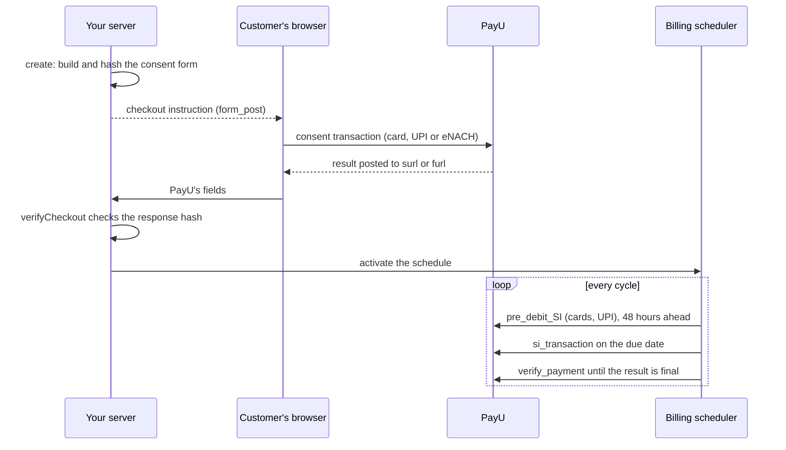

# PayU

PayU keeps the customer's mandate but does not raise recurring debits for you. For each cycle you check the mandate, send a pre-debit notification (for cards and UPI) and then call PayU's recurring-debit command. The library's [billing scheduler](../guides/scheduler.md) does all of that, so with PayU you **must** configure a scheduler. Creating a subscription without one fails before anything is sent to PayU.

## Configuration

```ts
import { Environment, payu } from 'india-subscriptions';

export const gateway = payu({
  key: process.env.PAYU_KEY!,
  salt: process.env.PAYU_SALT!,
  environment: Environment.Test,
  successUrl: 'https://shop.example.com/payu/success',
  failureUrl: 'https://shop.example.com/payu/failure',
});
```

| Option | Required | Meaning |
|---|---|---|
| `key`, `salt` | yes | The merchant key and salt. The salt signs every request and verifies every response. It never leaves your server: it is not in `checkout.fields` and not in any error. |
| `environment` | yes | `Environment.Test` (`test.payu.in`) or `Environment.Live` (`secure.payu.in` for consent, `info.payu.in` for commands). |
| `successUrl`, `failureUrl` | no | Default return URLs (PayU's `surl` and `furl`). A subscription's `returnUrl` overrides both. Without a `returnUrl`, `successUrl` is required, otherwise creating a subscription throws `VALIDATION`. `failureUrl` falls back to `successUrl`. |
| `consentHashLayout` | no | `six_pipes` (default), `five_pipes` or `four_pipes`. PayU's documentation prints the separator count three ways. Change it only if PayU rejects the consent hash. PayU's test environment accepted six pipes. |
| `acceptUnsignedWebhooks` | no | Normalise PayU's unsigned eNACH-cancellation and refund webhooks. Only behind an allow-list of PayU's published source addresses. Default false. |
| `paymentUrl`, `apiUrl` | no | Replace the PayU URLs (a proxy or a mock server). |

The service reads the same settings from the `PAYU_*` [environment variables](../reference/generated/environment.md#payu).

## Capabilities

<!-- generated:begin capabilities payu -->
<!-- generated:end -->

PayU is **merchant-scheduled** only. `pause: no` and `resume: no` describe PayU's own API, which has no pause. With a scheduler configured, the facade pauses and resumes by telling the scheduler to stop and start raising debits, and [`subs.capabilities()`](../reference/generated/capabilities.md#what-subscapabilities-reports) reports that. `charges.list` is not available: read a debit with `charges.get` and the debit id the scheduler chose, or follow the scheduler's events.

## How a subscription works on PayU

`createSubscription` makes **no network call**. It returns a signed form that the customer's browser posts to PayU. PayU first hears of the subscription when the customer submits it.



### The subscription id changes once

Before the customer authorises, the subscription's `id` is your consent transaction id: your `reference`, or a generated `sub_...` id. After the customer authorises, `verifyCheckout` returns the id to use from then on, `<method>:<mihpayid>` such as `card:31543714057`, because PayU's status, revoke and modify commands differ per payment method. **Store the `subscriptionId` that `verifyCheckout` returns.** The helpers `encodePayUSubscriptionId` and `decodePayUSubscriptionId` are exported if you need to take one apart.

Your `reference` is PayU's `txnid`. It must be at most 25 characters of letters, digits, `_` and `-`, and unique.

### What you must supply

- The plan **inline**. PayU has no plan API, so a plan id string throws `VALIDATION`, and `plans.create` and `plans.get` throw `UNSUPPORTED`.
- `customer.name`, `customer.email` and `customer.phone`, all required. PayU removes some characters from names and product text, so the adapter removes them first so the hash matches what PayU keeps. Letters, digits and `- _ @ / . +` are kept in an e-mail address; an address with any other character is refused with `VALIDATION` rather than silently changed.
- `quantity` other than 1 is not supported: multiply the plan amount yourself.
- `paymentMethods` cannot be enforced. PayU's hosted checkout lets the customer pick the method.

### Trials, delayed starts and upfront amounts

PayU has no trial feature for merchant-triggered debits. The mandate is registered with a small **consent transaction**, and the scheduler simply does not debit until the trial ends.

| You pass | Consent transaction | Notes |
|---|---|---|
| Nothing or `trial` | ₹2.00 with `free_trial=1` | PayU documents no automatic refund. **You refund it** with `charges.refund`. PayU's pages disagree on whether UPI is ₹0 or ₹2; the adapter uses ₹2, which is valid on every method. |
| `upfrontAmount` | That amount, at least ₹1 | The first instalment, collected with the registration. For eNACH this works on a small set of banks only. |

The mandate's start date is the first debit date, and its end date comes from `mandateEndsAt`, else seven days after the last cycle when you give `totalCycles`, else five years after the first debit. The mandate ceiling (`billingAmount`) is the plan's `maxAmount`, or its `amount`. For cards, PayU states that a fixed plan's debit must equal that amount, so leave `maxAmount` unset on card plans.

### Pre-debit notification and the debit

For cards and UPI the scheduler sends the pre-debit notification 48 hours before the debit and then waits at least 24 hours before debiting. PayU's pages disagree on the lead time (24, 24 to 36, 24 to 48 and 48 hours) and say that a debit without a timely notice fails. **eNACH needs no notification**: the adapter reports an accepted notification without calling PayU. The debit is PayU's `si_transaction`. Its first answer is always "pending", with a final result within about ten minutes for UPI and by T+2 for eNACH; the scheduler polls `verify_payment` until the result is final.

PayU does not reject a repeated transaction id: on its test environment the same `txnid` sent three times produced three debits. So before raising a debit the adapter looks the `txnid` up and returns the existing debit if PayU already holds it. The scheduler only ever re-sends an id after an unknown outcome, and then only after a grace period.

### Failures and retries

PayU can retry failed recurring debits itself (Dashboard, Revenue Recovery), but that is off by default and the library does not depend on it. The scheduler applies its own policy: three attempts, a day apart, then `halted`. See [Running the scheduler](../guides/scheduler.md).

## Payment methods and limits

| | UPI Autopay | Cards | eNACH (net banking) |
|---|---|---|---|
| Debit without the customer | Up to ₹15,000 (₹1,00,000 for insurance and credit-card bill payments) | Up to ₹15,000 (₹1,00,000 for mutual funds, insurance, credit-card bills); above, additional factor authentication | Not required for later debits (limits up to ₹10,00,000 by net banking) |
| Mandate ceiling | The UPI `billingAmount` must not exceed ₹15,000. The adapter does not check this locally; PayU rejects it. | The card's limit | Per bank |
| Pre-debit notice | Yes | Yes | No |
| Registration | Real time | Real time; the customer completes 3-D Secure | Up to T+2 at the bank |
| Pause by the customer | Yes, in their UPI app | No | No |
| Cancel | `upi_mandate_revoke` | `mandate_revoke` (RuPay needs the customer) | `mandate_revoke`, finishes at the bank in T+1 or T+2 |
| Modify | Amount and end date, through `upi_mandate_modify`; the customer must approve | Needs a new consent with the customer | Not available |
| Refund of a debit | Yes | Yes | Not supported by banks |

A card mandate ends at the latest on the card's expiry. UPI collect flows are being retired by NPCI. Every card used for a mandate must be tokenised.

## Authorisation and checkout

`subscription.checkout` is `kind: CheckoutKind.FormPost` with the URL and the signed fields. Post them exactly as given: they are covered by the hash. [`openCheckout`](../guides/checkout.md) builds and submits the form for you.

`verifyCheckout` verifies the response hash PayU posts back (the reverse hash, **without** `si_details`, which PayU's test environment confirmed), then applies PayU's rule: `status` is `success` and `payment_source` is `sist` (and, for cards, a card token was returned). Card and UPI mandates are then `authorized: true`. eNACH is `pending_authorization` until the bank registers it, and `authorized` stays false; the scheduler checks the mandate periodically and starts billing when it is live. The `charge` in the result is the consent payment. PayU marks a failed consent `payu` like any failed payment, and posts a card token even when 3-D Secure failed, so only `status` tells you the outcome.

## Managing a subscription

| Operation | On PayU |
|---|---|
| `pause` and `resume` | Through the scheduler only: it stops and starts raising debits and the mandate stays valid. PayU's own API has none. |
| `cancel` | The scheduler stops billing first, then the mandate is revoked with the method's command. Immediately only: `CancelMode.AtPeriodEnd` throws `UNSUPPORTED`. |
| `update` | UPI mandates only: `amount` and `mandateEndsAt`, which the customer must approve in their UPI app. The facade also applies `amount`, `nextChargeAt` and `remainingCycles` to the schedule. Cards and eNACH mandates cannot be modified through the API. |
| `charges.refund` | `cancel_refund_transaction`. `chargeId` is PayU's payment id or your transaction id. eNACH refunds fail with PayU error 232. A refund of a debit that was captured today may have to wait until tomorrow. |
| `charges.get` | `verify_payment` by your transaction id. A debit PayU does not know answers `NOT_FOUND`. |

## Statuses

<!-- generated:begin payu-subscription-status -->

| Card mandate status (`check_mandate_status`) | Unified status |
|---|---|
| `active` | `active` |
| `cancelled` | `cancelled` |
| `discarded` | `cancelled` |
| `deleted` | `cancelled` |
| `failed` | `failed` |
| `expired` | `expired` |
| `paused` | `paused` |

| eNACH mandate status (`NB_mandate_status`) | Unified status |
|---|---|
| `INITIATED` | `pending_authorization` |
| `SUCCESS` | `active` |
| `FAILED` | `failed` |
| `CANCEL_INITIATED` | `cancelled` |
| `CANCEL_PENDING` | `cancelled` |
| `CANCEL_SUCCESS` | `cancelled` |
| `CANCEL_FAILED` | `active` |
| `CANCEL_INITIATION_FAILED` | `active` |

| UPI mandate status (`upi_mandate_status`) | Unified status |
|---|---|
| `active` | `active` |
| `revoked` | `cancelled` |
| `pause` | `paused` |
| `paused` | `paused` |
| `unpause` | `active` |

<!-- generated:end -->

A mandate status the adapter does not know becomes `pending_authorization`, never `active`. A cancellation that is initiated or pending counts as cancelled; one that failed leaves the mandate live.

<!-- generated:begin payu-charge-status -->

| PayU transaction state | Unified charge status |
|---|---|
| `captured` | `succeeded` |
| `success` | `succeeded` |
| `auth` | `pending` |
| `pending` | `pending` |
| `in progress` | `pending` |
| `initiated` | `pending` |
| `failed` | `failed` |
| `failure` | `failed` |
| `bounced` | `failed` |
| `dropped` | `failed` |
| `autorefund` | `failed` |
| `usercancelled` | `cancelled` |
| `cancelled` | `cancelled` |

<!-- generated:end -->

A debit state the adapter does not know is `pending`, so the scheduler keeps asking instead of debiting again. An `autoRefund` debit is `failed`, never `refunded`, because the scheduler counts a refunded debit as collected.

## Webhooks

PayU's webhooks come in four shapes, and only some are signed.

| Webhook | Format | Signed | Result |
|---|---|---|---|
| Payment (consent result, recurring debit) | Form-encoded | Yes, the response hash | `subscription.authorized` for a card or UPI consent; `subscription.charged` or `subscription.charge_failed` for a debit; otherwise `unknown` |
| Card mandate (issuer modified or cancelled it) | JSON | Yes | `subscription.updated` or `subscription.cancelled` |
| UPI mandate (customer paused, resumed or revoked in their app) | JSON | Yes | `subscription.paused`, `subscription.resumed`, `subscription.cancelled` |
| eNACH cancellation and refund | JSON | **No** | `unknown`, unless `acceptUnsignedWebhooks` is set |

Payment webhooks arrive **form-encoded**, not JSON, so pass the raw body string through as it is. A recurring debit is recognised by `payment_source` of `sirecurring` or a `PG_TYPE` of `SI-PG`. The webhook carries no subscription id, so the scheduler matches it to its debit by the transaction id. PayU's source addresses are listed in its documentation (test: `180.179.174.1`, `3.6.73.183`, `3.6.83.44`; production: `3.7.89.1`, `3.7.89.2`, `3.7.89.3`, `52.140.8.88`, `52.140.8.89`, `52.140.8.64`); check them against PayU's current page before using them as an allow-list.

Because webhooks cannot attribute everything, rely on the scheduler's own events for debits: see [Events](../concepts/events.md).

<!-- generated:begin payu-webhook-events -->

| Card mandate `notificationType` | Unified event |
|---|---|
| `MANDATE_MODIFICATION` | `subscription.updated` |
| `MANDATE_CANCELLATION` | `subscription.cancelled` |
| `MANDATE_DELETION` | `subscription.cancelled` |
| `MANDATE_CANCELLATION_TOKEN_DELETION` | `subscription.cancelled` |

| UPI mandate `action` | Unified event |
|---|---|
| `MANDATE_PAUSE` | `subscription.paused` |
| `MANDATE_UNPAUSE` | `subscription.resumed` |
| `MANDATE_REVOKE` | `subscription.cancelled` |

<!-- generated:end -->

## Not built

PayU's ZION subscription product, which is gateway-scheduled and has its own APIs. Its create-subscription page is missing from the public documentation.
