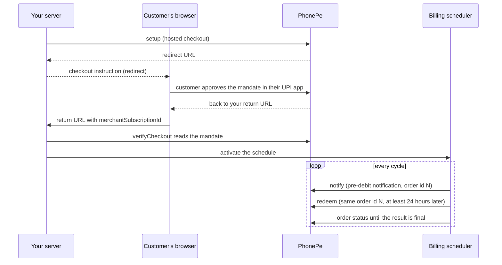

# PhonePe

PhonePe Autopay sets up **UPI mandates only**. PhonePe never raises a recurring debit itself: you tell it about each debit in advance and then ask it to take the money. The library's [billing scheduler](../guides/scheduler.md) does both, so with PhonePe you **must** configure a scheduler. Creating a subscription without one fails before anything is sent to PhonePe.

## Configuration

```ts
import { Environment, MemorySchedulerStore, createSubscriptions, phonepe } from 'india-subscriptions';

export const subs = createSubscriptions({
  providers: [
    phonepe({
      clientId: process.env.PHONEPE_CLIENT_ID!,
      clientSecret: process.env.PHONEPE_CLIENT_SECRET!,
      clientVersion: process.env.PHONEPE_CLIENT_VERSION!,
      environment: Environment.Test,
      webhookUsername: process.env.PHONEPE_WEBHOOK_USERNAME,
      webhookPassword: process.env.PHONEPE_WEBHOOK_PASSWORD,
      redirectUrl: 'https://shop.example.com/phonepe/return',
    }),
  ],
  scheduler: { store: new MemorySchedulerStore() },
});
```

| Option | Required | Meaning |
|---|---|---|
| `clientId`, `clientSecret`, `clientVersion` | yes | The credentials from the PhonePe Business Dashboard (Developer Settings). The adapter exchanges them for an OAuth token and caches it until five minutes before it expires. |
| `environment` | yes | `Environment.Test` (PhonePe's sandbox, `api-preprod.phonepe.com`) or `Environment.Live` (`api.phonepe.com`). The live token endpoint is on a different host; the adapter knows it. |
| `webhookUsername`, `webhookPassword` | for webhooks | Give both or neither. The credentials you set for the webhook in the Dashboard. Without them `parseWebhook` throws `CONFIG`. |
| `redirectUrl` | no | Default page PhonePe sends the customer back to. A subscription's `returnUrl` overrides it. One of the two is required. |
| `apiUrl`, `tokenUrl` | no | Replace the PhonePe hosts (a proxy or a mock server). |

The service reads the same settings from the `PHONEPE_*` [environment variables](../reference/generated/environment.md#phonepe).

## Capabilities

<!-- generated:begin capabilities phonepe -->
<!-- generated:end -->

PhonePe is **merchant-scheduled** only. `pause: no` and `resume: no` describe PhonePe's own API, which has none. With a scheduler configured, the facade pauses and resumes by telling the scheduler to stop and start raising debits, and [`subs.capabilities()`](../reference/generated/capabilities.md#what-the-facade-reports) reports that. `charges.list` is not available: read a debit with `charges.get` and its id, or follow the scheduler's events.

## How a subscription works on PhonePe

`createSubscription` calls PhonePe's setup API and returns a **redirect** to PhonePe's hosted checkout page. The customer approves the mandate in their UPI app; PhonePe sends them back to your return page.



### What you must supply

- The plan **inline**. PhonePe has no plan API, so a plan id string throws `VALIDATION`, and `plans.create` and `plans.get` throw `UNSUPPORTED`.
- A return page: `returnUrl` on the subscription or `redirectUrl` in the config.
- `paymentMethods`, if you pass it, must include `upi`. Nothing else exists.
- A plan amount of at least ₹1, and a ceiling (`maxAmount`, or the amount) of at most **₹15,000**. If `maxAmount` differs from `amount` the mandate is variable, otherwise fixed.
- `quantity` other than 1 is not supported. `notifyCustomer`, `idempotencyKey` and `customer` (which is kept on the returned subscription) have no PhonePe field and are ignored. `metadata` is sent only for the keys `udf1` to `udf15` (the first ten up to 256 characters, the rest up to 50 characters of letters, digits and `_ - + @ .`); other keys stay on the returned subscription only.

The subscription's `id` is your `reference` (letters, digits, `_` and `-`, at most 60 characters) or a generated `sub_...` id. PhonePe's own mandate id is never needed. The setup order id is derived from it (`ST_` plus the subscription id), so the adapter keeps no state.

### Billing intervals

PhonePe names a fixed set of frequencies. Any other interval is sent as `ON_DEMAND`, which means no recurrence rule is enforced at the bank:

<!-- generated:begin phonepe-frequencies -->

| Plan interval | PhonePe frequency |
|---|---|
| 1 day | `DAILY` |
| 1 week | `WEEKLY` |
| 7 day | `WEEKLY` |
| 2 week | `FORTNIGHTLY` |
| 14 day | `FORTNIGHTLY` |
| 1 month | `MONTHLY` |
| 3 month | `QUARTERLY` |
| 6 month | `HALFYEARLY` |
| 12 month | `YEARLY` |
| 1 year | `YEARLY` |

<!-- generated:end -->

A two-month interval is sent as `ON_DEMAND`, because PhonePe's "BIMONTHLY" could mean every two months or twice a month and its pages do not say which. Whether a failed debit counts against a frequency limit is not documented.

### Trials, delayed starts and upfront amounts

PhonePe has no trial or plan object. The mandate is set up with one of two verifications, and the scheduler simply does not debit until the trial ends.

| You pass | Setup | Notes |
|---|---|---|
| No `upfrontAmount` | **₹2 verification debit** (`PENNY_DROP`, fixed) | PhonePe's dashboard documentation says it is credited back during setup; the API pages do not say so. If it is not returned, refund it. |
| `upfrontAmount` (at least ₹1) | That amount is debited at setup (`TRANSACTION`) | The first payment, collected with the authorisation. |

**A recurring charge cannot happen at sign-up.** Every debit needs a pre-debit notification, and PhonePe allows the debit only 24 hours or more after it. The notification and the debit use the **same order id**, and the debit window runs from 24 hours after the notification until its expiry (PhonePe's retry window is 48 hours). So without an upfront amount, the customer's first real charge is at least a day after sign-up, trial or not. An upfront amount is the only way to take money at sign-up. It does not move the date of the first recurring debit, which is the subscription's `startAt` (now, when you pass no trial); pass `trial` or `startAt` if the upfront amount is meant to pay for the first period.

The mandate's end date is `mandateEndsAt`, else seven days after the last debit when you give `totalCycles`, else **29 years** (PhonePe's documented maximum is 30). `authorizeBy` sets how long the setup page lives and must be 300 to 3600 seconds away; outside that it is refused, not clamped.

### Pre-debit notification and the debit

For each cycle the scheduler calls `notifyCharge`, which returns the notification's order id as `ChargeNotification.chargeId`. The scheduler then uses that id as the debit's id: `createCharge` asks PhonePe to redeem that order. The amount is fixed by the notification, so a different amount in `createCharge` is a `VALIDATION` error.

Redeem has no documented idempotency, so the adapter **reads the order first**:

| What PhonePe holds | `createCharge` does |
|---|---|
| Nothing | `NOT_FOUND`: notify first |
| An order already redeemed | Returns that debit; sends nothing |
| A notification, window not open yet | `CONFLICT`: nothing was debited and it can still happen, so it does not use up an attempt |
| A notification, window expired | `PROVIDER_ERROR`: the scheduler retries with a fresh notification |
| A notification, window open | Redeems |

`getCharge` on an order PhonePe holds only as a notification answers `NOT_FOUND`: no debit exists yet. The scheduler reads that as "never reached PhonePe" and, after its grace period, sends the same redeem again. PhonePe retries failed debits itself inside its window (the `STANDARD` strategy), and only during non-peak hours (9:31 PM to 9:59 AM and 1:01 PM to 4:59 PM, as its documentation states). Use the scheduler's `debitAtIstTime` policy to stay inside them.

## Payment methods and limits

| | UPI Autopay |
|---|---|
| Customer authorises with | UPI PIN in a UPI app (PhonePe, BHIM, Google Pay, Paytm, CRED, Amazon Pay, SuperMoney) |
| Mandate ceiling | ₹15,000, PhonePe's stated maximum on this API. A larger ceiling is refused with `VALIDATION`. |
| Smallest amounts | ₹1 for the plan amount and any upfront amount; ₹2 for the verification |
| Frequency | The table above |
| Mandate validity | Up to 30 years |
| Customer actions | Pause, un-pause and revoke in their UPI app |

## Pause, resume, cancel

- **Customers** pause, un-pause and revoke in their UPI app. PhonePe tells you through webhooks. A pause that came from the customer is undone only by the customer's un-pause: the scheduler marks who paused and never lets a gateway event undo **your** pause. After a pause and un-pause, PhonePe's documentation requires a new notification and 24 hours before the next debit; the scheduler notifies before every debit anyway.
- **You** can only **cancel**. `subs.cancel` stops billing first and then cancels the mandate (PhonePe answers 204 and the status is read afterwards). Cancelling twice is fine. A mandate the customer never authorised cannot be cancelled at PhonePe (`NOT_FOUND`); the facade then stops the schedule and returns its own view of the subscription.
- `pause`, `resume`, `update` throw `UNSUPPORTED` on the adapter. Through the facade, pause and resume are the scheduler's. `CancelMode.AtPeriodEnd` is `UNSUPPORTED`.

## Authorisation and checkout

`subscription.checkout` has `kind: CheckoutKind.Redirect` and PhonePe's page URL. [`openCheckout`](../guides/checkout.md) navigates to it. PhonePe then sends the customer to your return URL; the adapter adds `merchantSubscriptionId` to it. That return carries **no documented signature**, so `verifyCheckout` trusts nothing in it except that id and **reads the mandate from PhonePe**: `authorized` is true only when it is `ACTIVE`. A mandate still `ACTIVATION_IN_PROGRESS` is `pending_authorization`. Always pass `expectedSubscriptionId`, because the id comes from the browser.

Before the customer authorises, PhonePe's subscription-status endpoint may not know the mandate. A not-found answer falls back to the **setup order**: still pending is `created`, failed or expired is `failed`, completed is `pending_authorization`.

## Statuses

<!-- generated:begin phonepe-subscription-status -->

| PhonePe mandate state | Unified status |
|---|---|
| `ACTIVATION_IN_PROGRESS` | `pending_authorization` |
| `ACTIVE` | `active` |
| `PAUSE_IN_PROGRESS` | `paused` |
| `PAUSED` | `paused` |
| `UNPAUSE_IN_PROGRESS` | `paused` |
| `CANCEL_IN_PROGRESS` | `cancelled` |
| `CANCELLED` | `cancelled` |
| `REVOKE_IN_PROGRESS` | `cancelled` |
| `REVOKED` | `cancelled` |
| `EXPIRED` | `expired` |
| `FAILED` | `failed` |

| Setup order state (before the mandate exists) | Unified status |
|---|---|
| `PENDING` | `created` |
| `COMPLETED` | `pending_authorization` |
| `FAILED` | `failed` |

<!-- generated:end -->

A mandate state PhonePe adds later becomes `pending_authorization`, the one status the scheduler and the facade do not act on. The gateway's own state is always in `providerStatus`. A mandate being paused, un-paused, cancelled or revoked is already as good as gone, so the in-progress states map like their final ones.

<!-- generated:begin phonepe-charge-status -->

| PhonePe order state | Unified charge status |
|---|---|
| `PENDING` | `pending` |
| `COMPLETED` | `succeeded` |
| `FAILED` | `failed` |
| `NOTIFICATION_IN_PROGRESS` | `scheduled` |
| `NOTIFIED` | `scheduled` |

<!-- generated:end -->

An unknown order state is `pending`: never final, never a failure. A notification that was never redeemed and whose window has passed is reported as a failed debit.

<!-- generated:begin phonepe-refund-status -->

| PhonePe refund state | Unified refund status |
|---|---|
| `PENDING` | `pending` |
| `CONFIRMED` | `pending` |
| `ACCEPTED` | `pending` |
| `COMPLETED` | `succeeded` |
| `FAILED` | `failed` |

<!-- generated:end -->

A refund state PhonePe adds later is `pending`.

## Refunds

`charges.refund` calls `POST /payments/v2/refund`: `chargeId` is the debit's order id (the notification id) and `refundId` your unique id (at most 63 characters). Without `amount` the adapter reads the order and refunds all of it; only a completed debit can be refunded. PhonePe refuses refunds of payments older than 90 days. The documented minimum refund amount contradicts itself (1 paisa in one place, 100 in another) and is not enforced locally. PhonePe does not say whether a repeated `refundId` is refused, so a refund that failed must be re-sent under a **new** id, and the call is not retried automatically.

## Webhooks

In the PhonePe Business Dashboard, add your webhook URL and set a username and password. PhonePe sends `Authorization: sha256(username:password)` (lower-case hex), which the adapter compares in constant time.

::: danger This header does not cover the body
It identifies the sender and nothing more. It does not sign the payload, so **a captured webhook can be replayed** and a body altered in transit would not be detected. Serve the endpoint over **HTTPS only**, and de-duplicate on `event.id`. PhonePe's HMAC webhook mode is not implemented, because its algorithm is not documented. The capability `signedWebhooks: yes` means the **sender** is authenticated, not the body.
:::

| PhonePe event | Unified event |
|---|---|
| `subscription.setup.order.completed`, `checkout.order.completed` (a subscription setup) | `subscription.authorized` |
| `subscription.setup.order.failed`, `checkout.order.failed` (a subscription setup) | `subscription.authorization_failed` |
| `subscription.paused` | `subscription.paused` |
| `subscription.unpaused` | `subscription.resumed` |
| `subscription.revoked`, `subscription.cancelled` | `subscription.cancelled` |
| `subscription.notification.completed` | `subscription.charge_scheduled` |
| `subscription.redemption.order.completed` and `subscription.redemption.transaction.completed` (confirmed) | `subscription.charged` |
| `subscription.redemption.order.failed` (final) | `subscription.charge_failed` |
| `pg.refund.completed`, `pg.refund.failed` | `refund.succeeded`, `refund.failed` |
| `subscription.notification.failed`, `subscription.redemption.transaction.failed`, `pg.refund.accepted`, one-off checkout payments, anything else | `unknown` |

A failed notification is `unknown` because reporting it as a failed charge would burn an attempt for a debit that was never tried. A single failed attempt is `unknown` as well, since PhonePe retries inside its window and only the order's own `FAILED` is final.

Event ids are built from the event name and the ids in the payload. The two redemption-success events of one debit share one id, so you do not fulfil twice. PhonePe's un-pause, revoke and cancel payloads carry no timestamp, so a second un-pause of the same subscription has the same id as the first: it looks like a redelivery.

## Testing in the sandbox

PhonePe's UAT sandbox simulates flows with templates: install PhonePe's test app, enter your merchant id and pick a template (for example "Setup, notify & redemption success with PhonePe retries"). The template must be set **before** you call the APIs, otherwise PhonePe answers "scenario name not found". Test VPAs for collect checks are `success@ybl`, `failure@ybl` and `pending@ybl`. The test app's Subscriptions list lets you pause, un-pause and revoke a mandate to see the webhooks. PhonePe's documentation asks you to share your UAT webhook URL with the integration team.

## Not built

PhonePe's API-integration variant (merchant-rendered UPI intent and collect), its paylinks variant, the mobile SDK token flow, and HMAC webhooks. eNACH is a separate PhonePe product and is not covered.
