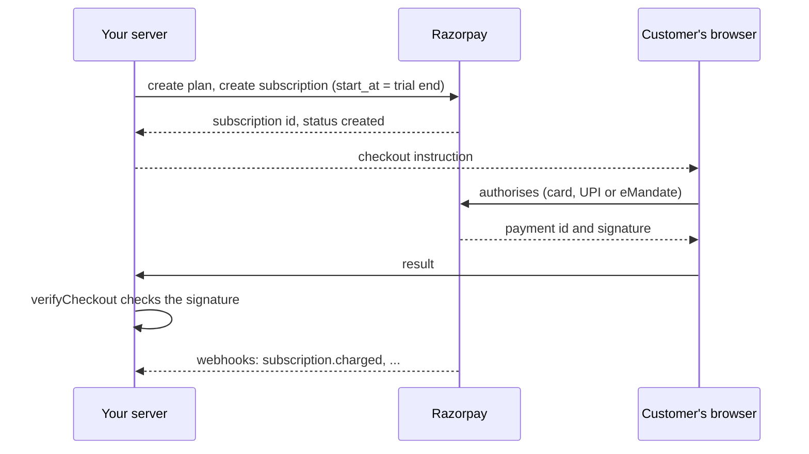
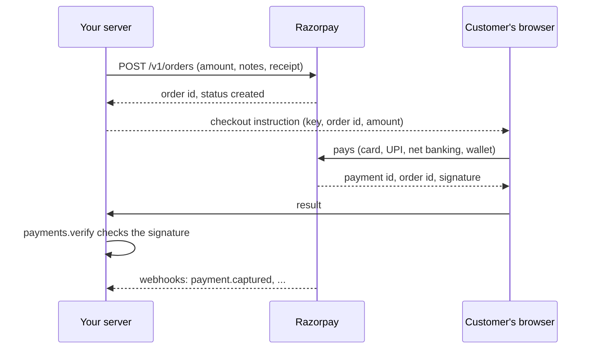

# Razorpay

Razorpay runs the whole billing cycle itself. You create a plan and a subscription, the customer authorises a mandate in Razorpay Checkout, and from then on Razorpay raises every debit on schedule, retries failures and tells you what happened through webhooks. You do not need the [billing scheduler](../guides/scheduler.md) for Razorpay.

## Configuration

```ts
import { razorpay } from 'india-subscriptions';

export const gateway = razorpay({
  keyId: process.env.RAZORPAY_KEY_ID!,
  keySecret: process.env.RAZORPAY_KEY_SECRET!,
  webhookSecret: process.env.RAZORPAY_WEBHOOK_SECRET,
});
```

| Option | Required | Meaning |
|---|---|---|
| `keyId` | yes | The API key id. It is also the `key` Checkout opens with, so it is sent to the browser. |
| `keySecret` | yes | The API key secret. Never sent anywhere except to Razorpay. |
| `webhookSecret` | for webhooks | The secret you set when adding the webhook in the Dashboard. Without it `parseWebhook` throws `CONFIG`. |
| `defaultDurationYears` | no | How long an open-ended subscription runs, 1 to 100. Default 10. See [open-ended subscriptions](#open-ended-subscriptions). |
| `baseUrl` | no | Replaces `https://api.razorpay.com` (a proxy or a mock server). |

Test and live mode use the same host. The mode follows the key pair you pass, so use the test-mode key pair from the Dashboard while you build. The subscriptions feature must be enabled on your account in each mode, and webhooks are configured separately in each. With `india-subscriptions serve` the same settings are the `RAZORPAY_*` [environment variables](../reference/generated/environment.md#razorpay).

## Capabilities

<!-- generated:begin capabilities razorpay -->
<!-- generated:end -->

Razorpay is **gateway-scheduled** only. `createCharge` and `notifyCharge` throw `UNSUPPORTED`: Razorpay raises the debits and sends the pre-debit notice itself.

## How a subscription works on Razorpay

You send a plan and a subscription. The customer opens Checkout with the subscription id and authorises. Razorpay then charges on the plan's schedule.



### Plans

`plans.create` creates a Razorpay plan. Razorpay plans are immutable: you cannot edit or delete one, and to change a price you move subscriptions to a new plan. `getPlan` fetches one. The plan's `id` option is only recorded, because Razorpay generates its own id.

If you pass a plan **inline** to `subs.create`, the adapter creates a new Razorpay plan for every subscription. That works, but it leaves one plan per customer in your account. Create the plan once with `subs.plans.create`, keep its id, and pass the id as `plan` afterwards.

Daily plans need an interval of 7 or more days (Razorpay's pages say both "7 or more" and "more than 7"; the adapter accepts 7 and lets Razorpay decide). A three-month interval is sent as `period: monthly, interval: 3`. The smallest plan amount is ₹1 (100 paise).

### Trials, delayed starts and upfront amounts

A trial on Razorpay is a **future start date**. `trial: { days: 14 }` or `trial: { endsAt }` becomes `start_at`, and the time between authorisation and `start_at` is the trial. The customer must authorise before `start_at`, otherwise the subscription becomes `expired`.

What the customer pays at authorisation depends on the start date and the upfront amount:

| Start | Upfront amount | Charged at authorisation |
|---|---|---|
| Immediate | none | The plan amount (not refunded) |
| Future (trial) | none | ₹5, refunded automatically |
| Immediate | yes | Upfront amount plus the plan amount |
| Future (trial) | yes | The upfront amount |

`upfrontAmount` is sent as an add-on to the subscription, labelled with `upfrontLabel` (default "Upfront amount"). An invoice's amount includes the add-on. While a subscription is in a trial, its status is `trialing` (Razorpay's `authenticated`).

### Open-ended subscriptions

Razorpay needs a `total_count`. If you omit `totalCycles`, the adapter uses the plan's `maxCycles`, then the whole cycles up to `mandateEndsAt`, and otherwise the number of cycles in `defaultDurationYears` (10 by default, the most conservative of three maximum durations Razorpay's pages state). If you pass both `totalCycles` and `mandateEndsAt`, they must describe the same number of whole cycles.

### Things the adapter does not send

Razorpay has no field for some inputs, so they are accepted and ignored. `capabilities` says so where it matters.

| Input | What happens |
|---|---|
| `idempotencyKey` | Ignored. Razorpay documents no idempotency for plans or subscriptions, so a create that gets no answer is `OUTCOME_UNKNOWN`. Do not retry it blindly. |
| `paymentMethods` | Ignored. The customer picks the method in Checkout; which methods appear is an account setting. |
| `customer` | Not sent. Razorpay collects details in Checkout; yours are used to prefill it. |
| `reference` | Kept in the subscription's `notes` and read back into `Subscription.reference`. The keys the adapter uses in `notes` start with `india_subscriptions_` and cannot be used in `metadata`. |

`authorizeBy` is sent as `expire_by`, and `notifyCustomer` as `customer_notify`. Razorpay allows 15 notes per object.

## Payment methods and limits

Razorpay Subscriptions supports cards, UPI Autopay and eMandate. The customer chooses in Checkout.

| | Cards | UPI Autopay | eMandate (eNACH) |
|---|---|---|---|
| Debits without the customer doing anything | Up to ₹15,000. Above that the customer must approve every debit with additional factor authentication (AFA). RuPay cards: no debit above ₹15,000. | Up to ₹15,000 | Mandate limit up to ₹1,00,00,000 |
| Higher limits | ₹1,00,000 for some business categories (mutual funds, insurance, credit-card bill payments) | Same categories | n/a |
| Failed charge | Retried at T+1, T+2, T+3, then `halted` | Same | Retried only after the bank confirms the last attempt |
| Change plan or quantity | Yes | **No** | **No** |
| Merchant pause and resume | Yes | Yes | Yes |
| Customer can pause or cancel | Through the card issuer's portal | From their UPI app | Only by contacting the bank |

Razorpay's own pages disagree on some of these limits (the settings page says charges above ₹15,000 "would automatically fail for domestic cards"; one FAQ gives ₹1,00,000 for UPI; the lists of business categories differ). Treat ₹15,000 as the safe per-debit ceiling for cards and UPI unless Razorpay confirms a higher limit for your account. [Recurring payments in India](../concepts/recurring-payments.md) explains the rules behind these numbers.

## Authorisation and checkout

`subscription.checkout` has `kind: CheckoutKind.RazorpayCheckout` with the key id, the subscription id, a hosted payment page (`hostedUrl`) and a prefill built from `customer`. Open it with [`openCheckout`](../guides/checkout.md). Checkout needs no amount: the subscription carries it.

`verifyCheckout` checks `hex(HMAC_SHA256(keySecret, payment_id + "|" + subscription_id))` against `razorpay_signature`. Always pass `expectedSubscriptionId`, the id your server stored when it created the subscription. Razorpay's own documentation says to sign with the stored id and not the one Checkout returns.

## Managing a subscription

| Operation | On Razorpay |
|---|---|
| `pause` | Pauses now. `resumeAt` is not supported. Refused with `CONFLICT` while the subscription is still in a trial (`authenticated`), because Razorpay would cancel it irreversibly. Only an `active` subscription can be paused. |
| `resume` | Resumes now. `nextChargeAt` is not supported. A subscription paused by the customer in their UPI app can only be resumed by them. |
| `update` | `planId`, `quantity`, `remainingCycles` and `nextChargeAt` (sent as `start_at`), with `timing`. `amount` and `mandateEndsAt` throw `UNSUPPORTED`: switch plan instead. UPI and eMandate subscriptions cannot be updated at all, and Razorpay's refusal surfaces as an error. Only `authenticated` and `active` subscriptions can be updated. |
| `cancel` | `mode: CancelMode.AtPeriodEnd` cancels at the end of the cycle. It is refused while no cycle is running (trial) and in the final cycle. Cancelling is irreversible. |
| `charges.list` | Reads the subscription's invoices (it pages through all of them unless you pass `limit`). A charge's `id` is its payment id, or the invoice id while there is no payment. |
| `charges.refund` | Refunds a payment through `POST /v1/payments/{id}/refund`. Razorpay does not enforce uniqueness of your `refundId`, so never retry after `OUTCOME_UNKNOWN` without checking the payment's refunds. |

Razorpay allows one operation per subscription at a time. A second one answers `CONFLICT`; wait a few seconds and try again. See [Managing subscriptions](../guides/managing-subscriptions.md) for the cross-gateway view.

## Statuses

<!-- generated:begin razorpay-subscription-status -->

| Razorpay status | Unified status |
|---|---|
| `created` | `created` |
| `authenticated` | `trialing` |
| `active` | `active` |
| `pending` | `past_due` |
| `halted` | `halted` |
| `paused` | `paused` |
| `cancelled` | `cancelled` |
| `completed` | `completed` |
| `expired` | `expired` |

<!-- generated:end -->

A status Razorpay adds in future maps to `created`, which is neither live nor terminal. The gateway's own value is always in `providerStatus`. `paused` is real but missing from Razorpay's documented status list; the adapter accepts it.

Charges are read from invoices and payments:

<!-- generated:begin razorpay-charge-status -->

| Razorpay invoice status | Unified charge status |
|---|---|
| `draft` | `scheduled` |
| `issued` | `pending` |
| `partially_paid` | `pending` |
| `paid` | `succeeded` |
| `cancelled` | `cancelled` |
| `deleted` | `cancelled` |
| `expired` | `failed` |

| Razorpay payment status | Unified charge status |
|---|---|
| `created` | `pending` |
| `authorized` | `pending` |
| `captured` | `succeeded` |
| `refunded` | `refunded` |
| `failed` | `failed` |

<!-- generated:end -->

An unknown charge status becomes `pending`, never `succeeded`. A payment that belongs to an invoice is a recurring charge; one without is the authorisation payment.

Refund statuses:

<!-- generated:begin razorpay-refund-status -->

| Razorpay refund status | Unified refund status |
|---|---|
| `pending` | `pending` |
| `processed` | `succeeded` |
| `failed` | `failed` |

<!-- generated:end -->

## Webhooks

In the Razorpay Dashboard, add a webhook that points at your server, choose the subscription events and set a secret. Razorpay signs the raw body with `HMAC_SHA256(webhookSecret, rawBody)` in `x-razorpay-signature`, and sends a unique `x-razorpay-event-id`, which becomes `event.id`. Your endpoint must answer 2xx within 5 seconds. Razorpay retries for 24 hours with exponential backoff and then disables the webhook, and delivery is at least once and not always in order. [Handling webhooks](../guides/webhooks.md) shows the route for each framework.

<!-- generated:begin razorpay-webhook-events -->

| Razorpay event | Unified event |
|---|---|
| `subscription.authenticated` | `subscription.authorized` |
| `subscription.activated` | `subscription.activated` |
| `subscription.charged` | `subscription.charged` |
| `subscription.completed` | `subscription.completed` |
| `subscription.updated` | `subscription.updated` |
| `subscription.pending` | `subscription.past_due` |
| `subscription.halted` | `subscription.halted` |
| `subscription.cancelled` | `subscription.cancelled` |
| `subscription.paused` | `subscription.paused` |
| `subscription.resumed` | `subscription.resumed` |

<!-- generated:end -->

`subscription.created` and `subscription.expired` events do not exist at Razorpay. Any other event is returned as `EventType.Unknown` with the payload in `raw`. The payment, order and refund events of a [one-time payment](#one-time-payments) are the exception: they are normalised as `payment.succeeded`, `payment.failed`, `refund.succeeded` and `refund.failed`. Subscription events carry the subscription and, when a payment attempt preceded the event, the charge.

## Failures and retries

When a debit fails, the subscription becomes `pending` (unified `past_due`) and Razorpay retries on the next day, up to three more times, then moves it to `halted` and stops charging. That is four attempts in total on cards and UPI. A `halted` subscription is not cancelled; it recovers when a charge succeeds (for example after the customer updates their card), and invoices created while it was halted must be charged manually. Your webhook route sees `subscription.pending` on each failed attempt and `subscription.halted` at the end.

## One-time payments

Razorpay takes one-time payments through its **Orders API** and Standard Checkout. Call `subs.payments.create(Provider.Razorpay, ...)`; it creates an order and returns a `Payment` whose `checkout` opens Standard Checkout for it. After the customer pays, `subs.payments.verify` checks what Checkout returned, `subs.payments.get` reads the payment, `subs.payments.refund` refunds it, and webhooks report what happens afterwards.

`Payment.id` is the **Razorpay order id** (`order_...`). A payment id (`pay_...`) exists only once the customer has paid, but the id `createPayment` returns has to work for `getPayment` and `refundPayment` from then on and has to appear in webhooks, and the order is the one Razorpay object that exists at all three moments. Store `payment.id` against your own order. The ids of the individual payment attempts are in `payment.raw`. Passing a `pay_...` id to `getPayment` or `refundPayment` is refused with `VALIDATION`.



### Creating a payment

```ts title="razorpay-payment-create.ts"
import { Provider, type Customer } from 'india-subscriptions';
import { subs } from './billing';

export async function startPayment(orderNumber: string, amountInPaise: number, customer: Customer) {
  const payment = await subs.payments.create(Provider.Razorpay, {
    reference: orderNumber,
    amount: amountInPaise, // paise: 49900 is ₹499
    description: 'Pro plan, one year',
    customer,
    idempotencyKey: orderNumber, // at most 40 printable ASCII characters on Razorpay
  });
  // Keep payment.id (the order id) with your order, and give payment.checkout to the browser.
  return { paymentId: payment.id, checkout: payment.checkout };
}
```

The order is in INR and the amount is at least 100 paise (₹1). What the adapter does with each input:

| Input | What happens |
|---|---|
| `amount` | The order `amount`, in paise. Razorpay's per-order maximum is an account setting, not a fixed number. |
| `reference` | Stored in the order's `notes` and read back into `Payment.reference`. |
| `description` | Stored in the order's `notes`. The Orders API has no description field; the text Checkout shows comes from the `description` option you pass to `openCheckout`. |
| `metadata` | Stored in the order's `notes` and read back. Razorpay allows 15 notes of 256 characters each, and `reference` and `description` use one note each. Keys starting with `india_subscriptions_` are reserved. |
| `customer` | Prefills Checkout (`name`, `email`, `phone`). |
| `returnUrl` | Sent to Checkout as `callback_url`. The domain must be allowlisted at Razorpay. |
| `idempotencyKey` | Sent as the order `receipt`, which Razorpay treats as an idempotency key: it must be unique, at most 40 characters and ASCII only, otherwise `VALIDATION`. A repeat of the call is answered "Duplicate request"; the adapter then reads the existing order back by its receipt and returns it when the amount is the same, and `CONFLICT` when it is not. A create that gets no answer is retried automatically only when a key was given; without one it is `OUTCOME_UNKNOWN`. |
| `paymentMethods` | `UNSUPPORTED`. The Orders API has no parameter that restricts the methods; Razorpay configures them in the Dashboard (Payment Configuration) or in the Checkout options. |
| `expiresAt` | `UNSUPPORTED`. An order has no expiry parameter. |
| `storeProduct` | Ignored; it is for app stores. |

An order stays open: a customer whose payment fails can try again on the same order, and an order can be paid once. Razorpay Checkout also offers EMI and pay-later, which have no unified payment method name; for those payments `paymentMethod` stays unset and the gateway's value is in `raw`.

### The checkout step

`payment.checkout` has `kind: CheckoutKind.RazorpayCheckout` with `keyId`, `orderId`, `amount`, `callbackUrl` (from `returnUrl`) and a prefill. `openCheckout` from [Checkout in the browser](../guides/checkout.md) opens Standard Checkout with `order_id`, `amount` and `currency` (INR) instead of `subscription_id`. On success it returns the fields Checkout hands back, `razorpay_payment_id`, `razorpay_order_id` and `razorpay_signature`; POST them to your server untouched. With `callbackUrl`, Razorpay posts the same three fields to your URL instead of calling a handler. Razorpay's pages recommend the handler for standard web integrations and `callback_url` for WebView and redirect flows.

### Verifying the result

```ts title="razorpay-payment-verify.ts"
import { ErrorCode, PaymentStatus, Provider, isSubscriptionError, type CheckoutResult } from 'india-subscriptions';
import { subs } from './billing';

export async function confirmPayment(storedPaymentId: string, result: CheckoutResult): Promise<boolean> {
  try {
    const verification = await subs.payments.verify(Provider.Razorpay, result, { expectedPaymentId: storedPaymentId });
    // The signature proves the result came from Razorpay; getPayment says whether the money is captured.
    const payment = await subs.payments.get(Provider.Razorpay, verification.paymentId);
    return payment.status === PaymentStatus.Succeeded;
  } catch (error) {
    if (isSubscriptionError(error) && error.code === ErrorCode.SignatureInvalid) return false;
    throw error;
  }
}
```

`verify` checks `hex(HMAC_SHA256(keySecret, order_id + "|" + razorpay_payment_id))` against `razorpay_signature`, compared in constant time; a result that does not match throws `SIGNATURE_INVALID`. The order id comes first, the reverse of the subscription formula. `paymentId` in the verification is the order id, so passing the id you stored as `expectedPaymentId` rejects a genuine result that belongs to another order. Razorpay's documentation says to sign with the order id from your own storage and not the one Checkout returns; `expectedPaymentId` achieves that, and a caller using the adapter directly can add `expected_order_id` to the result object. A result that is missing a field, or that is a subscription result, is `VALIDATION`.

The result says the payment was authorised or captured, not which. By default Razorpay captures a payment automatically; it can stay `authorized` when capture is set to manual in the Dashboard or when Razorpay learns the outcome late, and authorised payments that are not captured within three days are refunded automatically. `getPayment` and the webhooks report the captured state.

### Reading a payment

`subs.payments.get` fetches the order and every payment attempt made on it (two requests), so the answer is the current state. The deciding attempt is the one that took the money; failing that an authorised one; failing that the most recent.

| Razorpay | Unified `Payment.status` |
|---|---|
| Payment `captured` | `succeeded` |
| Payment `captured` with `refund_status` `partial`, or an amount refunded | `partially_refunded` |
| Payment `refunded`, or `refund_status` `full` | `refunded` |
| Payment `created` or `authorized` | `pending` |
| Payment `failed` (every attempt so far failed) | `failed`, with `failureCode` and `failureReason` from `error_code` and `error_description` |
| No attempt yet, order `created` | `created` |
| No attempt, order `attempted` | `pending` |
| No attempt, order `paid` (and an order `paid` over a payment list with no captured payment) | `succeeded` |

A status Razorpay adds in future becomes `pending`, never `succeeded`, and the gateway's own value is in `providerStatus`. `failed` means every attempt so far failed; the order stays open, so a later attempt can still succeed and the status then changes. `paidAt` is the creation time of the captured payment, because Razorpay's payment entity carries no capture time. `refundedAmount` comes from the captured payment's `amount_refunded`.

### Refunds

```ts title="razorpay-payment-refund.ts"
import { Provider } from 'india-subscriptions';
import { subs } from './billing';

export async function refundPartOfPayment(paymentId: string) {
  const refund = await subs.payments.refund(Provider.Razorpay, {
    paymentId, // the order id returned by create
    refundId: 'refund-1001-part1', // your unique id for this refund
    amount: 10000, // paise; leave it out to refund what is left
    reason: 'Customer returned one item',
  });
  return refund.status;
}
```

Razorpay refunds a payment, not an order, so the adapter reads the order's payments, takes the one that took the money and calls `POST /v1/payments/{id}/refund`. The returned `Refund` has `chargeId` and `paymentId` both set to the order id. Without `amount` the whole payment is refunded. `refundId` is sent as the refund `receipt` and in the `X-Refund-Idempotency` header, which Razorpay accepts only for 10 or more letters, digits, hyphens and underscores, so a shorter `refundId` is `VALIDATION`. A repeat of the same refund returns the first answer, and a refund that gets no response is retried automatically. An order with no captured payment is `CONFLICT`. Razorpay's own refusals surface as errors: more than was captured, a payment already fully refunded, a method that does not support partial refunds, an account balance too low, and a payment under dispute.

A refund can be `pending` while Razorpay processes it (a normal refund takes 5 to 7 working days) and ends `succeeded` (`processed`) or `failed`. Razorpay's refund page says a normal refund is not possible for a payment more than six months old, and such a refund ends `failed`.

### Webhooks for payments

Add the events to the webhook you already configured in the Dashboard, with the same secret. Signatures are checked as described in [Webhooks](#webhooks).

| Razorpay event | Unified event | Carries |
|---|---|---|
| `payment.captured` | `payment.succeeded` | `paymentId`, `payment` |
| `order.paid` | `payment.succeeded` | `paymentId`, `payment` (with the order's amount and notes) |
| `payment.failed` | `payment.failed` | `paymentId`, `payment` with the failure |
| `refund.processed` | `refund.succeeded` | `paymentId`, `refund`, `payment` |
| `refund.failed` | `refund.failed` | `paymentId`, `refund`, `payment` |

`payment.authorized`, `payment.pending` (cash on delivery), `refund.created` and `refund.speed_changed` come back as `unknown` with the payload in `raw`.

```ts title="razorpay-payment-events.ts"
import { EventType, type SubscriptionEvent } from 'india-subscriptions';

export function applyPaymentEvent(event: SubscriptionEvent, paidOrders: Set<string>, seen: Set<string>): void {
  if (seen.has(event.id) || event.paymentId === undefined) return;
  seen.add(event.id);
  switch (event.type) {
    case EventType.PaymentSucceeded:
      paidOrders.add(event.paymentId); // the order id that create returned
      break;
    case EventType.RefundSucceeded:
      paidOrders.delete(event.paymentId); // a full refund; check event.refund.amount for a partial one
      break;
    default:
      break; // payment.failed: the customer can retry on the same order, so ask getPayment before giving up
  }
}
```

How the adapter tells a payment event of a one-time payment from a subscription debit: the documented one-time samples have a payment with an `order_id` and no `invoice_id` and no `subscription` in the payload, while every payment inside a subscription sample has an invoice. An event that fits is mapped; every other event keeps its subscription mapping or is `unknown`. Razorpay's pages do not say whether the payment events of a subscription's authorisation carry an order or an invoice, and payments made through other Razorpay products on the same account (payment links, for example) can look the same, so match `paymentId` against the ids you stored.

Things the webhook pages say that shape your handler:

- Enabling both `payment.captured` and `order.paid` sends two `payment.succeeded` events (different `id`s) for one payment. Subscribe to one, or de-duplicate on `paymentId` and `type`.
- A `payment.failed` can be followed by `payment.captured` for the same transaction (a UPI retry, or a late authorisation), and delivery order is not fixed. Treat `getPayment` as the source of truth.
- Refund events are also sent for auto-refunds of payments that were never captured; `payment.captured` is `false` in `raw`.

### Limits

| | |
|---|---|
| Currency | INR only |
| Amount | At least 100 paise. The maximum is an account setting. |
| Payments per order | One successful payment; failed attempts can be retried on the order |
| Methods in `capabilities.oneTimePaymentMethods` | `card`, `upi`, `netbanking`, `wallet` |
| Notes | 15 per order, 256 characters each |
| Receipt (`idempotencyKey`) | 40 printable ASCII characters, unique on the account |
| Refund idempotency (`refundId`) | 10 to 40 letters, digits, hyphens and underscores |
| `paymentMethods`, `expiresAt` | Refused with `UNSUPPORTED` |

## Testing in test mode

Razorpay's Dashboard has a **Charge this now** button that simulates a due charge as a success or a failure, so you can see `subscription.charged`, `subscription.pending` and `subscription.halted` without waiting. Four failures in a row halt the subscription. A test subscription can only be updated if no test charge beyond the authorisation has been made, and in test mode a subsequent debit must happen within 3 days of the card token's creation.
