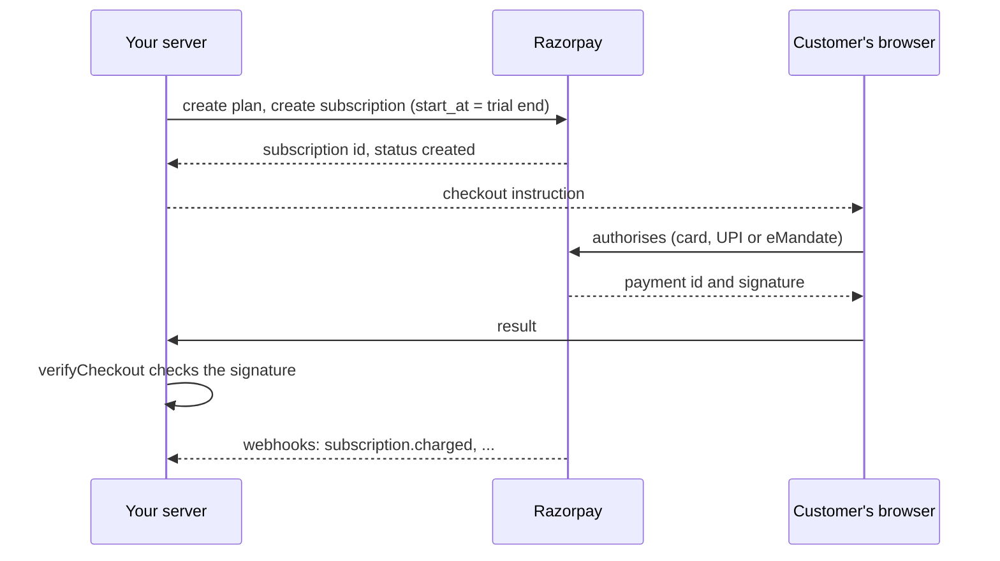

# Razorpay

Razorpay runs the whole billing cycle itself. You create a plan and a subscription, the customer authorises a mandate in Razorpay Checkout, and from then on Razorpay raises every debit on schedule, retries failures and tells you what happened through webhooks. You do not need the [billing scheduler](../guides/scheduler.md) for Razorpay.

## Configuration

```ts
import { razorpay } from 'india-subscriptions';

export const gateway = razorpay({
  keyId: process.env.RAZORPAY_KEY_ID!,
  keySecret: process.env.RAZORPAY_KEY_SECRET!,
  webhookSecret: process.env.RAZORPAY_WEBHOOK_SECRET,
});
```

| Option | Required | Meaning |
|---|---|---|
| `keyId` | yes | The API key id. It is also the `key` Checkout opens with, so it is sent to the browser. |
| `keySecret` | yes | The API key secret. Never sent anywhere except to Razorpay. |
| `webhookSecret` | for webhooks | The secret you set when adding the webhook in the Dashboard. Without it `parseWebhook` throws `CONFIG`. |
| `defaultDurationYears` | no | How long an open-ended subscription runs, 1 to 100. Default 10. See [open-ended subscriptions](#open-ended-subscriptions). |
| `baseUrl` | no | Replaces `https://api.razorpay.com` (a proxy or a mock server). |

Test and live mode use the same host. The mode follows the key pair you pass, so use the test-mode key pair from the Dashboard while you build. The subscriptions feature must be enabled on your account in each mode, and webhooks are configured separately in each. With `india-subscriptions serve` the same settings are the `RAZORPAY_*` [environment variables](../reference/generated/environment.md#razorpay).

## Capabilities

<!-- generated:begin capabilities razorpay -->
<!-- generated:end -->

Razorpay is **gateway-scheduled** only. `createCharge` and `notifyCharge` throw `UNSUPPORTED`: Razorpay raises the debits and sends the pre-debit notice itself.

## How a subscription works on Razorpay

You send a plan and a subscription. The customer opens Checkout with the subscription id and authorises. Razorpay then charges on the plan's schedule.



### Plans

`plans.create` creates a Razorpay plan. Razorpay plans are immutable: you cannot edit or delete one, and to change a price you move subscriptions to a new plan. `getPlan` fetches one. The plan's `id` option is only recorded, because Razorpay generates its own id.

If you pass a plan **inline** to `subs.create`, the adapter creates a new Razorpay plan for every subscription. That works, but it leaves one plan per customer in your account. Create the plan once with `subs.plans.create`, keep its id, and pass the id as `plan` afterwards.

Daily plans need an interval of 7 or more days (Razorpay's pages say both "7 or more" and "more than 7"; the adapter accepts 7 and lets Razorpay decide). A three-month interval is sent as `period: monthly, interval: 3`. The smallest plan amount is ₹1 (100 paise).

### Trials, delayed starts and upfront amounts

A trial on Razorpay is a **future start date**. `trial: { days: 14 }` or `trial: { endsAt }` becomes `start_at`, and the time between authorisation and `start_at` is the trial. The customer must authorise before `start_at`, otherwise the subscription becomes `expired`.

What the customer pays at authorisation depends on the start date and the upfront amount:

| Start | Upfront amount | Charged at authorisation |
|---|---|---|
| Immediate | none | The plan amount (not refunded) |
| Future (trial) | none | ₹5, refunded automatically |
| Immediate | yes | Upfront amount plus the plan amount |
| Future (trial) | yes | The upfront amount |

`upfrontAmount` is sent as an add-on to the subscription, labelled with `upfrontLabel` (default "Upfront amount"). An invoice's amount includes the add-on. While a subscription is in a trial, its status is `trialing` (Razorpay's `authenticated`).

### Open-ended subscriptions

Razorpay needs a `total_count`. If you omit `totalCycles`, the adapter uses the plan's `maxCycles`, then the whole cycles up to `mandateEndsAt`, and otherwise the number of cycles in `defaultDurationYears` (10 by default, the most conservative of three maximum durations Razorpay's pages state). If you pass both `totalCycles` and `mandateEndsAt`, they must describe the same number of whole cycles.

### Things the adapter does not send

Razorpay has no field for some inputs, so they are accepted and ignored. `capabilities` says so where it matters.

| Input | What happens |
|---|---|
| `idempotencyKey` | Ignored. Razorpay documents no idempotency for plans or subscriptions, so a create that gets no answer is `OUTCOME_UNKNOWN`. Do not retry it blindly. |
| `paymentMethods` | Ignored. The customer picks the method in Checkout; which methods appear is an account setting. |
| `customer` | Not sent. Razorpay collects details in Checkout; yours are used to prefill it. |
| `reference` | Kept in the subscription's `notes` and read back into `Subscription.reference`. The keys the adapter uses in `notes` start with `india_subscriptions_` and cannot be used in `metadata`. |

`authorizeBy` is sent as `expire_by`, and `notifyCustomer` as `customer_notify`. Razorpay allows 15 notes per object.

## Payment methods and limits

Razorpay Subscriptions supports cards, UPI Autopay and eMandate. The customer chooses in Checkout.

| | Cards | UPI Autopay | eMandate (eNACH) |
|---|---|---|---|
| Debits without the customer doing anything | Up to ₹15,000. Above that the customer must approve every debit with additional factor authentication (AFA). RuPay cards: no debit above ₹15,000. | Up to ₹15,000 | Mandate limit up to ₹1,00,00,000 |
| Higher limits | ₹1,00,000 for some business categories (mutual funds, insurance, credit-card bill payments) | Same categories | n/a |
| Failed charge | Retried at T+1, T+2, T+3, then `halted` | Same | Retried only after the bank confirms the last attempt |
| Change plan or quantity | Yes | **No** | **No** |
| Merchant pause and resume | Yes | Yes | Yes |
| Customer can pause or cancel | Through the card issuer's portal | From their UPI app | Only by contacting the bank |

Razorpay's own pages disagree on some of these limits (the settings page says charges above ₹15,000 "would automatically fail for domestic cards"; one FAQ gives ₹1,00,000 for UPI; the lists of business categories differ). Treat ₹15,000 as the safe per-debit ceiling for cards and UPI unless Razorpay confirms a higher limit for your account. [Recurring payments in India](../concepts/recurring-payments.md) explains the rules behind these numbers.

## Authorisation and checkout

`subscription.checkout` has `kind: CheckoutKind.RazorpayCheckout` with the key id, the subscription id, a hosted payment page (`hostedUrl`) and a prefill built from `customer`. Open it with [`openCheckout`](../guides/checkout.md). Checkout needs no amount: the subscription carries it.

`verifyCheckout` checks `hex(HMAC_SHA256(keySecret, payment_id + "|" + subscription_id))` against `razorpay_signature`. Always pass `expectedSubscriptionId`, the id your server stored when it created the subscription. Razorpay's own documentation says to sign with the stored id and not the one Checkout returns.

## Managing a subscription

| Operation | On Razorpay |
|---|---|
| `pause` | Pauses now. `resumeAt` is not supported. Refused with `CONFLICT` while the subscription is still in a trial (`authenticated`), because Razorpay would cancel it irreversibly. Only an `active` subscription can be paused. |
| `resume` | Resumes now. `nextChargeAt` is not supported. A subscription paused by the customer in their UPI app can only be resumed by them. |
| `update` | `planId`, `quantity`, `remainingCycles` and `nextChargeAt` (sent as `start_at`), with `timing`. `amount` and `mandateEndsAt` throw `UNSUPPORTED`: switch plan instead. UPI and eMandate subscriptions cannot be updated at all, and Razorpay's refusal surfaces as an error. Only `authenticated` and `active` subscriptions can be updated. |
| `cancel` | `mode: CancelMode.AtPeriodEnd` cancels at the end of the cycle. It is refused while no cycle is running (trial) and in the final cycle. Cancelling is irreversible. |
| `charges.list` | Reads the subscription's invoices (it pages through all of them unless you pass `limit`). A charge's `id` is its payment id, or the invoice id while there is no payment. |
| `charges.refund` | Refunds a payment through `POST /v1/payments/{id}/refund`. Razorpay does not enforce uniqueness of your `refundId`, so never retry after `OUTCOME_UNKNOWN` without checking the payment's refunds. |

Razorpay allows one operation per subscription at a time. A second one answers `CONFLICT`; wait a few seconds and try again. See [Managing subscriptions](../guides/managing-subscriptions.md) for the cross-gateway view.

## Statuses

<!-- generated:begin razorpay-subscription-status -->

| Razorpay status | Unified status |
|---|---|
| `created` | `created` |
| `authenticated` | `trialing` |
| `active` | `active` |
| `pending` | `past_due` |
| `halted` | `halted` |
| `paused` | `paused` |
| `cancelled` | `cancelled` |
| `completed` | `completed` |
| `expired` | `expired` |

<!-- generated:end -->

A status Razorpay adds in future maps to `created`, which is neither live nor terminal. The gateway's own value is always in `providerStatus`. `paused` is real but missing from Razorpay's documented status list; the adapter accepts it.

Charges are read from invoices and payments:

<!-- generated:begin razorpay-charge-status -->

| Razorpay invoice status | Unified charge status |
|---|---|
| `draft` | `scheduled` |
| `issued` | `pending` |
| `partially_paid` | `pending` |
| `paid` | `succeeded` |
| `cancelled` | `cancelled` |
| `deleted` | `cancelled` |
| `expired` | `failed` |

| Razorpay payment status | Unified charge status |
|---|---|
| `created` | `pending` |
| `authorized` | `pending` |
| `captured` | `succeeded` |
| `refunded` | `refunded` |
| `failed` | `failed` |

<!-- generated:end -->

An unknown charge status becomes `pending`, never `succeeded`. A payment that belongs to an invoice is a recurring charge; one without is the authorisation payment.

Refund statuses:

<!-- generated:begin razorpay-refund-status -->

| Razorpay refund status | Unified refund status |
|---|---|
| `pending` | `pending` |
| `processed` | `succeeded` |
| `failed` | `failed` |

<!-- generated:end -->

## Webhooks

In the Razorpay Dashboard, add a webhook that points at your server, choose the subscription events and set a secret. Razorpay signs the raw body with `HMAC_SHA256(webhookSecret, rawBody)` in `x-razorpay-signature`, and sends a unique `x-razorpay-event-id`, which becomes `event.id`. Your endpoint must answer 2xx within 5 seconds. Razorpay retries for 24 hours with exponential backoff and then disables the webhook, and delivery is at least once and not always in order. [Handling webhooks](../guides/webhooks.md) shows the route for each framework.

<!-- generated:begin razorpay-webhook-events -->

| Razorpay event | Unified event |
|---|---|
| `subscription.authenticated` | `subscription.authorized` |
| `subscription.activated` | `subscription.activated` |
| `subscription.charged` | `subscription.charged` |
| `subscription.completed` | `subscription.completed` |
| `subscription.updated` | `subscription.updated` |
| `subscription.pending` | `subscription.past_due` |
| `subscription.halted` | `subscription.halted` |
| `subscription.cancelled` | `subscription.cancelled` |
| `subscription.paused` | `subscription.paused` |
| `subscription.resumed` | `subscription.resumed` |

<!-- generated:end -->

`subscription.created` and `subscription.expired` events do not exist at Razorpay. Any other event is returned as `EventType.Unknown` with the payload in `raw`, including refund webhooks, which the subscription documentation does not describe. Subscription events carry the subscription and, when a payment attempt preceded the event, the charge.

## Failures and retries

When a debit fails, the subscription becomes `pending` (unified `past_due`) and Razorpay retries on the next day, up to three more times, then moves it to `halted` and stops charging. That is four attempts in total on cards and UPI. A `halted` subscription is not cancelled; it recovers when a charge succeeds (for example after the customer updates their card), and invoices created while it was halted must be charged manually. Your webhook route sees `subscription.pending` on each failed attempt and `subscription.halted` at the end.

## Testing in test mode

Razorpay's Dashboard has a **Charge this now** button that simulates a due charge as a success or a failure, so you can see `subscription.charged`, `subscription.pending` and `subscription.halted` without waiting. Four failures in a row halt the subscription. A test subscription can only be updated if no test charge beyond the authorisation has been made, and in test mode a subsequent debit must happen within 3 days of the card token's creation.
