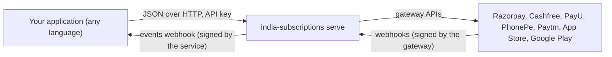

# Using it from any language

After this page you will be able to run the library as a small HTTP service, create a subscription with `curl`, do the same from Python, and receive the service's events in an application written in any language, with the signature checked.

The library is TypeScript. Applications in other languages run the **service**, a self-hosted process that holds your gateway keys and speaks a plain JSON API. The service is described by an OpenAPI 3.1 document, so you can generate a client for your language from it. A Python client with Pydantic models is included.



## 1. Run the service

The service is configured only through environment variables. It refuses to start without an API key, because it holds live gateway credentials, and it listens on `127.0.0.1` only. Everything is listed in [Environment variables](../reference/generated/environment.md).

```bash
INDIA_SUBSCRIPTIONS_API_KEY=change-this-to-a-long-random-value \
  RAZORPAY_KEY_ID=rzp_test_replace_me \
  RAZORPAY_KEY_SECRET=replace_me \
  RAZORPAY_WEBHOOK_SECRET=replace_me \
  npx india-subscriptions serve
```

A gateway or store is switched on by its variables. Leave its variables out entirely to switch it off. Setting some but not all of a gateway's required variables is an error, so a typo cannot silently disable a gateway. The startup report says which gateways are on, where it listens and whether the billing scheduler is running.

::: warning Network exposure
Run the service next to your application, never on the public internet. The only routes that should be reachable from outside are the gateway webhook routes, `POST /v1/{provider}/webhooks`, which are authenticated by the gateway's own signature. See [Running the HTTP service](../guides/http-service.md).
:::

Check that it is up. This route needs no API key:

```bash
curl http://127.0.0.1:8787/v1/health
```

## 2. Call it with curl

Every other route needs `Authorization: Bearer <your API key>`. Create a ₹499 a month subscription with a 14-day trial. Amounts are integer paise.

```bash
curl -X POST http://127.0.0.1:8787/v1/razorpay/subscriptions \
  -H "Authorization: Bearer $INDIA_SUBSCRIPTIONS_API_KEY" \
  -H "Content-Type: application/json" \
  -d '{"reference":"order_1042","plan":{"name":"Pro monthly","amount":49900,"interval":{"unit":"month","count":1}},"customer":{"name":"Asha Rao","email":"asha@example.com","phone":"9876543210"},"trial":{"days":14}}'
```

The answer is the subscription, with the instruction the customer's browser must follow. Store `id` against your customer:

```json
{
  "provider": "razorpay",
  "id": "sub_00000000000001",
  "reference": "order_1042",
  "status": "created",
  "providerStatus": "created",
  "scheduling": "gateway",
  "checkout": {
    "kind": "razorpay_checkout",
    "keyId": "rzp_test_replace_me",
    "subscriptionId": "sub_00000000000001"
  }
}
```

Send `checkout` to your front end. In a web page, hand it to [`openCheckout`](../guides/checkout.md). In a mobile app, branch on `checkout.kind`: open the gateway's own SDK or a web view. When the customer has authorised, send what the gateway returned **untouched**, together with the id you stored, to be verified:

```bash
curl -X POST http://127.0.0.1:8787/v1/razorpay/checkout/verify \
  -H "Authorization: Bearer $INDIA_SUBSCRIPTIONS_API_KEY" \
  -H "Content-Type: application/json" \
  -d '{"result":{"razorpay_payment_id":"pay_00000000000001","razorpay_subscription_id":"sub_00000000000001","razorpay_signature":"..."},"expectedSubscriptionId":"sub_00000000000001"}'
```

If `expectedSubscriptionId` does not match, or the signature is wrong, the answer is HTTP 401 with `SIGNATURE_INVALID`. Every error has the same body, `{"error": {"code", "message", "retryable", ...}}`, and you branch on `code`. See [Errors](../concepts/errors.md).

The full list of routes is in the [HTTP API reference](../reference/generated/http-api.md), and the OpenAPI document is served at `/v1/openapi.json`.

## 3. Call it from Python

The Python client is in `clients/python` of the repository. Its models are generated from the OpenAPI document, so enums are real enums (`Provider.RAZORPAY`, `SubscriptionStatus.TRIALING`) and errors are one type, `SubscriptionsApiError`, with a `code` you branch on.

```python
import os

from india_subscriptions import (
    ErrorCode,
    Provider,
    SubscriptionsApiError,
    SubscriptionsClient,
)
from india_subscriptions.models import IntervalUnit

with SubscriptionsClient("http://127.0.0.1:8787", api_key=os.environ["INDIA_SUBSCRIPTIONS_API_KEY"]) as client:
    subscription = client.subscriptions.create(
        Provider.RAZORPAY,
        {
            "reference": "order_1042",
            "plan": {"name": "Pro monthly", "amount": 49900, "interval": {"unit": IntervalUnit.MONTH, "count": 1}},
            "customer": {"name": "Asha Rao", "email": "asha@example.com", "phone": "9876543210"},
            "trial": {"days": 14},
        },
    )
    print(subscription.id, subscription.checkout)

    try:
        client.checkout.verify(
            Provider.RAZORPAY,
            {"razorpay_payment_id": "pay_1", "razorpay_subscription_id": subscription.id, "razorpay_signature": "..."},
            expected_subscription_id=subscription.id,
        )
    except SubscriptionsApiError as error:
        if error.code is ErrorCode.SIGNATURE_INVALID:
            print("do not trust this result")
        else:
            raise
```

A `OUTCOME_UNKNOWN` error means a request that moves money was sent and no answer came back. The client never retries a write; fetch the current state before deciding. The [Python client reference](../reference/python-client.md) lists every method.

## 4. Payments, routing and purchases

The same service takes one-time payments, chooses gateways and sells on phones. Each is a plain JSON route behind the same API key.

Ask the router which gateway it would use for a ₹499 one-time payment. Nothing is created at a gateway, and the answer lists every gateway with its score or the reasons it was excluded:

```bash
curl -X POST http://127.0.0.1:8787/v1/routing/decide \
  -H "Authorization: Bearer $INDIA_SUBSCRIPTIONS_API_KEY" \
  -H "Content-Type: application/json" \
  -d '{"kind":"one_time","amount":49900}'
```

To sell one catalog on iPhone, Android and the web, set `PURCHASES_FILE` (the catalog, the platform policy and the routing strategy), `PURCHASE_STORE_FILE` and `PUBLIC_BASE_URL`. Then start a purchase. The platform decides where it may go, and the answer is a session with the ways to pay:

```bash
curl -X POST http://127.0.0.1:8787/v1/purchases \
  -H "Authorization: Bearer $INDIA_SUBSCRIPTIONS_API_KEY" \
  -H "Content-Type: application/json" \
  -d '{"platform":"web","product":"ebook","customer":{"name":"Asha Rao","email":"asha@example.com","phone":"9876543210"},"customerRef":"user_42","returnUrl":"https://shop.example.com/thanks"}'
```

Ask what the customer owns, across stores and gateways:

```bash
curl http://127.0.0.1:8787/v1/entitlements/user_42 -H "Authorization: Bearer $INDIA_SUBSCRIPTIONS_API_KEY"
```

The other routes are `POST /v1/{provider}/payments`, `GET /v1/{provider}/payments/{paymentId}`, `POST /v1/{provider}/payments/verify` and `POST /v1/{provider}/payment-refunds` for one-time payments, and `GET /v1/purchases/{sessionId}`, `POST /v1/purchases/{sessionId}/alternative` and `POST /v1/purchases/{sessionId}/complete` for sessions. All are in the [HTTP API reference](../reference/generated/http-api.md). The Python client's models include these shapes; its [reference page](../reference/python-client.md) lists which calls have a method.

A mobile app must never call these routes with the service's API key. It calls your backend, which forwards them: [Mobile apps](../guides/mobile-apps.md). See [One-time payments](../guides/one-time-payments.md), [Routing](../guides/routing.md) and [Selling on iPhone, Android and the web](../guides/purchases.md).

## 5. Webhooks and events

There are two different streams, and it helps to keep them apart.

| Stream | From | To | Signed by |
|---|---|---|---|
| Gateway webhooks | Any configured gateway | The service (`POST /v1/{provider}/webhooks`) | The gateway |
| Events webhook | The service | Your application (`EVENTS_WEBHOOK_URL`) | The service, with `EVENTS_WEBHOOK_SECRET` |

Register `https://<your-service>/v1/razorpay/webhooks` at the gateway. App Store Server Notifications and Google's Pub/Sub push go to `/v1/app_store/webhooks` and `/v1/google_play/webhooks` in the same way. The service verifies the gateway's signature, applies the event to the billing scheduler and to purchase sessions (so entitlements follow), and, if you set `EVENTS_WEBHOOK_URL` and `EVENTS_WEBHOOK_SECRET`, **posts the normalised events to your application** as JSON. Your application only has to check one signature scheme whichever gateway sent the event.

If you would rather receive the gateway's webhook in your own application, forward the exact raw body and headers to `POST /v1/{provider}/webhooks/parse` (the Python client wraps this as `parse_webhook`). The service verifies the signature, **applies each event to the billing scheduler and to purchase sessions** (so a mandate that was authorised, paused or cancelled at the gateway is reflected in billing, and entitlements follow), and returns the normalised events. Forwarding the same webhook twice is safe, and a bad signature answers 401 and changes nothing.

### What the service posts

```json
{
  "kind": "gateway",
  "provider": "razorpay",
  "events": [
    {
      "id": "evt_00000000000001",
      "provider": "razorpay",
      "type": "subscription.charged",
      "providerEventType": "subscription.charged",
      "subscriptionId": "sub_00000000000001"
    }
  ]
}
```

The other kind, `"kind": "scheduler"`, carries the billing scheduler's events, for gateways whose debits the scheduler raises. Every event has an `id`. Delivery is **at least once**: de-duplicate on `id`.

| Kind | Delivered | If your endpoint fails |
|---|---|---|
| `gateway` | Before the gateway is answered | The gateway's webhook gets a 500 and the gateway retries |
| `scheduler` | In the background, in order | Retried with backoff 5 times, then logged and dropped. The queue is in memory. |

Treat scheduler events as a prompt and read the subscription with `GET` when it matters.

### Verifying the signature

Each delivery carries two headers:

```text
x-india-subscriptions-timestamp: 1767225600
x-india-subscriptions-signature: <lower-case hex>
```

The signature is `HMAC-SHA256`, keyed with `EVENTS_WEBHOOK_SECRET` (UTF-8 bytes), over the string `<timestamp>.<raw request body>`: the timestamp exactly as it appears in the header, one full stop, then the body bytes exactly as received, before any JSON parsing. Your receiver must:

1. reject a timestamp that is missing or not a whole number of seconds;
2. recompute the signature and compare it **in constant time**;
3. reject a timestamp more than 300 seconds from its own clock, past or future;
4. answer 2xx only once the events are safely stored. Anything else, or no answer within 10 seconds, is a failed delivery.

In Python, with nothing but the standard library:

```python run="events-signature-python"
import hashlib
import hmac
import time

TOLERANCE_SECONDS = 300


def verify_events_signature(secret, raw_body, headers, now=None):
    """Raise ValueError unless the delivery is genuine and recent.

    raw_body is the exact bytes received; headers has lower-case names (Flask and Starlette headers work too).
    """
    timestamp = headers.get("x-india-subscriptions-timestamp", "").strip()
    signature = headers.get("x-india-subscriptions-signature", "").strip().lower()
    if not (timestamp.isascii() and timestamp.isdigit()):
        raise ValueError("missing or malformed timestamp")
    signed = timestamp.encode() + b"." + raw_body
    expected = hmac.new(secret.encode(), signed, hashlib.sha256).hexdigest()
    if not hmac.compare_digest(expected, signature):
        raise ValueError("bad signature")
    current = time.time() if now is None else now
    if abs(current - int(timestamp)) > TOLERANCE_SECONDS:
        raise ValueError("timestamp outside the tolerance")
```

In Go:

```go run="events-signature-go"
package main

import (
	"crypto/hmac"
	"crypto/sha256"
	"encoding/hex"
	"errors"
	"strconv"
	"strings"
	"time"
)

// VerifyEventsSignature checks one delivery of the events webhook. body is the exact bytes received.
func VerifyEventsSignature(secret string, body []byte, timestamp, signature string, now time.Time) error {
	timestamp = strings.TrimSpace(timestamp)
	if timestamp == "" || strings.Trim(timestamp, "0123456789") != "" {
		return errors.New("missing or malformed timestamp")
	}
	seconds, err := strconv.ParseInt(timestamp, 10, 64)
	if err != nil {
		return errors.New("malformed timestamp")
	}
	mac := hmac.New(sha256.New, []byte(secret))
	mac.Write([]byte(timestamp + "."))
	mac.Write(body)
	expected := hex.EncodeToString(mac.Sum(nil))
	if !hmac.Equal([]byte(expected), []byte(strings.ToLower(strings.TrimSpace(signature)))) {
		return errors.New("bad signature")
	}
	age := now.Unix() - seconds
	if age > 300 || -age > 300 {
		return errors.New("timestamp outside the tolerance")
	}
	return nil
}
```

In TypeScript the same check is `verifyEventsSignature(secret, rawBody, headers)`, exported from `india-subscriptions`; it throws `SIGNATURE_INVALID`.

```ts
import { EventsDeliverySchema, verifyEventsSignature } from 'india-subscriptions';

export function receiveEvents(rawBody: string, headers: Record<string, string | string[] | undefined>) {
  verifyEventsSignature(process.env.EVENTS_WEBHOOK_SECRET!, rawBody, headers);
  return EventsDeliverySchema.parse(JSON.parse(rawBody));
}
```

## Next

- [Handling webhooks](../guides/webhooks.md): what to do on each event.
- [Running the HTTP service](../guides/http-service.md): a Dockerfile, a compose file and the exposure rules.
- [HTTP API reference](../reference/generated/http-api.md) and the [Python client reference](../reference/python-client.md).
