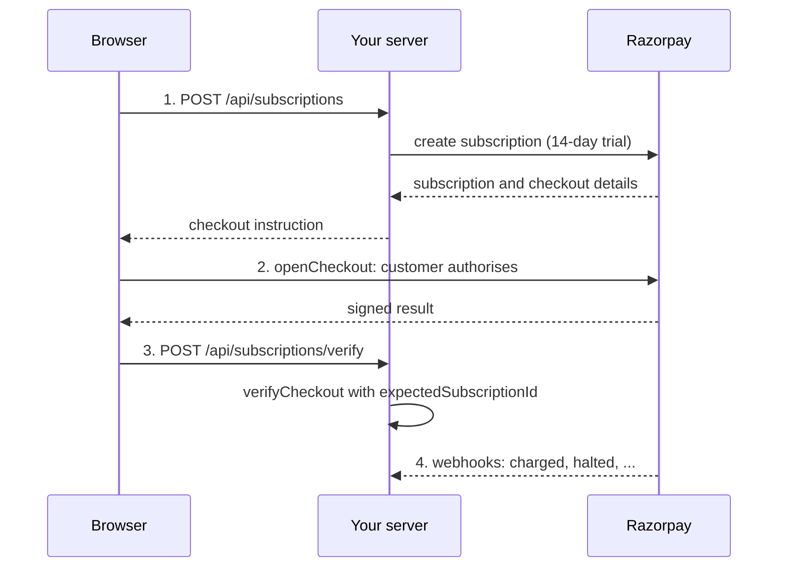

# Your first subscription

After this page you will have a working flow: a server route that creates a ₹499 a month subscription with a 14-day free trial, a browser page that opens the gateway's checkout, a route that verifies the result, and a webhook route that keeps your records in step. It is shown for Express and for a Next.js route handler. It uses Razorpay because Razorpay raises every debit itself, so there is nothing else to run. Everything here runs in the gateway's **test mode**.

Some words you will meet:

- **Mandate.** The customer's standing permission for you to debit their account or card on a schedule, up to a ceiling. Creating a subscription creates a mandate the customer must authorise once.
- **Paise.** One hundredth of a rupee. Every amount in this library is an integer in paise: ₹499 is `49900`.
- **Trial.** The mandate is authorised now and the first real charge happens when the trial ends.

[How recurring payments work in India](../concepts/recurring-payments.md) explains the rest (UPI Autopay, eNACH, card standing instructions, the pre-debit notice).

## The flow



Four rules keep it safe:

1. Your server creates the subscription and stores its id. The browser never decides what is charged.
2. The browser only opens the checkout and passes the result back.
3. Your server verifies the result against the id **it stored**, not against anything in the request.
4. Webhooks are verified against the **raw** request body.

## 1. Set up the client

Create the plan once. A Razorpay plan cannot be edited or deleted, so do not create one per customer. This script prints the plan id; put it in `RAZORPAY_PLAN_ID`.

```ts title="create-plan.ts"
import { IntervalUnit, Provider } from 'india-subscriptions';
import { subs } from './billing';

const plan = await subs.plans.create(Provider.Razorpay, {
  name: 'Pro monthly',
  amount: 49900, // paise: ₹499
  interval: { unit: IntervalUnit.Month, count: 1 },
});
console.log(plan.id);
```

The client is created once and shared:

```ts title="billing.ts"
import { createSubscriptions, razorpay } from 'india-subscriptions';

export const subs = createSubscriptions({
  providers: [
    razorpay({
      keyId: process.env.RAZORPAY_KEY_ID!,
      keySecret: process.env.RAZORPAY_KEY_SECRET!,
      webhookSecret: process.env.RAZORPAY_WEBHOOK_SECRET,
    }),
  ],
});
```

The next file stands in for your database and your session lookup. Replace it with real storage.

```ts title="app-stubs.ts"
import type { Customer } from 'india-subscriptions';

export interface User {
  id: string;
  customer: Customer;
}

const users = new Map<string, User>([
  ['u_1', { id: 'u_1', customer: { name: 'Asha Rao', email: 'asha@example.com', phone: '9876543210' } }],
]);
const subscriptionIds = new Map<string, string>();
const processedEvents = new Set<string>();

/** Identify the customer from your own session. Never trust an id that comes from the request body. */
export function findUser(id: string | null | undefined): User | undefined {
  return id ? users.get(id) : undefined;
}

export function saveSubscriptionId(userId: string, subscriptionId: string): void {
  subscriptionIds.set(userId, subscriptionId);
}

export function storedSubscriptionId(userId: string): string | undefined {
  return subscriptionIds.get(userId);
}

export function userForSubscription(subscriptionId: string): string | undefined {
  return [...subscriptionIds].find(([, stored]) => stored === subscriptionId)?.[0];
}

export function grantAccess(userId: string): void {
  console.log(`access on for ${userId}`);
}

export function suspendAccess(userId: string): void {
  console.log(`access off for ${userId}`);
}

export function alreadyProcessed(eventId: string): boolean {
  return processedEvents.has(eventId);
}

export function markProcessed(eventId: string): void {
  processedEvents.add(eventId);
}
```

## 2. Create the subscription

`subs.create` returns the subscription with a `checkout` instruction. Store `subscription.id` against the customer and send `checkout` to the browser. The customer's details come from your own records, never from the request.

`trial: { days: 14 }` makes the first charge happen 14 days from now. Until then the status is `trialing`. Razorpay takes a ₹5 token amount at authorisation and refunds it automatically. [Trials, delayed starts and upfront amounts](../concepts/trials.md) has the details for each gateway.

## 3. The webhook handler

Webhooks tell you what happened after the customer left: a charge succeeded, a card failed, the retries ran out. This function is shared by both server variants. It de-duplicates on `event.id`, because gateways deliver the same event more than once.

```ts title="webhook-events.ts"
import { EventType, type SubscriptionEvent } from 'india-subscriptions';
import { alreadyProcessed, grantAccess, markProcessed, suspendAccess, userForSubscription } from './app-stubs';

export async function applyEvent(event: SubscriptionEvent): Promise<void> {
  if (alreadyProcessed(event.id)) return;

  const userId = event.subscriptionId ? userForSubscription(event.subscriptionId) : undefined;
  if (userId) {
    switch (event.type) {
      case EventType.SubscriptionCharged:
        grantAccess(userId); // a payment arrived: extend access
        break;
      case EventType.SubscriptionHalted:
      case EventType.SubscriptionCancelled:
      case EventType.SubscriptionCompleted:
        suspendAccess(userId);
        break;
      default:
        break; // authorised, activated, pending, paused, ...: see "Handling webhooks"
    }
  }
  markProcessed(event.id);
}
```

[Handling webhooks](../guides/webhooks.md) lists what to do on every event type.

## 4a. Express

The webhook route must see the **raw** body, so it is registered before `express.json()` and with `express.raw`. If JSON parsing runs first, the body is re-serialised and the signature no longer matches.

```ts title="server.ts"
import express from 'express';
import { ErrorCode, Provider, isSubscriptionError } from 'india-subscriptions';
import { applyEvent } from './webhook-events';
import { subs } from './billing';
import { findUser, saveSubscriptionId, storedSubscriptionId } from './app-stubs';

const app = express();

// 1. Webhooks: raw body, before any JSON parsing.
app.post('/webhooks/razorpay', express.raw({ type: '*/*' }), async (req, res) => {
  try {
    const events = await subs.webhooks.handle(Provider.Razorpay, {
      rawBody: req.body.toString('utf8'),
      headers: req.headers,
    });
    for (const event of events) await applyEvent(event);
    res.sendStatus(200);
  } catch (error) {
    if (isSubscriptionError(error) && error.code === ErrorCode.SignatureInvalid) {
      res.sendStatus(401);
      return;
    }
    res.sendStatus(500); // the gateway retries a non-2xx answer
  }
});

app.use(express.json());

// 2. Create the subscription.
app.post('/api/subscriptions', async (req, res) => {
  const user = findUser(req.headers['x-user-id'] as string | undefined); // your session lookup
  if (!user) {
    res.sendStatus(401);
    return;
  }
  const subscription = await subs.create(Provider.Razorpay, {
    reference: `user_${user.id}_pro`,
    plan: process.env.RAZORPAY_PLAN_ID!,
    customer: user.customer,
    trial: { days: 14 },
  });
  saveSubscriptionId(user.id, subscription.id);
  res.status(201).json({ checkout: subscription.checkout });
});

// 3. Verify what the browser brings back.
app.post('/api/subscriptions/verify', async (req, res) => {
  const user = findUser(req.headers['x-user-id'] as string | undefined);
  const expected = user ? storedSubscriptionId(user.id) : undefined;
  if (!user || !expected) {
    res.sendStatus(401);
    return;
  }
  try {
    const verification = await subs.verifyCheckout(Provider.Razorpay, req.body, {
      expectedSubscriptionId: expected,
    });
    res.json({ authorized: verification.authorized });
  } catch (error) {
    if (isSubscriptionError(error) && error.code === ErrorCode.SignatureInvalid) {
      res.sendStatus(400);
      return;
    }
    throw error;
  }
});

app.listen(3000);
```

## 4b. Next.js (route handlers)

Next.js route handlers receive a standard `Request`. `await request.text()` gives the raw body, so no special configuration is needed. They are shown with the paths they live at.

```ts title="app/api/subscriptions/route.ts"
import { Provider } from 'india-subscriptions';
import { findUser, saveSubscriptionId } from '@/app-stubs';
import { subs } from '@/billing';

export async function POST(request: Request): Promise<Response> {
  const user = findUser(request.headers.get('x-user-id')); // your session lookup
  if (!user) return new Response(null, { status: 401 });

  const subscription = await subs.create(Provider.Razorpay, {
    reference: `user_${user.id}_pro`,
    plan: process.env.RAZORPAY_PLAN_ID!,
    customer: user.customer,
    trial: { days: 14 },
  });
  saveSubscriptionId(user.id, subscription.id);
  return Response.json({ checkout: subscription.checkout }, { status: 201 });
}
```

```ts title="app/api/subscriptions/verify/route.ts"
import { ErrorCode, Provider, isSubscriptionError } from 'india-subscriptions';
import { findUser, storedSubscriptionId } from '@/app-stubs';
import { subs } from '@/billing';

export async function POST(request: Request): Promise<Response> {
  const user = findUser(request.headers.get('x-user-id'));
  const expected = user ? storedSubscriptionId(user.id) : undefined;
  if (!user || !expected) return new Response(null, { status: 401 });

  try {
    const verification = await subs.verifyCheckout(Provider.Razorpay, await request.json(), {
      expectedSubscriptionId: expected,
    });
    return Response.json({ authorized: verification.authorized });
  } catch (error) {
    if (isSubscriptionError(error) && error.code === ErrorCode.SignatureInvalid) {
      return new Response(null, { status: 400 });
    }
    throw error;
  }
}
```

```ts title="app/api/webhooks/razorpay/route.ts"
import { ErrorCode, Provider, isSubscriptionError } from 'india-subscriptions';
import { applyEvent } from '@/webhook-events';
import { subs } from '@/billing';

export async function POST(request: Request): Promise<Response> {
  const rawBody = await request.text(); // the exact bytes: do not call request.json() first
  try {
    const events = await subs.webhooks.handle(Provider.Razorpay, {
      rawBody,
      headers: Object.fromEntries(request.headers),
    });
    for (const event of events) await applyEvent(event);
    return new Response(null, { status: 200 });
  } catch (error) {
    if (isSubscriptionError(error) && error.code === ErrorCode.SignatureInvalid) {
      return new Response(null, { status: 401 });
    }
    return new Response(null, { status: 500 }); // the gateway retries a non-2xx answer
  }
}
```

## 5. The browser

The browser asks your server for the checkout instruction, opens it and posts the result back. `openCheckout` handles all four kinds of instruction (a redirect, an auto-submitted form, Razorpay Checkout and Cashfree.js), so this code does not change if you add a gateway.

```ts title="public/subscribe.ts"
import { CheckoutStatus, openCheckout, type CheckoutInstruction } from 'india-subscriptions/checkout';

export async function subscribe(): Promise<string> {
  const created = await fetch('/api/subscriptions', { method: 'POST' });
  const { checkout } = (await created.json()) as { checkout: CheckoutInstruction };

  const outcome = await openCheckout(checkout, { name: 'Acme', description: 'Pro monthly, 14-day trial' });
  if (outcome.status !== CheckoutStatus.Completed) return outcome.status;

  // Pass the gateway's result back untouched.
  const verified = await fetch('/api/subscriptions/verify', {
    method: 'POST',
    headers: { 'content-type': 'application/json' },
    body: JSON.stringify(outcome.result),
  });
  return verified.ok ? CheckoutStatus.Completed : CheckoutStatus.Failed;
}
```

If the outcome is `redirecting` (PayU, Cashfree, or Razorpay with a `callbackUrl`), the browser leaves the page and the result reaches your server through the gateway's return URL instead. [Checkout in the browser](../guides/checkout.md) covers all four kinds.

## 6. Register the webhook and try it

1. In the Razorpay Dashboard (test mode), add a webhook that points at `https://your-host/webhooks/razorpay`, select the subscription events and set the secret you put in `RAZORPAY_WEBHOOK_SECRET`. Razorpay needs a public URL: use a tunnel while developing.
2. Run the page. Complete the checkout with a Razorpay test card.
3. In the Dashboard, open the subscription and use **Charge this now** to simulate the first charge, then a failed charge. You should see `subscription.charged`, then `subscription.pending`, in your webhook route.

## What you have not done yet

- You have not handled every event. See [Handling webhooks](../guides/webhooks.md).
- You have not run a security review. See the [security checklist](../guides/security.md).
- When you are ready for real money, follow the [going-live checklist](../guides/going-live.md).
