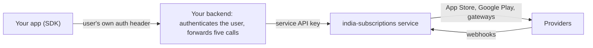

# Mobile apps

After this page you will know how an iPhone or Android app takes part in a purchase: what the app does, what your backend does, which five calls connect them, and which of the four SDKs (iOS, Android, React Native, Flutter) drives the device side. Each SDK has a short section here, and a comparison table shows which call exists where.

## The rule: the app never holds the service's API key

The service's API key can start purchases for any customer and read any customer's entitlements. Anything inside an app can be extracted, so the key never goes there. The app talks to **your own backend**, which knows who the signed-in user is. Your backend forwards five calls to the service (or calls `subs.purchases` in-process if you use the library).



Your backend must:

- authenticate the user and decide which `customerRef` they may buy for. Never trust the one in the request body;
- check that a session id, or a `customerRef` in a path, belongs to that user before forwarding;
- forward the calls with the service's API key and return the service's JSON and status code unchanged. The SDKs read the error `code` of the service's error body to decide whether to retry;
- receive the providers' webhooks (App Store Server Notifications, Google's Pub/Sub push, the gateways') at the service's webhook routes, so renewals, cancellations and refunds reach the entitlements. The device does not report renewals.

All four SDKs follow this rule. They hold no API key, they send the signed-in user's own authorisation header to your backend, and they never acknowledge, consume or finish a purchase before your backend has confirmed it.

## The five calls

| Call | Path | Body | Answer |
|---|---|---|---|
| start | `POST /v1/purchases` | `platform`, `product`, `customer`, `customerRef`, `reference?`, `returnUrl?` | `PurchaseSession` |
| get | `GET /v1/purchases/{sessionId}` | | `PurchaseSession` |
| alternative | `POST /v1/purchases/{sessionId}/alternative` | `{ "externalTransactionToken" }` | `PurchaseSession` |
| complete | `POST /v1/purchases/{sessionId}/complete` | `{ "provider", "result" }` | `PurchaseSession` |
| entitlements | `GET /v1/entitlements/{customerRef}` | | `Entitlements` |

The shapes are in [Models](../reference/generated/models.md#purchasesession). The relative paths are the defaults of the SDKs, and each is configurable, so your backend can mount them wherever it likes. A backend that forwards them is shown [below](#a-backend-that-forwards-the-five-calls).

## Four ways to build the app side

| Your app is | Use | Platforms |
|---|---|---|
| Native iPhone (Swift) | [The iOS SDK](#ios-sdk) | iOS 15 or later |
| Native Android (Kotlin) | [The Android SDK](#android-sdk) | `minSdk` 23 |
| React Native | [The React Native library](#react-native) | iOS and Android, one TypeScript API |
| Flutter | [The Flutter plugin](#flutter) | iOS and Android, one Dart API |

React Native and Flutter are thin bridges over the two native SDKs. They contain no purchase logic: every flow, retry and persistence rule lives in the iOS and Android SDKs, and the bridges translate calls, results and events. An app that cannot use any of them follows [the sequence without an SDK](#without-an-sdk).

What happens on each platform is the same whichever SDK you use:

- **iPhone.** The customer pays with Apple in-app purchase (StoreKit 2). Digital goods and subscriptions sold in an iOS app go through the App Store, and an iOS app must not steer customers to other ways to pay (App Review Guideline 3.1.1(a)).
- **Android.** The session's policy decides. With `store`, the customer pays through Google Play. With `user_choice`, Google shows its own choice screen: if the customer picks Google Play the purchase is an ordinary Play purchase, and if the customer picks the alternative the SDK hands Google's external transaction token to your backend and opens the gateway's hosted checkout page in a Custom Tab. With `gateways` (apps distributed outside Google Play, and physical goods) the SDK goes straight to the hosted page. When the hosted checkout is done, the customer comes back to the app through its **return link**, and the SDK reads the outcome from your backend. See [Selling on iPhone, Android and the web](./purchases.md) for the policies.

## Which call exists where

| | iOS SDK | Android SDK | React Native | Flutter |
|---|---|---|---|---|
| Purchase a product key | `purchase(product:customerRef:customer:reference:returnUrl:)` | `purchase(activity, product, customerRef, customer, reference, returnUrl)` | `purchase(productKey, options)`, both platforms | `purchase(productKey, ...)`, both platforms |
| Events outside a purchase call | `events` (`AsyncStream`) | `events` (`SharedFlow`) | `addPurchaseListener(listener)` | `events` (`Stream`) |
| Start listeners and send what is waiting | `start()` | `start()` | `start()` | `configure(...)` starts them unless `start: false` |
| Entitlements, read from your backend | `entitlements(customerRef:)` | `entitlements(customerRef)` | `entitlements(customerRef)` | `entitlements(customerRef)` |
| Restore | `restorePurchases(customerRef:)`, calls `AppStore.sync()` | `restorePurchases(customerRef)`, re-reads Google Play's purchases | `restorePurchases(customerRef)`, both platforms | `restorePurchases(customerRef)`, both platforms |
| Send waiting purchases again | `processUnfinishedTransactions()` | `processPendingPurchases()` | `processPendingPurchases()` | `processPendingPurchases()` |
| Manage subscriptions | `AppStoreSheets.showManageSubscriptions(in:)` | `PlaySubscriptions.managementIntent(...)` and `managementUrl(...)` | `showManageSubscriptions()` on iOS, `getSubscriptionManagementUrl(productId?)` on Android | `showManageSubscriptions()` on iOS, `openSubscriptionManagement(productId:)` and `subscriptionManagementUrl(productId:)` on Android |
| Refund request | `AppStoreSheets.requestRefund(forTransaction:in:)` | not available | `requestRefund(transactionId)`, iOS only | `requestRefund(transactionId)`, iOS only |
| Return link handling | not applicable | `handleReturnLink(intent)` and `handleReturnLink(link)` | `handleReturnLink(url)`, Android only | `handleReturnLink(link)` and `returnLinkResults`, Android only |
| Update the authorisation header | the `authorization` closure of `HTTPPurchaseBackend` runs for every request | the `authorization` lambda of `HttpPurchaseBackend` runs for every request | `setAuthorization(value \| null)` | `setAuthorization(value)` |

A call that belongs to the other platform rejects with `NOT_APPLICABLE` in React Native and throws `UnsupportedOnPlatformException` in Flutter. The App Store cannot be asked by the server to cancel or refund, so the two Apple sheets are how a customer does either. Google Play subscriptions are cancelled on Google Play's own page, which the Android helpers open.

## iOS SDK

A Swift package, [`sdks/ios`](../../sdks/ios/README.md), that buys an App Store product with StoreKit 2, hands the signed transaction to your backend, and finishes the transaction once your backend has confirmed it. It has no user interface and no third-party dependencies. It needs iOS 15 or later.

**Install.** The repository root has a `Package.swift` that exposes the `IndiaSubscriptions` library, so an app depends on the repository by its URL; the package name is the repository's name:

```swift
.package(url: "https://example.com/path/to/india-subscriptions.git", from: "0.1.0"),   // this repository's URL
.target(name: "MyApp", dependencies: [.product(name: "IndiaSubscriptions", package: "india-subscriptions")]),
```

**Use.**

```swift
let backend = HTTPPurchaseBackend(
    baseURL: URL(string: "https://api.example.com/billing/")!,
    authorization: { await Auth.shared.freshBearerToken().map { "Bearer \($0)" } }   // the user's own token
)
let purchases = PurchaseClient(backend: backend)
Task { await purchases.start() }   // listener on Transaction.updates, and a pass over unfinished transactions

let outcome = try await purchases.purchase(
    product: "pro_monthly",                     // your product key
    customerRef: Auth.shared.customerRef,
    customer: Customer(name: "Asha", email: "asha@example.com", state: "Karnataka")
)
switch outcome {
case .completed:       break   // the backend confirmed it
case .pending:         break   // Ask to Buy: completed later through the listener
case .cancelled:       break
case .unverified:      break   // StoreKit could not verify the transaction; nothing was sent
case .awaitingBackend: break   // paid; sent again automatically
case .rejected:        break   // the backend refused it for good
}
```

**What happens.** `purchase` starts a session for the product key with platform `ios`, saves the account token and session id in a small persisted record, and calls `Product.purchase(options:)` with `.appAccountToken(token)` and, when the option carries one, the promotional offer. A transaction is finished only after your backend confirmed it. One that arrives later (an Ask to Buy approved days later, a purchase interrupted by the app being killed, a backend that was down) is matched to its session by the account token and completed through the listener on `Transaction.updates` and the pass over unfinished transactions. Failures are sorted into those worth retrying without limit (no network, 429, 503, an expired user token), those retried a limited number of times, and those that will not change (`VALIDATION`, `SIGNATURE_INVALID`, `NOT_FOUND`, `CONFLICT`, `UNSUPPORTED`, `NO_ROUTE`). `restorePurchases(customerRef:)` calls `AppStore.sync()`, which prompts the customer to sign in, so call it from a button, and returns what your backend says the customer owns. Read what the customer owns from your backend, never from StoreKit alone.

**Apple rules.** Digital goods and subscriptions go through the App Store: there is no external-link or alternative-payment entitlement for the Indian storefront, so the iOS app must not show buttons, links, prices or text that steer people to the web or a gateway (App Review Guideline 3.1.1(a)). A customer can still use on iPhone what they bought elsewhere, because entitlements span stores and gateways. The server can neither cancel nor refund an App Store purchase: `AppStoreSheets` shows Apple's manage-subscriptions and refund-request sheets.

**You set up** the **In-App Purchase** capability on the app target, and in App Store Connect the app record, the Paid Applications Agreement, the products and the notification URLs: [Setting up the App Store](./setting-up-app-store.md). The package README is the reference: [sdks/ios/README.md](../../sdks/ios/README.md).

## Android SDK

A Kotlin library, [`sdks/android`](../../sdks/android/README.md), that buys a Google Play product with Play Billing Library 9 and hands the purchase to your backend. When the customer chooses the alternative on Google's user choice billing screen, it sends Google's external transaction token to your backend, opens the gateway's hosted checkout page in a Custom Tab, and reads the outcome back when the app is opened through its return link. It never acknowledges or consumes a purchase: the service does that when it verifies the purchase. It depends only on Google's billing library, `androidx.browser` and `kotlinx-coroutines-android`, and needs `minSdk` 23.

**Install.** The Maven coordinates are `dev.indiasubscriptions:android:0.1.0`:

```kotlin
dependencies {
    implementation("dev.indiasubscriptions:android:0.1.0")
}
```

The README also shows how to use the module from this repository by path.

**Use.**

```kotlin
val backend = HttpPurchaseBackend(
    baseUrl = "https://api.example.com/billing/",
    authorization = { Auth.freshBearerToken()?.let { "Bearer $it" } },   // the user's own token
)
val purchases = PurchaseClient.create(applicationContext, backend)
purchases.start()   // connects to Google Play, listens for purchases, sends what is waiting

// In an activity, from a coroutine:
val outcome = purchases.purchase(
    activity = this,
    product = "pro_monthly",                          // your product key
    customerRef = Auth.customerRef,
    customer = Customer(name = "Asha", email = "asha@example.com", state = "Karnataka"),
    returnUrl = "myapp://billing/return",             // the return link declared in the manifest
)
when (outcome) {
    is PurchaseOutcome.Completed -> Unit        // the backend confirmed it
    is PurchaseOutcome.Pending -> Unit          // a payment that settles later
    is PurchaseOutcome.Cancelled -> Unit
    is PurchaseOutcome.AwaitingBackend -> Unit  // paid; sent again automatically
    is PurchaseOutcome.Rejected -> Unit         // the backend refused it for good
    is PurchaseOutcome.AwaitingReturn -> Unit   // the hosted checkout is open; the return link finishes it
    is PurchaseOutcome.Failed -> Unit           // nothing was charged
}
```

**What happens.** `purchase` starts a session with platform `android` and follows its options. For a Google Play option (policy `store` or `user_choice`) it builds the billing client, with user choice billing enabled when the instruction says so, picks the offer from `basePlanId` and `offerId`, records the account id and session id, and launches Google's purchase screen with the obfuscated account id. When the purchase is `PURCHASED` it sends `{ purchaseToken, productId }` to the complete call; a `PENDING` purchase stays open and completes later as an event. If the customer chose the alternative, the SDK sends the token to the alternative call and opens the gateway option's `hostedUrl`. For a session whose only option is a gateway (policy `gateways`) it opens the hosted page directly. Purchases that arrive later or were interrupted by process death are matched through a small persisted map from account id to session id when the client starts and on `processPendingPurchases()`, which you call from `onResume`. A permanent refusal is not retried for ever; an unreachable backend is, until the backend confirms or Google refunds the purchase after three days.

**The return link.** Pass a link such as `myapp://billing/return` as `returnUrl`. Declare it on the activity that handles it, use `launchMode="singleTop"`, and pass the intent to `handleReturnLink` from `onCreate` and `onNewIntent`:

```xml
<activity android:name=".MainActivity" android:exported="true" android:launchMode="singleTop">
    <intent-filter>
        <action android:name="android.intent.action.VIEW" />
        <category android:name="android.intent.category.DEFAULT" />
        <category android:name="android.intent.category.BROWSABLE" />
        <data android:scheme="myapp" android:host="billing" android:path="/return" />
    </intent-filter>
</activity>
```

The link is not trusted. `handleReturnLink` reads the session from your backend and reports what the backend says (`Completed`, `NotPaid`, `StillPending`, `BackendFailed`); the link's own `status` is never read, and a link that is not for a checkout the app has pending gives `Ignored`. A custom scheme is not tied to your app by Android; an Android App Link (`https` with `android:autoVerify="true"` and an `assetlinks.json` on your domain) is verified for your domain.

**You set up** the products, base plans and offers in Play Console, the service account and real-time developer notifications, and for user choice billing the enrolment, the payment-method logos and the subscription-management link Google's choice screen needs: [Setting up Google Play](./setting-up-google-play.md). In the app, declare the return link and keep the SDK's purchase-record file out of backups; the README has the two backup rule files. Your backend collects `customer.state` at start and sets `taxRateBps` on the product for user choice billing, and serves the hosted checkout (`PUBLIC_BASE_URL`). The README is the reference: [sdks/android/README.md](../../sdks/android/README.md).

## React Native

A library, [`sdks/react-native`](../../sdks/react-native/README.md), with one TypeScript API for iOS and Android over the two native SDKs (React Native 0.87 or later, the New Architecture, iOS 15 or later, Android `minSdk` 24). Outcomes and events are discriminated unions on `type`, and each ends in an `unknown` variant so that a value a newer native SDK adds never crashes the app.

**Install.**

```bash
npm install india-subscriptions-react-native
```

On iOS, `pod install` resolves the Swift package product `IndiaSubscriptions` of this repository through the repository-root `Package.swift`; on Android the bridge asks for `dev.indiasubscriptions:android` from a Maven repository. The README covers both, and how to build against a clone of this repository by path.

**Use.**

```tsx
import { Linking, Platform } from 'react-native';
import {
  addPurchaseListener,
  configure,
  entitlements,
  handleReturnLink,
  purchase,
  setAuthorization,
  start,
} from 'india-subscriptions-react-native';

// At start-up: configure, listen, then start, so that no event is missed.
await configure({
  baseUrl: 'https://api.example.com/billing/',
  authorization: `Bearer ${await Auth.freshToken()}`,
});
const listener = addPurchaseListener((event) => {
  if (event.type === 'completed') showMessage(`Purchase of ${event.session.product} confirmed.`);
});
await start();

// When the app's token changes, give the native backend the new header value.
Auth.onTokenChange((token) => setAuthorization(token ? `Bearer ${token}` : null));

// Android: the app is opened again through its return link after a hosted checkout.
if (Platform.OS === 'android') {
  const read = async (url: string | null) => {
    if (url) await handleReturnLink(url);
  };
  Linking.getInitialURL().then(read);
  Linking.addEventListener('url', ({ url }) => read(url));
}

const outcome = await purchase('pro_monthly', {
  customerRef: Auth.customerRef,
  customer: { name: 'Asha', email: 'asha@example.com', state: 'Karnataka' },
  returnUrl: 'myapp://billing/return', // Android hosted checkout
});
if (outcome.type === 'completed') {
  const owned = await entitlements(Auth.customerRef);
}
```

**What happens.** On iPhone the iOS SDK runs the App Store purchase; on Android the Android SDK runs Google Play billing, user choice billing or the hosted checkout, according to the session's policy. `purchase` rejects with an `IndiaSubscriptionsError` (its `code` is an `ErrorCode`) when something fails before the payment screen. A call that belongs to the other platform rejects with `NOT_APPLICABLE`.

**You set up** the **In-App Purchase** capability for the iOS target, and on Android the return link in the manifest of the activity (`singleTask` in React Native's template) and the current activity must be available when `purchase` is called. The store consoles are set up as for the native SDKs. The README is the reference: [sdks/react-native/README.md](../../sdks/react-native/README.md).

## Flutter

A plugin, [`sdks/flutter`](../../sdks/flutter/README.md), with one Dart API for iOS and Android over the two native SDKs (Flutter 3.41 or later, Dart 3.11 or later, iOS 15 or later, Android `minSdk` 24). Outcomes, events and return-link results are sealed classes, each with an `Unknown...` variant. The plugin integrates the iOS SDK through Swift Package Manager, which Flutter enables by default, and has no CocoaPods podspec.

**Install.**

```yaml
dependencies:
  india_subscriptions:
    path: ../path/to/india-subscriptions/sdks/flutter
```

**Use.**

```dart
final subs = IndiaSubscriptions.instance;

// Listen first: the native SDKs do not replay events.
subs.events.listen((event) {
  if (event is PurchaseCompletedEvent) showMessage('Purchase of ${event.session.product} confirmed.');
});

// Android: what a hosted checkout's return link led to.
subs.returnLinkResults.listen((result) {
  if (result is ReturnLinkCompleted) showMessage('Welcome to Pro.');
});

await subs.configure(
  baseUrl: 'https://api.example.com/billing/',
  authorization: 'Bearer ${await auth.freshToken()}', // the user's own token
);

// When the app's token changes, give the plugin the new header value.
Future<void> onTokenChanged(String token) => subs.setAuthorization('Bearer $token');

final outcome = await subs.purchase(
  'pro_monthly', // your product key
  customerRef: auth.customerRef,
  customer: const Customer(name: 'Asha', email: 'asha@example.com', state: 'Karnataka'),
  returnUrl: 'myapp://billing/return', // Android: the return link declared in the manifest
);
if (outcome is PurchaseCompleted) {
  final owned = await subs.entitlements(auth.customerRef);
}
```

**What happens.** As in React Native, the native SDK of each platform does the work. On Android the plugin watches the activity: a link the activity was opened with, and a link that arrives while the app runs, go to the Android SDK, which reads the session from your backend and reports the result on `returnLinkResults`. If your own deep link handler receives the link, pass it to `handleReturnLink(link)`. A call that belongs to the other platform throws `UnsupportedOnPlatformException`. Failures before the store's screen are exceptions (`BackendException`, `PurchaseStartException`, `NotConfiguredException`); a payment the backend has not confirmed is the outcome `PurchaseAwaitingBackend`.

**You set up** the **In-App Purchase** capability on the Runner target, and on Android the return link in `AndroidManifest.xml` together with `<meta-data android:name="flutter_deeplinking_enabled" android:value="false"/>` on the activity, so that Flutter does not push the link into the app's navigator as a route. The README is the reference: [sdks/flutter/README.md](../../sdks/flutter/README.md).

## A backend that forwards the five calls

A backend that forwards them, written with the standard `fetch`, `Request` and `Response`. It forces `customerRef` on start, and refuses a session or a customer that is not the signed-in user's:

```ts title="mobile-backend.ts"
import { ErrorCode } from 'india-subscriptions';

const SERVICE_URL = process.env.BILLING_SERVICE_URL ?? 'http://127.0.0.1:8787';
const API_KEY = process.env.INDIA_SUBSCRIPTIONS_API_KEY ?? '';

async function callService(method: string, path: string, body?: unknown): Promise<Response> {
  return fetch(`${SERVICE_URL}${path}`, {
    method,
    headers: { authorization: `Bearer ${API_KEY}`, 'content-type': 'application/json' },
    ...(body === undefined ? {} : { body: JSON.stringify(body) }),
  });
}

/** Answers with the service's status and body, unchanged: the SDK reads the error code from it. */
async function relay(upstream: Response): Promise<Response> {
  return new Response(await upstream.text(), { status: upstream.status, headers: { 'content-type': 'application/json' } });
}

function notFound(): Response {
  return new Response(JSON.stringify({ error: { code: ErrorCode.NotFound, message: 'Not found', retryable: false } }), {
    status: 404,
    headers: { 'content-type': 'application/json' },
  });
}

/** `userId` is who your own authentication says is calling. The app's paths are mounted under /billing. */
export async function handleBillingRequest(request: Request, userId: string): Promise<Response> {
  const path = new URL(request.url).pathname.replace(/^\/billing/, '');
  const [, , resource, id, action] = path.split('/'); // ['', 'v1', 'purchases', id, action]
  const method = request.method;

  if (method === 'POST' && resource === 'purchases' && id === undefined) {
    const body = (await request.json()) as Record<string, unknown>;
    return relay(await callService('POST', '/v1/purchases', { ...body, customerRef: userId }));
  }
  if (method === 'GET' && resource === 'entitlements' && id === userId) {
    return relay(await callService('GET', `/v1/entitlements/${encodeURIComponent(userId)}`));
  }
  if (resource === 'purchases' && id !== undefined) {
    // The session id is a capability, but your backend still checks whose it is.
    const session = await callService('GET', `/v1/purchases/${encodeURIComponent(id)}`);
    if (!session.ok) return relay(session);
    if (((await session.json()) as { customerRef?: string }).customerRef !== userId) return notFound();
    if (method === 'GET' && action === undefined) return relay(await callService('GET', `/v1/purchases/${encodeURIComponent(id)}`));
    if (method === 'POST' && (action === 'alternative' || action === 'complete')) {
      return relay(await callService('POST', `/v1/purchases/${encodeURIComponent(id)}/${action}`, await request.json()));
    }
  }
  return notFound();
}
```

If you use the library in the same process, replace `callService` with `subs.purchases.start(...)` and the rest of the [purchase session](./purchases.md) calls.

## Without an SDK

An app that cannot use one of the four SDKs drives the same five calls itself, with StoreKit 2 or Play Billing for the device side. A single-page web app needs no SDK at all: it carries out the checkout instruction with [`openCheckout`](./checkout.md). The app reads the session's `policy` and options from the start call.

- **iPhone.** Call start with platform `ios`. The session has one App Store option. Buy the product with `Product.purchase(options:)` and `.appAccountToken(...)` set to the option's account token, then send `{ signedTransaction }` to your backend, which forwards it as `complete` with provider `app_store`. Finish the transaction only after your backend confirmed it.
- **Android, policy `store`.** Call start with platform `android`. The session has one option, `google_play_billing`, with `productId`, `basePlanId`, `offerId` and `obfuscatedAccountId`. Launch the billing flow with `BillingFlowParams.setObfuscatedAccountId(obfuscatedAccountId)`, then send `{ purchaseToken, productId }` as `complete` with provider `google_play`. The server acknowledges the purchase when it verifies it, and Google refunds a purchase that never reaches the server after three days, so retry until the backend confirms it.
- **Android, policy `user_choice`.** The option has `userChoiceBilling: true`, so build the `BillingClient` with `enableUserChoiceBilling`. If the customer picks Google Play, `onPurchasesUpdated` runs as above. If the customer picks the alternative, `userSelectedAlternativeBilling` runs with an `externalTransactionToken`: send it as `alternative`, open the `hostedUrl` of the gateway option in the answer in a Custom Tab, and when the app is opened through the `returnUrl` you gave at start (the page appends `session` and `status`), call `get` for the session and read the entitlements. The `status` in the link is not what decides access; the entitlement read from your backend is. Your backend also needs `customer.state` at start: see [Google user choice billing](./purchases.md#google-user-choice-billing).
- **Android, policy `gateways`.** The session has a gateway option: open its `hostedUrl` in a Custom Tab and read the entitlement afterwards.

In every case the result of a purchase reaches your backend twice, once from the app and once as a provider notification. Both are idempotent: completing a completed session returns it unchanged, and a repeated event changes nothing.

## Where to set up the stores

The App Store side is in [Setting up the App Store](./setting-up-app-store.md), and the Play side in [Setting up Google Play](./setting-up-google-play.md). Both name the SDK that does each device step. The [going-live checklist](./going-live.md#2d-mobile-apps) has an item list for each SDK an app uses.
