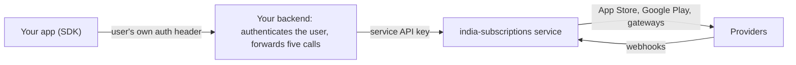

# Mobile apps

After this page you will know how an iPhone or Android app takes part in a purchase: what the app does, what your backend does, which five calls connect them, how the iOS SDK drives the App Store, and how an Android app drives Google Play billing and the hosted checkout page until there is an Android SDK.

## The rule: the app never holds the service's API key

The service's API key can start purchases for any customer and read any customer's entitlements. Anything inside an app can be extracted, so the key never goes there. The app talks to **your own backend**, which knows who the signed-in user is. Your backend forwards five calls to the service (or calls `subs.purchases` in-process if you use the library).



Your backend must:

- authenticate the user and decide which `customerRef` they may buy for. Never trust the one in the request body;
- check that a session id, or a `customerRef` in a path, belongs to that user before forwarding;
- forward the calls with the service's API key and return the service's JSON and status code unchanged. The SDK reads the error `code` of the service's error body to decide whether to retry;
- receive the providers' webhooks (App Store Server Notifications, Google's Pub/Sub push, the gateways') at the service's webhook routes, so renewals, cancellations and refunds reach the entitlements. The device does not report renewals.

## The five calls

| Call | Path | Body | Answer |
|---|---|---|---|
| start | `POST /v1/purchases` | `platform`, `product`, `customer`, `customerRef`, `reference?`, `returnUrl?` | `PurchaseSession` |
| get | `GET /v1/purchases/{sessionId}` | | `PurchaseSession` |
| alternative | `POST /v1/purchases/{sessionId}/alternative` | `{ "externalTransactionToken" }` | `PurchaseSession` |
| complete | `POST /v1/purchases/{sessionId}/complete` | `{ "provider", "result" }` | `PurchaseSession` |
| entitlements | `GET /v1/entitlements/{customerRef}` | | `Entitlements` |

The shapes are in [Models](../reference/generated/models.md#purchasesession). The relative paths are the defaults of the SDKs, and each is configurable, so your backend can mount them wherever it likes.

A backend that forwards them, written with the standard `fetch`, `Request` and `Response`. It forces `customerRef` on start, and refuses a session or a customer that is not the signed-in user's:

```ts title="mobile-backend.ts"
import { ErrorCode } from 'india-subscriptions';

const SERVICE_URL = process.env.BILLING_SERVICE_URL ?? 'http://127.0.0.1:8787';
const API_KEY = process.env.INDIA_SUBSCRIPTIONS_API_KEY ?? '';

async function callService(method: string, path: string, body?: unknown): Promise<Response> {
  return fetch(`${SERVICE_URL}${path}`, {
    method,
    headers: { authorization: `Bearer ${API_KEY}`, 'content-type': 'application/json' },
    ...(body === undefined ? {} : { body: JSON.stringify(body) }),
  });
}

/** Answers with the service's status and body, unchanged: the SDK reads the error code from it. */
async function relay(upstream: Response): Promise<Response> {
  return new Response(await upstream.text(), { status: upstream.status, headers: { 'content-type': 'application/json' } });
}

function notFound(): Response {
  return new Response(JSON.stringify({ error: { code: ErrorCode.NotFound, message: 'Not found', retryable: false } }), {
    status: 404,
    headers: { 'content-type': 'application/json' },
  });
}

/** `userId` is who your own authentication says is calling. The app's paths are mounted under /billing. */
export async function handleBillingRequest(request: Request, userId: string): Promise<Response> {
  const path = new URL(request.url).pathname.replace(/^\/billing/, '');
  const [, , resource, id, action] = path.split('/'); // ['', 'v1', 'purchases', id, action]
  const method = request.method;

  if (method === 'POST' && resource === 'purchases' && id === undefined) {
    const body = (await request.json()) as Record<string, unknown>;
    return relay(await callService('POST', '/v1/purchases', { ...body, customerRef: userId }));
  }
  if (method === 'GET' && resource === 'entitlements' && id === userId) {
    return relay(await callService('GET', `/v1/entitlements/${encodeURIComponent(userId)}`));
  }
  if (resource === 'purchases' && id !== undefined) {
    // The session id is a capability, but your backend still checks whose it is.
    const session = await callService('GET', `/v1/purchases/${encodeURIComponent(id)}`);
    if (!session.ok) return relay(session);
    if (((await session.json()) as { customerRef?: string }).customerRef !== userId) return notFound();
    if (method === 'GET' && action === undefined) return relay(await callService('GET', `/v1/purchases/${encodeURIComponent(id)}`));
    if (method === 'POST' && (action === 'alternative' || action === 'complete')) {
      return relay(await callService('POST', `/v1/purchases/${encodeURIComponent(id)}/${action}`, await request.json()));
    }
  }
  return notFound();
}
```

If you use the library in the same process, replace `callService` with `subs.purchases.start(...)` and the rest of the [purchase session](./purchases.md) calls.

## iOS

The iOS SDK is a Swift package in [`sdks/ios`](../../sdks/ios/README.md) of the repository. It drives the device side of a purchase: it buys an App Store product with StoreKit 2, hands the signed transaction to your backend, and finishes the transaction once your backend confirmed it. It has no user interface and no third-party dependencies. It needs iOS 15 or later and the **In-App Purchase** capability. Its [README](../../sdks/ios/README.md) is the reference for the package; this is the summary.

What the SDK does for `purchase(product:customerRef:customer:)`:

1. Starts a session for the product key with platform `ios` and finds the session's App Store option.
2. Saves the account token and session id in a small persisted record.
3. Calls `Product.purchase(options:)` with `.appAccountToken(token)` and, when the option carries one, the promotional offer.
4. Handles every StoreKit result and returns one of `completed`, `pending` (Ask to Buy), `cancelled`, `unverified`, `awaitingBackend` or `rejected`. A transaction is finished only after your backend confirmed it.

A transaction that arrives later (an Ask to Buy approved days later, a purchase interrupted by the app being killed, a backend that was down) is completed through a listener on `Transaction.updates` and a pass over unfinished transactions, matched to its session by the account token. Failures are sorted into those worth retrying (no network, 429, 503, an expired user token), those that may or may not last (retried a limited number of times) and those that will not change (`VALIDATION`, `SIGNATURE_INVALID`, `NOT_FOUND`, `CONFLICT`, `UNSUPPORTED`, `NO_ROUTE`). `restorePurchases(customerRef:)` calls `AppStore.sync()` and returns what your backend says the customer owns. Read what the customer owns from your backend, never from StoreKit alone.

```swift
let backend = HTTPPurchaseBackend(
    baseURL: URL(string: "https://api.example.com/billing/")!,
    authorization: { await Auth.shared.freshBearerToken().map { "Bearer \($0)" } }   // the user's own token
)
let purchases = PurchaseClient(backend: backend)
```

The server can neither cancel nor refund an App Store purchase. The SDK has `AppStoreSheets` to show Apple's manage-subscriptions and refund-request sheets. An iOS app must not point customers to other ways to pay: no buttons, links, prices or text that steer people to the web or a gateway (App Review Guideline 3.1.1(a)). The customer can still use on iPhone what they bought elsewhere: entitlements span stores and gateways. The App Store side is set up in [Setting up the App Store](./setting-up-app-store.md).

## Android

There is no Android SDK yet. An Android app drives the same five calls itself, with Play Billing for the device side and, for the alternative payment, the hosted checkout page in a Custom Tab. The sequence depends on the policy of the product's session; the app reads it from `session.policy`.

**Policy `store` (Google Play only).**

1. Call start with platform `android`. The session has one option, `google_play_billing`, with `productId`, `basePlanId`, `offerId` and `obfuscatedAccountId`.
2. Build a `BillingClient`, query the product details, and launch the billing flow with `BillingFlowParams.setObfuscatedAccountId(obfuscatedAccountId)`.
3. When `onPurchasesUpdated` delivers the `Purchase`, send `{ purchaseToken, productId }` to your backend, which forwards it as `complete` with provider `google_play`.
4. The server acknowledges the purchase when it verifies it. A purchase that never reaches the server is refunded by Google after three days, so retry until the backend confirms it.

**Policy `user_choice`.** The option has `userChoiceBilling: true`, so build the `BillingClient` with user choice billing enabled. Google shows its own choice screen; the library and your app draw nothing.

```kotlin
val userChoiceBillingListener = UserChoiceBillingListener { details ->
    // The customer picked the alternative on Google's screen.
    backend.chooseAlternative(sessionId, details.externalTransactionToken)   // forwards the `alternative` call
        ?.hostedUrl                                                          // the gateway option's page
        ?.let { openInCustomTab(it) }
}

val billingClient = BillingClient.newBuilder(context)
    .setListener(purchasesUpdatedListener)
    .enablePendingPurchases(PendingPurchasesParams.newBuilder().enableOneTimeProducts().build())
    .enableUserChoiceBilling(userChoiceBillingListener)
    .build()
```

- If the customer picks **Google Play**, `onPurchasesUpdated` runs, and it is the `store` case above.
- If the customer picks **the alternative**, `userSelectedAlternativeBilling` runs with an `externalTransactionToken`. Send it to your backend, which forwards it as `alternative`. The answer is the session with a second, gateway option and its `hostedUrl`. Open that address in a Custom Tab. The page performs the gateway's checkout, completes the session when the customer comes back and redirects to the `returnUrl` you gave at start (a deep link into your app) with `session` and `status` appended.
- When the app is opened by that deep link, call `get` for the session, and read the entitlements. The `status` in the link is the session's own, but it is the entitlement, read from your backend, that decides what to unlock.

Your backend also needs the customer's state at start (`customer.state`), because the purchase is reported to Google. See [Google user choice billing](./purchases.md#google-user-choice-billing) for what Google requires and what the library sends.

**Policy `gateways`** (apps distributed outside Google Play, and physical goods). The session has a gateway option: open its `hostedUrl` in a Custom Tab, or run the instruction with the gateway's own SDK or a web view, and read the entitlement afterwards.

In every case the result of a purchase reaches your backend twice, once from the app and once as a provider notification. Both are idempotent: completing a completed session returns it unchanged, and a repeated event changes nothing.

Setting up the Play side: [Setting up Google Play](./setting-up-google-play.md).

## Other clients

A React Native, Flutter or web-view app follows the Android or iOS sequence for its platform, through whatever native module reaches StoreKit or Play Billing. The backend and the five calls are the same. A single-page web app does not need an SDK at all: it carries out the checkout instruction with [`openCheckout`](./checkout.md).
