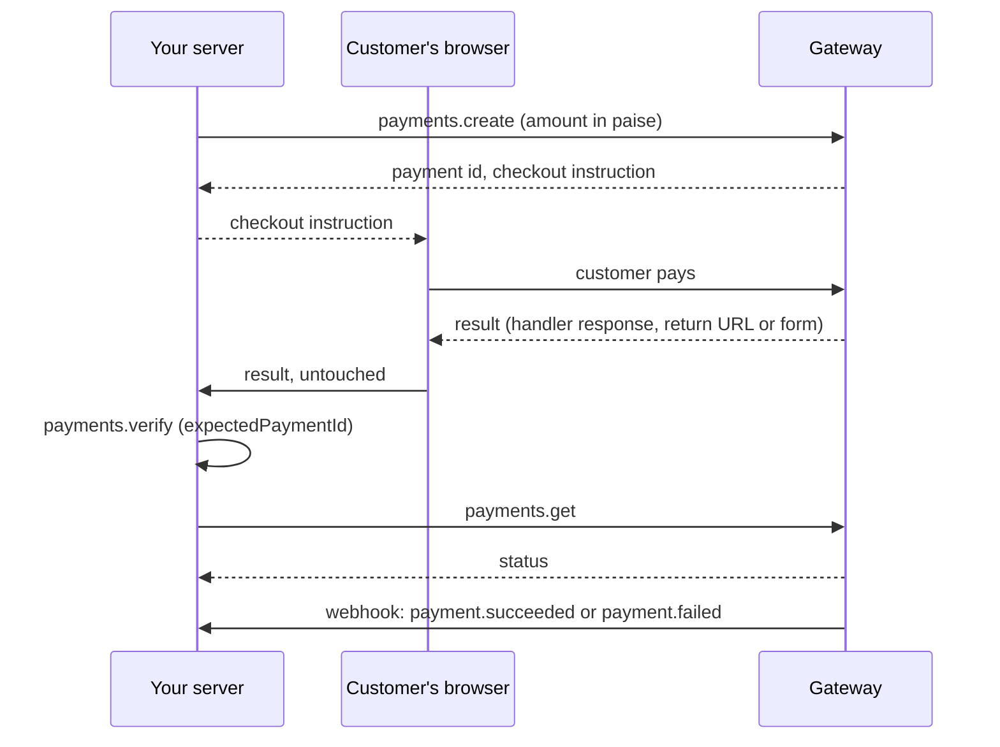

# One-time payments

After this page you will be able to take a one-time payment on any of the five gateways with the same calls: create it, send the customer to pay, verify what comes back, read the payment, refund it and react to its webhooks. You will also know what differs from gateway to gateway.

A one-time payment needs no mandate and no scheduler. It is an order at the gateway that the customer pays once. The calls live on `subs.payments`:

| Call | Does |
|---|---|
| `subs.payments.create(provider, input)` | Creates the payment and returns a `Payment` with `status: created` and a `checkout` instruction. |
| `subs.payments.verify(provider, result, { expectedPaymentId })` | Verifies what the browser or the return URL handed back. |
| `subs.payments.get(provider, paymentId)` | Reads the payment from the gateway. The source of truth. |
| `subs.payments.refund(provider, input)` | Refunds the payment in full or in part. |

If you would rather have the library choose the gateway, see [Routing](./routing.md); to sell on iPhone and Android as well as the web, see [Selling on iPhone, Android and the web](./purchases.md), which uses these same calls underneath.

## The flow



1. **Create** on the server. The amount is integer paise and comes from your own price list, never from the browser. Store `payment.id` with your order.
2. **Pay** in the browser with [`openCheckout`](./checkout.md), which carries out `payment.checkout`.
3. **Verify** on the server with what came back, passing the id you stored as `expectedPaymentId`.
4. **Confirm** with `payments.get` before you fulfil the order, and treat the webhook as a second, independent signal.

## Create

The examples use one client with Razorpay and Cashfree:

```ts title="billing-payments.ts"
import { Environment, cashfree, createSubscriptions, razorpay } from 'india-subscriptions';

export const subs = createSubscriptions({
  providers: [
    razorpay({
      keyId: process.env.RAZORPAY_KEY_ID!,
      keySecret: process.env.RAZORPAY_KEY_SECRET!,
      webhookSecret: process.env.RAZORPAY_WEBHOOK_SECRET,
    }),
    cashfree({
      clientId: process.env.CASHFREE_CLIENT_ID!,
      clientSecret: process.env.CASHFREE_CLIENT_SECRET!,
      environment: Environment.Test,
    }),
  ],
});
```

```ts title="payments-create.ts"
import { PaymentMethod, Provider, type Customer } from 'india-subscriptions';
import { subs } from './billing-payments';

export async function startPayment(orderNumber: string, amountInPaise: number, customer: Customer) {
  const payment = await subs.payments.create(Provider.Razorpay, {
    reference: orderNumber, // your own id for the order
    amount: amountInPaise, // paise: 49900 is Rs 499
    description: 'Pro plan, one year',
    customer,
    idempotencyKey: orderNumber,
  });
  // Keep payment.id with your order and hand payment.checkout to the browser.
  return { paymentId: payment.id, checkout: payment.checkout };
}

export async function startCashfreePayment(orderNumber: string, amountInPaise: number, customer: Customer) {
  const payment = await subs.payments.create(Provider.Cashfree, {
    reference: orderNumber,
    amount: amountInPaise,
    customer,
    paymentMethods: [PaymentMethod.Upi, PaymentMethod.Card],
    returnUrl: 'https://shop.example.com/pay/return',
  });
  return { paymentId: payment.id, checkout: payment.checkout };
}
```

`CreatePaymentInput` is in [Models](../reference/generated/models.md#createpaymentinput). The result is a [`Payment`](../reference/generated/models.md#payment) whose `id` is what every later call takes. What that id is depends on the gateway (see below), but it is always the id you can pass to `get`, `refund` and `expectedPaymentId` from the moment `create` returns, so there is nothing to map.

## Pay in the browser

`payment.checkout` is the same kind of [checkout instruction](./checkout.md) a subscription has. Send it to the page and let `openCheckout` run it:

```ts title="payments-browser.ts"
import { CheckoutStatus, openCheckout, type CheckoutInstruction } from 'india-subscriptions/checkout';

export async function pay(checkout: CheckoutInstruction): Promise<string> {
  const outcome = await openCheckout(checkout, { name: 'Acme', description: 'Pro plan, one year' });
  switch (outcome.status) {
    case CheckoutStatus.Completed:
      // Razorpay: the handler response. Send it to your server untouched.
      await fetch('/api/payments/verify', {
        method: 'POST',
        headers: { 'content-type': 'application/json' },
        body: JSON.stringify(outcome.result),
      });
      return 'verifying';
    case CheckoutStatus.Dismissed:
      return 'the customer closed the checkout';
    case CheckoutStatus.Failed:
      return outcome.error.description ?? 'the payment failed';
    default:
      return CheckoutStatus.Redirecting; // the result arrives at your return URL
  }
}
```

## Verify

How the result reaches your server depends on the gateway. Razorpay hands it to the browser; Cashfree and PhonePe send the customer to your return URL; PayU and Paytm post a form to it. The call is the same:

```ts title="payments-verify.ts"
import { ErrorCode, PaymentStatus, Provider, isSubscriptionError, type CheckoutResult } from 'india-subscriptions';
import { subs } from './billing-payments';

export async function confirmPayment(provider: Provider, storedPaymentId: string, result: CheckoutResult): Promise<boolean> {
  try {
    const verification = await subs.payments.verify(provider, result, { expectedPaymentId: storedPaymentId });
    if (!verification.paid) return false;
    // The result came through the customer's browser. The gateway's own answer decides.
    const payment = await subs.payments.get(provider, verification.paymentId);
    return payment.status === PaymentStatus.Succeeded;
  } catch (error) {
    // A forged result, or a genuine one for another payment than the one you stored.
    if (isSubscriptionError(error) && error.code === ErrorCode.SignatureInvalid) return false;
    throw error;
  }
}
```

Always pass `expectedPaymentId`. Without it a genuine result for a cheaper order would verify. With it, a result for any other payment fails with `SIGNATURE_INVALID`, exactly like a forged one. Compare `payment.amount` with the amount of your own order before you fulfil it.

A customer who closes the browser never returns. Do not rely on the return alone: act on the webhook too, or call `payments.get` from a job.

## Read a payment

`subs.payments.get(provider, paymentId)` asks the gateway. The unified status is one of the `PaymentStatus` constants, and the gateway's own value is verbatim in `providerStatus`:

<!-- generated:begin payment-statuses -->

| Constant | Value | Meaning |
|---|---|---|
| `PaymentStatus.Created` | `created` | Created, the customer has not paid yet. |
| `PaymentStatus.Pending` | `pending` | The customer paid or approved; the final result is not known yet. |
| `PaymentStatus.Succeeded` | `succeeded` |  |
| `PaymentStatus.Failed` | `failed` |  |
| `PaymentStatus.Cancelled` | `cancelled` |  |
| `PaymentStatus.Refunded` | `refunded` |  |
| `PaymentStatus.PartiallyRefunded` | `partially_refunded` |  |

<!-- generated:end -->

A status a gateway adds later is `pending`, never `succeeded`. For gateways that let the customer retry on the same order (Razorpay, Cashfree), `failed` describes the attempts so far and the order can still be paid, so ask `get` again before you give up on an order.

## Refund

```ts title="payments-refund.ts"
import { Provider } from 'india-subscriptions';
import { subs } from './billing-payments';

export async function refundPartOfPayment(paymentId: string) {
  const refund = await subs.payments.refund(Provider.Razorpay, {
    paymentId,
    refundId: 'refund-1001-part1', // your unique id for this refund; makes a retry safe
    amount: 10000, // paise; leave it out to refund what is left
    reason: 'Customer returned one item',
  });
  return refund.status; // usually pending: the outcome arrives as a refund event
}
```

`RefundPaymentInput` is in [Models](../reference/generated/models.md#refundpaymentinput). The returned `Refund` has both `chargeId` and `paymentId` set to the payment's id. A refund is usually `pending` first and ends `succeeded` or `failed`; the `refund.succeeded` and `refund.failed` events tell you which. Each gateway has its own limits on the refund id, the time window and partial refunds, in the table below and on its page.

## Webhooks

The webhook route you already have for subscriptions also receives payment events. `subs.webhooks.handle` verifies the signature and returns the events; the payment ones are:

| Event | Means | Carries |
|---|---|---|
| `payment.succeeded` | The payment was captured. | `paymentId`, `payment` |
| `payment.failed` | An attempt failed. For gateways that allow retries it describes one attempt. | `paymentId`, `payment` with `failureCode` and `failureReason` |
| `refund.succeeded`, `refund.failed` | A refund finished or failed. | `paymentId`, `refund` |

```ts title="payments-events.ts"
import { EventType, type SubscriptionEvent } from 'india-subscriptions';

const seen = new Set<string>(); // a table with a unique key in production

export function applyPaymentEvent(event: SubscriptionEvent, paidOrders: Set<string>): void {
  if (seen.has(event.id) || event.paymentId === undefined) return; // delivery is at least once
  seen.add(event.id);
  switch (event.type) {
    case EventType.PaymentSucceeded:
      paidOrders.add(event.paymentId);
      break;
    case EventType.RefundSucceeded:
      paidOrders.delete(event.paymentId); // a full refund; check event.refund.amount for a partial one
      break;
    default:
      break; // payment.failed: the customer may retry, so ask payments.get before giving up
  }
}
```

Match `event.paymentId` against the ids you stored: a gateway account also receives events for payments made outside this library (payment links, for example). The usual rules apply: [raw body, 401 for a bad signature, de-duplicate on `event.id`](./webhooks.md).

## What differs per gateway

Which payment methods each gateway takes in a one-time payment, read from the adapters:

<!-- generated:begin one-time-methods -->

| Provider | One-time payments | Methods of a one-time payment | Methods of a mandate |
|---|---|---|---|
| Razorpay | yes | `card`, `upi`, `netbanking`, `wallet` | `card`, `upi`, `enach` |
| Cashfree | yes | `upi`, `card`, `netbanking`, `wallet` | `upi`, `card`, `enach` |
| PayU | yes | `card`, `upi`, `netbanking`, `wallet` | `card`, `upi`, `enach` |
| PhonePe | yes | `upi`, `card`, `netbanking` | `upi` |
| Paytm | yes | `upi`, `card`, `netbanking`, `wallet` | `upi`, `card`, `enach` |
| Apple App Store | yes | none to choose | none to choose |
| Google Play | yes | none to choose | none to choose |

<!-- generated:end -->

The rest of the differences, in one place. Each gateway's page has the detail.

| | Razorpay | Cashfree | PayU | PhonePe | Paytm |
|---|---|---|---|---|---|
| `payment.id` is | The order id (`order_...`) | The order id: your `reference` | The transaction id: your `reference` | The merchant order id: your `reference` | `pay_` plus your `reference` |
| `reference` rule | Kept in the order notes | 3 to 45 letters, digits, `_`, `-` | At most 25 characters | At most 60 characters, not starting with `ST_` | At most 46 characters |
| Checkout instruction | `razorpay_checkout` (Standard Checkout with the order) | `cashfree_checkout` (cashfree.js `checkout`) | `form_post` | `redirect` | `form_post` |
| Result reaches you as | The handler response, or a `callbackUrl` post | The return URL (the adapter adds `order_id`) | A form post to `surl` or `furl` | The return URL (the adapter adds `merchantOrderId`) | A form post to the callback URL |
| What `verify` checks | HMAC of `order_id\|payment_id` with the key secret | Reads the order from Cashfree | The response hash with the salt | Reads the order from PhonePe | The `CHECKSUMHASH`, then Transaction Status |
| Restrict `paymentMethods` | `UNSUPPORTED` | Yes (`enach` is refused) | Yes (`enach` is refused) | Yes (`wallet` and `enach` are refused) | Yes (`enach` is refused) |
| `expiresAt` | `UNSUPPORTED` | Yes | `UNSUPPORTED` | Yes: 300 to 3600 seconds from now | `UNSUPPORTED` |
| `metadata` | Order notes, 15 at most | Order tags, 10 at most | One field, 255 characters | Only the keys `udf1` to `udf15` | `UNSUPPORTED` |
| `idempotencyKey` | The order receipt, 40 ASCII characters | A UUID | Not used: the transaction id is the guard | Not used: the order id is the guard | Not used: the order id is the guard |
| Customer fields needed | Optional (prefill) | Phone required | Name, e-mail and phone required | None | A phone is validated if you pass one |
| Partial refunds | Yes | Yes | Yes | Yes | Yes |
| `refundId` | 10 to 40 letters, digits, `-`, `_` | 3 to 40 letters, digits, `_`, `-` | At most 19 characters | 1 to 40 letters, digits, `_`, `-` | Unique per refund |
| Refund window | Not for a payment over six months old | Six months | See the gateway's page | Three months | Not for an order over a year old |
| Webhook events | `payment.captured` or `order.paid`, `payment.failed`, `refund.processed`, `refund.failed` | `PAYMENT_SUCCESS_WEBHOOK`, `PAYMENT_FAILED_WEBHOOK`, `PAYMENT_USER_DROPPED_WEBHOOK`, `REFUND_STATUS_WEBHOOK` | Payment webhook (signed) | `checkout.order.completed`, `checkout.order.failed`, refund events | Payment Status, refund notifications (signed) |

A restriction or an input that a gateway cannot honour is refused with `UNSUPPORTED` or `VALIDATION` before any request, never silently dropped. When you let [purchase sessions](./purchases.md) choose the gateway, a gateway that refuses the inputs of a purchase is skipped and the next one is tried.

Per gateway:

- [Razorpay](../gateways/razorpay.md#one-time-payments), [Cashfree](../gateways/cashfree.md#one-time-payments), [PayU](../gateways/payu.md#one-time-payments), [PhonePe](../gateways/phonepe.md#one-time-payments), [Paytm](../gateways/paytm.md#one-time-payments).
- Apple App Store and Google Play also take one-time purchases (consumables and non-consumables), but they start on the device and the store sets the price: see [Apple App Store](../gateways/app-store.md#one-time-purchases) and [Google Play](../gateways/google-play.md#one-time-products).

## Before you fulfil an order

- [ ] You created the payment on the server with an amount you computed, and stored `payment.id`.
- [ ] You verified with `expectedPaymentId`.
- [ ] You read the payment with `payments.get` and compared its `amount` and `status`.
- [ ] You de-duplicate webhooks on `event.id` and make fulfilment idempotent, because the return and the webhook both arrive.
- [ ] You never retry a create that failed with `OUTCOME_UNKNOWN` without reading the order first: pass a `reference` so that `payments.get` can tell you whether it exists.
