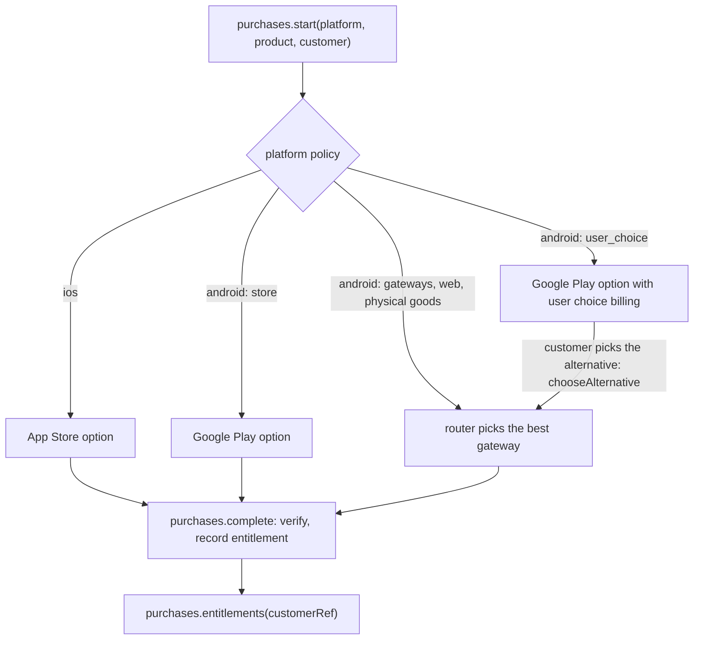

# Selling on iPhone, Android and the web

After this page you will be able to sell one catalog of products on iPhone, on Android and on the web with one set of calls: start a purchase, let the customer pay where the platform allows, complete it, and ask what the customer owns. You will know what the store rules in India allow on each platform, what Google's user choice billing asks of you, and what the library does about it automatically.

The problem is that the same product has to be bought in different places. An iPhone app must use the App Store. An Android app on Google Play may use Google Play, or, in India, Google Play with Google's own choice screen that offers another payment method. The web uses payment gateways. A **purchase session** is the one object that decides this for a `(platform, product)` pair, creates the purchase in the right place, and later turns the result into an **entitlement**: one answer to "what does this customer own", whichever store or gateway took the money.



## Rules in India that shape this

These are the providers' own rules, and they are why the library works the way it does. Read them at the source; they change.

- **iOS: in-app purchase only.** Digital goods and subscriptions sold in an iOS app go through the App Store. For the India storefront there is no external-link or alternative-payment entitlement, and an iOS app may not steer customers to other ways to pay (App Review Guideline 3.1.1(a)). A service may let iOS users use what they bought elsewhere, if it is also sold as an in-app purchase in the app (guideline 3.1.3(b)). [App Review Guidelines](https://developer.apple.com/app-store/review/guidelines/). The [iOS SDK](./mobile-apps.md#ios-sdk) only ever offers the App Store, and React Native and Flutter follow it on iPhone.
- **Android: user choice billing is available in India.** For apps and games, for in-app purchases and subscriptions. Google Play billing must remain an option, and Google renders the information and choice screens. Alternative billing without Play billing, and link-outs, are not available in India. [Understanding user choice billing on Google Play](https://support.google.com/googleplay/android-developer/answer/13821247) and [the program page](https://support.google.com/googleplay/android-developer/answer/13306652). The [Android SDK](./mobile-apps.md#android-sdk) builds Google's billing client with user choice billing only when the session's option says so.
- **Android: you report every alternative transaction to Google** within 24 hours of the payment's authorisation: the first payment (a free trial too, with a zero amount), every renewal, upgrades and downgrades, and refunds. India needs the customer's state with the tax split. [Report external transactions](https://developer.android.com/google/play/billing/outside-gpb-backend).
- **Physical goods and services consumed outside the app** are not in-app purchases. The catalog marks them `physicalGoods` and they go to the gateways on every platform.
- **Recurring payments on gateways follow the RBI e-mandate framework**: after registration, no additional factor up to Rs 15,000 per debit (Rs 1,00,000 for insurance premiums, mutual funds and credit card bills), with a 24-hour pre-debit notice. [RBI notification](https://www.rbi.org.in/Scripts/NotificationUser.aspx?Id=13374). Put the per-debit ceiling in your [routing limits](./routing.md#set-it-up).

## The catalog

You describe each product once. The library validates the whole catalog when `Purchases` is built, and a bad catalog throws `CONFIG` listing every problem at once.

| Field | Meaning |
|---|---|
| `key` | Your product key. Sessions and entitlements refer to it. |
| `kind` | `subscription` or `one_time`. |
| `name`, `amount` | The name shown by the gateways, and the price in paise **with tax included**. |
| `interval` | How often a subscription bills. Required for a subscription, forbidden on a one-time product. |
| `trialDays` | A free trial on the gateways, in days. Only gateways that support trials are chosen. The stores use their own offers. |
| `taxRateBps` | The tax included in `amount`, in basis points (1800 is 18%). Required for a product sold through user choice billing: the reports to Google split the charge into a pre-tax amount and tax. |
| `physicalGoods` | True: never sold through store billing. |
| `platforms` | Where the product is sold. Omit for all of them. |
| `paymentMethods` | Restrict gateway purchases of this product to these methods. |
| `appStore`, `googlePlay` | The product in each store: `productId`, `basePlanId` and `offerId` (Google Play), and `consumable` for a one-time product that can be bought again. |
| `plan` | Extra plan fields for gateway subscriptions, such as `maxAmount` or `maxCycles`. |

The full shapes are [`Product`](../reference/generated/models.md#product) and [`StoreProduct`](../reference/generated/models.md#storeproduct).

## The platform policy

The policy is three settings, and only `android` is a real choice:

| Setting | Values | Default |
|---|---|---|
| `ios` | `store` only | `store` |
| `android` | `store`, `user_choice` or `gateways` | `store` |
| `web` | `gateways` only | `gateways` |

What each resolves to, read from the policy code with the App Store, Google Play and a gateway configured:

<!-- generated:begin platform-policy -->

| Platform | Policy | Store | Gateway |
|---|---|---|---|
| ios | `store` | Apple App Store (`app_store`) | never |
| android | `store` | Google Play (`google_play`) | never |
| android | `user_choice` | Google Play (`google_play`) | only after the customer picks the alternative |
| android | `gateways` | none | the best gateway, chosen by the router |
| web | `gateways` | none | the best gateway, chosen by the router |
| any platform, physical goods | not applicable | none | the best gateway, chosen by the router |

<!-- generated:end -->

The three Android settings, and when to use each:

- **`store`: Google Play only.** The customer pays through Google Play billing. The simplest setting, and the right one if you do not want to take payments outside Google Play.
- **`user_choice`: Google Play with user choice billing.** Google's own screen offers the customer Google Play or an alternative. If the customer picks the alternative, the purchase is routed to the best gateway and reported to Google. It needs the Google Play provider, a gateway, `taxRateBps` on the products, `customer.state` at `start`, a public URL for the hosted checkout page, and your enrolment in Google's program (below).
- **`gateways`: gateways only.** For apps distributed outside Google Play. The platform is treated like the web.

A product with `physicalGoods: true` goes to the gateways whatever the platform. A product sold on a platform whose store provider is not configured is a `CONFIG` error at start-up (or a `VALIDATION` error if the product is simply not sold on that platform, through `platforms`).

## Set it up

```ts title="billing-purchases.ts"
import {
  ChannelPolicy,
  Environment,
  IntervalUnit,
  MemoryPurchaseStore,
  ProductKind,
  appStore,
  createSubscriptions,
  googlePlay,
  razorpay,
  type Product,
} from 'india-subscriptions';

const catalog: Product[] = [
  {
    key: 'pro-monthly',
    kind: ProductKind.Subscription,
    name: 'Pro monthly',
    amount: 49900, // paise, tax included
    interval: { unit: IntervalUnit.Month, count: 1 },
    taxRateBps: 1800, // needed for user choice billing reports
    appStore: { productId: 'com.example.app.pro.monthly' },
    googlePlay: { productId: 'pro', basePlanId: 'monthly' },
  },
  {
    key: 'coins-100',
    kind: ProductKind.OneTime,
    name: '100 coins',
    amount: 9900,
    taxRateBps: 1800,
    appStore: { productId: 'com.example.app.coins100', consumable: true },
    googlePlay: { productId: 'coins_100', consumable: true },
  },
];

export const subs = createSubscriptions({
  providers: [
    razorpay({ keyId: process.env.RAZORPAY_KEY_ID!, keySecret: process.env.RAZORPAY_KEY_SECRET!, webhookSecret: process.env.RAZORPAY_WEBHOOK_SECRET }),
    appStore({
      bundleId: 'com.example.app',
      issuerId: process.env.APP_STORE_ISSUER_ID!,
      keyId: process.env.APP_STORE_KEY_ID!,
      privateKey: process.env.APP_STORE_PRIVATE_KEY!,
      environment: Environment.Test,
    }),
    googlePlay({
      packageName: 'com.example.app',
      clientEmail: process.env.GOOGLE_PLAY_CLIENT_EMAIL!,
      privateKey: process.env.GOOGLE_PLAY_PRIVATE_KEY!,
      environment: Environment.Test,
      pushAudience: 'https://billing.example.com/webhooks/google_play',
      pushServiceAccountEmail: 'pubsub-push@example-project.iam.gserviceaccount.com',
    }),
  ],
  purchases: {
    catalog,
    policy: { android: ChannelPolicy.UserChoice },
    store: new MemoryPurchaseStore(), // development only: see "Where it is stored"
    // The hosted checkout page and the address gateways return the customer to, built on your public URL.
    hostedCheckoutUrl: (sessionId) => `https://billing.example.com/checkout/${sessionId}`,
    gatewayReturnUrl: (sessionId) => `https://billing.example.com/checkout/${sessionId}/return`,
    onIssue: (issue) => console.warn(`purchases: ${issue.issue}: ${issue.message}`),
  },
});

export function purchasesOf() {
  if (!subs.purchases) throw new Error('purchases are not configured');
  return subs.purchases;
}
```

`subs.purchases` is a `Purchases` built over the client: it goes through the client for every gateway and store call (so the billing scheduler stays in step), through `subs.router` to choose a gateway, and uses the Google Play provider as its reporter when one is configured. With the HTTP service you do not write this: `PURCHASES_FILE` holds the catalog, policy and routing strategy, and `PUBLIC_BASE_URL` builds the hosted checkout addresses. See [the service](#the-service).

## Start, choose the alternative, complete

### Start

```ts title="purchases-start.ts"
import { Platform, type Customer } from 'india-subscriptions';
import { purchasesOf } from './billing-purchases';

export async function startPurchase(platform: Platform, product: string, customerRef: string, customer: Customer) {
  const session = await purchasesOf().start({
    platform,
    product, // your product key
    customer, // customer.state is required on Android when the policy is user_choice
    customerRef, // your id for the customer: entitlements are kept under it
    reference: `${customerRef}-${product}`, // optional: repeating the call returns the same session
    returnUrl: 'myapp://purchase/done', // where the hosted checkout sends the customer afterwards
  });
  return session;
}
```

`start` returns a `PurchaseSession` ([Models](../reference/generated/models.md#purchasesession)). The part that matters is `options`: each is a `PurchaseOption` with the `channel` (`store` or `gateway`), the `provider`, the `checkout` instruction the app or browser must carry out, the `handle` (the id the provider returned, which the result must be bound to), and for a gateway `routing` (why it was chosen) and `hostedUrl`.

What `start` does for each policy:

- **Store policy** (iOS, Android `store`): one store option, with an `apple_storekit` or `google_play_billing` instruction. No call to the store is made.
- **`user_choice`**: the Google Play option with `userChoiceBilling: true`. The gateway option is created only when the customer picks the alternative, because creating a mandate or an order is a write you do not want for a customer who then pays through Google Play.
- **Gateways** (web, Android `gateways`, physical goods): the router picks the best gateway and the purchase is created there. See [When a gateway fails](#when-a-gateway-fails).

`start` refuses with `CONFLICT` when the customer already owns the product (see [Entitlements](#entitlements)), with `NOT_FOUND` for an unknown product key, with `NO_ROUTE` when no gateway can take the purchase, and with `CONFIG` for a policy the configuration cannot serve. Repeating a `start` with the same `customerRef` and `reference` returns the open session instead of creating a second purchase.

A session is unguessable (`ps_` and 192 bits of randomness): whoever holds it can complete it, so treat the id as a capability. An unpaid session expires after 24 hours (`sessionTtlMs`). A session is `open`, then `awaiting_payment` (approved but not confirmed, or the alternative's gateway checkout is under way), then `completed`; `failed` and `expired` are not final, because money that moves afterwards still completes it.

### The device or browser pays

What the customer's client does depends on the option:

| Option | Client does | Then sends to your server |
|---|---|---|
| `apple_storekit` | StoreKit purchase with `appAccountToken` | `{ signedTransaction }` |
| `google_play_billing` | Play Billing flow with `setObfuscatedAccountId`; with `userChoiceBilling` the billing client is built with user choice billing enabled | `{ purchaseToken, productId }` |
| A gateway instruction | [`openCheckout`](./checkout.md) in a browser, or the `hostedUrl` in a browser tab | What the gateway returned, untouched (the hosted page does this itself) |

A mobile app never calls these functions directly: it talks to your backend. The [iOS SDK](./mobile-apps.md#ios-sdk), the [Android SDK](./mobile-apps.md#android-sdk), [React Native](./mobile-apps.md#react-native) and [Flutter](./mobile-apps.md#flutter) carry out the device column of this table and send your backend the calls. See [Mobile apps](./mobile-apps.md).

### Choose the alternative (Android, user choice billing)

When Google's choice screen reports that the customer picked the alternative, the app receives an external transaction token and sends it to your backend, which forwards it. The Android SDK does this itself, and then opens the gateway option's hosted page:

```ts title="purchases-alternative.ts"
import { SalesChannel } from 'india-subscriptions';
import { purchasesOf } from './billing-purchases';

export async function customerPickedTheAlternative(sessionId: string, externalTransactionToken: string) {
  const session = await purchasesOf().chooseAlternative(sessionId, { externalTransactionToken });
  const gateway = session.options.find((option) => option.channel === SalesChannel.Gateway);
  // The app opens this in a browser tab (a Custom Tab). The page performs the gateway's checkout.
  return gateway?.hostedUrl;
}
```

`chooseAlternative` creates the purchase at the best gateway and adds it to the session as a second option. The token is kept: it is what the first report to Google is sent with. Calling it again with the same token returns the same option, never a second mandate; a different token after the option exists is `CONFLICT`. If every gateway fails, the session records the gateways tried, the token is not kept, and the call can be repeated.

### Complete

```ts title="purchases-complete.ts"
import { Provider, type CheckoutResult } from 'india-subscriptions';
import { purchasesOf } from './billing-purchases';

export async function completePurchase(sessionId: string, provider: Provider, result: CheckoutResult) {
  const session = await purchasesOf().complete(sessionId, { provider, result });
  return { status: session.status, provider: session.provider, subscriptionId: session.subscriptionId, paymentId: session.paymentId };
}
```

`complete` verifies what the checkout returned **against the order this session created** (the option's `handle`), writes the entitlement, records the outcome for the router and, for a purchase made through the alternative, queues the first report to Google. A result for another order is refused with `SIGNATURE_INVALID` and the session stays as it was. Paid: the session is `completed`. Not paid: it is `failed`. Still pending at the provider, such as a mandate waiting for the bank: `awaiting_payment`. Completing a completed session returns it unchanged, so it is safe to repeat.

`purchases.get(sessionId)` reads a session at any time.

## Entitlements

`purchases.entitlements(customerRef)` answers what a customer owns across stores and gateways. `active` is true when at least one item gives access now; each item says which product, from which provider and channel, on which platform, with what status.

```ts title="purchases-entitlements.ts"
import { purchasesOf } from './billing-purchases';

export async function hasAccess(customerRef: string, product: string): Promise<boolean> {
  const entitlements = await purchasesOf().entitlements(customerRef);
  return entitlements.items.some((item) => item.product === product && item.active);
}
```

An item gives access while it is `active`, `trialing` or `past_due`. It stops when it is `paused`, `halted`, `cancelled`, `expired` or `refunded`. A subscription cancelled at the end of its period stays active, with `cancelAtPeriodEnd`, until the period ends. The statuses are described in [Entitlements](../concepts/entitlements.md).

Entitlements are kept current by webhook events. Route every provider's webhook through `subs.webhooks.handle` and the client applies the events to purchases (`purchases.handleEvents`): activation, renewal, past due, pause, cancellation, expiry and the refund of a one-time purchase. A success event also completes a session whose customer never came back.

### One product, once

`start` refuses with `CONFLICT` when the customer already holds an active, trialing, past-due or paused entitlement for the product, whichever channel it was bought in, so nobody subscribes twice, once in the store and once on the web. A consumable is the exception.

Two sessions can both be open for a product at once (the web and a phone at the same time), and the guard only sees entitlements that exist. If both get paid, both entitlements are kept, because the money has moved, and `onIssue` is called with `duplicate_purchase` naming both sessions. That is the alert: refund or cancel one of them.

```ts title="purchases-issues.ts"
import { PurchaseIssue, type IssueReport } from 'india-subscriptions';

/** Pass as `purchases.onIssue`. */
export function onIssue(report: IssueReport): void {
  if (report.issue === PurchaseIssue.DuplicatePurchase) {
    console.error(`page someone: ${report.message}`, report.sessionId, report.otherSessionId);
    return;
  }
  console.warn(`purchases: ${report.issue}: ${report.message}`);
}
```

The other issues reported to `onIssue` are listed in the [Purchases reference](../reference/generated/purchases.md#problems-reported-to-onissue).

## When a gateway fails

`start` and `chooseAlternative` ask the router for a ranking and create the purchase at the first gateway. If that gateway cannot take it, the next ranked gateway is tried. Nothing was created at a gateway that refused or could not be reached, so this is safe.

- The next gateway is tried after `PROVIDER_UNAVAILABLE`, `RATE_LIMITED`, `NETWORK`, `TIMEOUT`, `AUTH`, `PROVIDER_ERROR` and `OUTCOME_UNKNOWN`, and after a gateway **refuses the purchase's inputs** (`VALIDATION` or `UNSUPPORTED` from its create call). `CONFLICT` stops at once.
- Every attempt is recorded for the router and kept in the session's `attempts`. A refusal is recorded as a failed request, never as the gateway being unavailable, so it does not feed the circuit breaker.
- When every gateway fails, the error lists each gateway's refusal. Its code is `VALIDATION` if every one of them was a refusal, and `PROVIDER_UNAVAILABLE` otherwise.

## Google user choice billing

If the Android policy is `user_choice`, these are the things Google asks of you and what the library does about each.

| Google asks | The library | You |
|---|---|---|
| **Enrol.** Accept the terms and complete onboarding in Play Console, then enable user choice billing for the app. | Nothing: it is an account step. | Do it. [Setting up Google Play](./setting-up-google-play.md#enrol-in-user-choice-billing) has the steps. |
| **Show Google's own screens.** Google renders the information and choice screens when the billing client is built with `enableUserChoiceBilling`. | Marks the Google Play option with `userChoiceBilling: true`. It never draws the choice. | Nothing, when you use the [Android SDK](./mobile-apps.md#android-sdk), React Native or Flutter: they build the `BillingClient` with user choice billing when the session says so. Without an SDK, build it that way yourself: [Mobile apps](./mobile-apps.md#without-an-sdk). |
| **Report within 24 hours** of the payment's authorisation: the first payment (a free trial as zero), every renewal, every refund. | Queues each report in the store before `complete` returns, sends them with `flush`, retries with backoff, and flags any that pass the deadline. | Run `flush` (the service does it on every tick) and alert when `overdue` is not empty. |
| **Send the customer's state** with the tax split. | Splits the charge with `taxRateBps` and reports the state with region `IN`. | Collect `customer.state` and set `taxRateBps` on the products. |
| **Keep Google Play billing as an option.** | The Google Play option is always in the session. | Do not hide it. |

### Reports

What gets queued, and when:

- **The first transaction**, when `complete` runs for a session that came through the alternative. The amount is what has actually been paid. For a free trial, or a mandate whose first charge has not been paid yet, it is **0**, because only money that has moved is reported. A one-time purchase is reported with the amount paid.
- **Every renewal**, when `subs.webhooks.handle` sees a `subscription.charged` event for a subscription that started through the alternative. A renewal is reported with its own id and the id of the first transaction (`initialExternalTransactionId`).
- **Every refund**, when a `refund.succeeded` event arrives. A full refund sends no amounts; a partial one sends the pre-tax amount, split in the proportions of the transaction it refunds.

The amount is split with `taxRateBps`: the pre-tax amount is `gross * 10000 / (10000 + rate)` rounded half up, and the tax is the rest, so the two always add up to what the customer paid. Rs 499 (49900 paise) at 18% is 42288 paise plus 7612 paise of tax. Integer paise throughout.

The reports are an **outbox**. Each is stored durably before `complete` returns, with a `dueBy` of the transaction time plus 24 hours. `flush` claims the reports that are due, sends them to Google and returns what it did:

```ts title="purchases-flush.ts"
import { purchasesOf } from './billing-purchases';

/** Call on a schedule: every minute is fine. The HTTP service does this on every tick. */
export async function sendReports(): Promise<void> {
  const result = await purchasesOf().flush({ limit: 50 });
  console.log(`sent ${result.sent}, retrying ${result.retrying}, blocked ${result.blocked}, rejected ${result.rejected}`);
  if (result.overdue.length > 0) {
    // A report missed Google's 24 hour deadline. A person should look at it.
    console.error(`overdue reports: ${result.overdue.map((entry) => entry.id).join(', ')}`);
  }
}
```

A failed send stays queued and is retried with a doubling backoff (1 minute, up to 1 hour). A report Google refuses as invalid (`VALIDATION`) is marked `rejected` and not retried: fix the data and report it by hand. A renewal or refund waits (`blocked`) until the report it refers to has been sent. Two flushes never send the same report: each report is claimed with a lease. Without a reporter nothing is sent and every report stays queued. The numbers are in the [Purchases reference](../reference/generated/purchases.md#numbers).

## The hosted checkout page

An Android app that took the alternative cannot run the browser helper, so the service serves a page that performs the gateway's checkout step. The Android SDK (and React Native and Flutter on Android) opens it in a Custom Tab; `GET /checkout/{sessionId}` is the address, and works for any gateway instruction: a redirect, a form post, Razorpay Standard Checkout or cashfree.js.

- The session id in the path is the only credential. No API key is needed, and no secret is in the page: it holds what the customer's browser is allowed to know (a Razorpay key id, a payment session id, the signed form fields).
- An unknown id and an expired or completed session answer 404 with the same empty page, so neither can be told from the other.
- The page is served with a strict Content-Security-Policy that allows only the gateway's script and frames, and one fixed script per instruction kind.
- When the customer comes back, `GET` or `POST /checkout/{sessionId}/return` gathers the result the gateway sent (query and form fields), calls `purchases.complete` (which asks the gateway about the order the session created, so a forged field changes nothing) and redirects the customer to the session's own `returnUrl` with `session` and `status` appended. The `returnUrl` may be an app deep link: the app declares it in its manifest, and the SDK reads the session from your backend when the link opens the app (see [the Android SDK](./mobile-apps.md#android-sdk)). The status is always the session's own, never taken from the request.
- A return URL with a script-running scheme (`javascript:`, `data:` and similar) is never redirected to.

`PUBLIC_BASE_URL` makes the service build these addresses (`hostedUrl` on each gateway option, and the return address gateways are given). Use `https`. Without it, options carry no `hostedUrl` and gateways return customers to the `returnUrl` you passed to `start`.

PayU limits its return address to 50 characters, which a hosted return address with a session id does not fit. PayU therefore gets a fixed short address, `<PUBLIC_BASE_URL>/checkout/return/payu` (`GET` or `POST /checkout/return/{gateway}`; only PayU uses it). The session is found from the transaction id PayU posts back, and an unknown id answers 404. If your public base URL is so long that even this address is over 50 characters, PayU is skipped for hosted purchases, the service says so in a start-up warning, and the purchase goes to the next gateway.

When you build `Purchases` yourself, the two hooks are `hostedCheckoutUrl(sessionId)` and `gatewayReturnUrl(sessionId, provider)`; `Purchases` also has `findByGatewayId(provider, id)`, which finds the session of a gateway's own id, as the PayU return does.

## Where it is stored

Sessions, entitlements and the report outbox go through a `PurchaseStore`.

| Store | For |
|---|---|
| `MemoryPurchaseStore` | Development and tests. Loses everything on restart. |
| `FilePurchaseStore` from `india-subscriptions/server` | One server process. A single JSON file, written atomically with mode 0600. The service uses it with `PURCHASE_STORE_FILE`. |
| `PostgresPurchaseStore` from `india-subscriptions/postgres` | Production, one process or many. The service uses it with `DATABASE_URL`. |
| Your own, implementing `PurchaseStore` | Another database. |

A store must meet the guarantees written in the doc comment of `PurchaseStore`: a lock with a time to live (so two requests do not complete one session twice), writes that are durable when they resolve (`complete` queues the Google report before it returns and relies on that write surviving a crash), reads that see your own writes, copies rather than shared objects, and an atomic insert-if-absent for reports. Every write `Purchases` makes is idempotent, so a crash between two writes is repaired by repeating the call.

### On PostgreSQL

Install [`pg`](https://node-postgres.com), create a `Pool`, run `migratePostgres`, and pass the store to `purchases`. The scheduler's tables and the routing statistics come from the same migration, so a deployment that keeps all three in PostgreSQL migrates once ([how migrations behave](./scheduler.md#running-it-on-postgresql)).

```ts title="billing-purchases-postgres.ts"
import { Pool } from 'pg';
import { ProductKind, createSubscriptions, razorpay } from 'india-subscriptions';
import { PostgresPurchaseStore, migratePostgres } from 'india-subscriptions/postgres';

export async function buildClient() {
  const pool = new Pool({ connectionString: process.env.DATABASE_URL });
  pool.on('error', (error) => console.error('database connection failed', error.message));
  await migratePostgres(pool);

  const subs = createSubscriptions({
    providers: [razorpay({ keyId: process.env.RAZORPAY_KEY_ID!, keySecret: process.env.RAZORPAY_KEY_SECRET! })],
    purchases: {
      catalog: [{ key: 'coins-100', kind: ProductKind.OneTime, name: '100 coins', amount: 9900 }],
      store: new PostgresPurchaseStore(pool),
    },
  });
  return { subs, close: () => pool.end() };
}
```

What `PostgresPurchaseStore` guarantees, with several servers on one database:

- **Durable writes that every server sees.** Each save and each queued report is one statement that has committed when it resolves, so a session a customer started on one server is found by another, and the report `complete` queues is in the database before `complete` returns. Point the pool at the primary.
- **One owner per session.** The lock is a single statement on the database's clock: of any number of servers completing the same session at the same moment, one holds the lock, and a lock whose owner died expires by itself.
- **Reports are claimed once.** `enqueueReport` stores a report only if its id is new, and says whether it was the one that stored it. `flush` claims due reports with a lease written into the row, in one statement that skips rows another server has locked: two servers flushing at once never send the same report, a server that crashes mid-flush leaves reports that become claimable again when its lease ends, and a server whose lease ran out cannot overwrite the result of the server that took over. Which reports are due, and when a lease ends, is decided by the instant the flush passes, so the flush's own clock decides.
- **Copies and validation.** Rows are read into fresh objects, and every record is validated against its schema going in and coming out.

The tables are `sessions`, `entitlements`, `reports` and `purchase_locks` (behind the `tablePrefix`, in the `schema` you choose). See [PostgreSQL stores](../reference/postgres.md) for the options.

## The service

`india-subscriptions serve` runs all of this from configuration. Set `PURCHASES_FILE` to a JSON document with `catalog`, `policy` and `routing`, and give it somewhere to keep its state: `PURCHASE_STORE_FILE` (one instance), or `DATABASE_URL` (PostgreSQL, any number of instances). Set `PUBLIC_BASE_URL` for the hosted checkout. The service flushes Google's reports on every tick, on every instance, and says so in its start-up report. The routes are `POST /v1/purchases`, `GET /v1/purchases/{sessionId}`, `POST /v1/purchases/{sessionId}/alternative`, `POST /v1/purchases/{sessionId}/complete`, `GET /v1/entitlements/{customerRef}` and `POST /v1/purchases/flush`, all behind the API key, plus the public checkout routes. See [Running the HTTP service](./http-service.md) and the [HTTP API reference](../reference/generated/http-api.md#purchases).

A mobile app never holds the service's API key. It talks to your backend, which forwards the calls: [Mobile apps](./mobile-apps.md), which also compares the four SDKs.

## What it does not do

- It never cancels or refunds anything at a provider. The App Store cannot be asked to, and your refunds on a gateway or Google Play are yours to make; the refund event then flows back into the entitlement.
- It does not move a purchase between gateways after the customer has paid.
- It ignores events about orders it did not create.
- It does not decide the price a store charges: the store's own price for the product is what the customer pays. Keep the catalog `amount` in step with it.

Next: [Setting up the App Store](./setting-up-app-store.md), [Setting up Google Play](./setting-up-google-play.md) and [Mobile apps](./mobile-apps.md).
